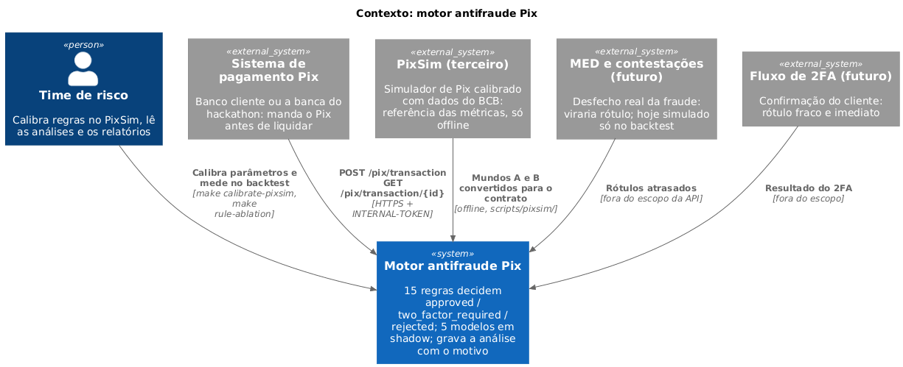
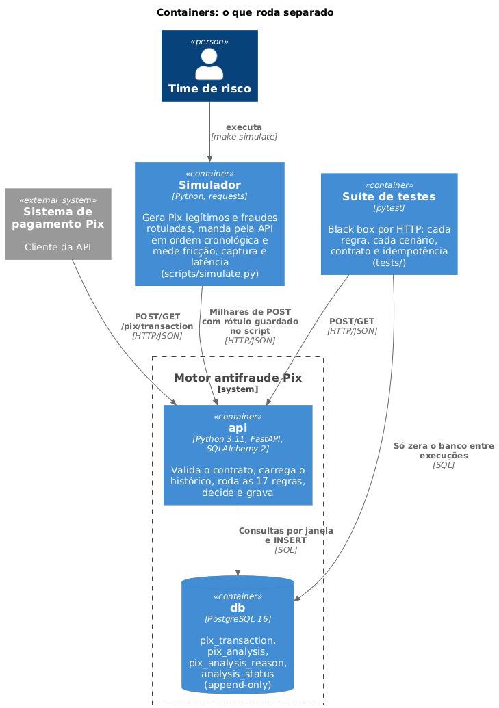
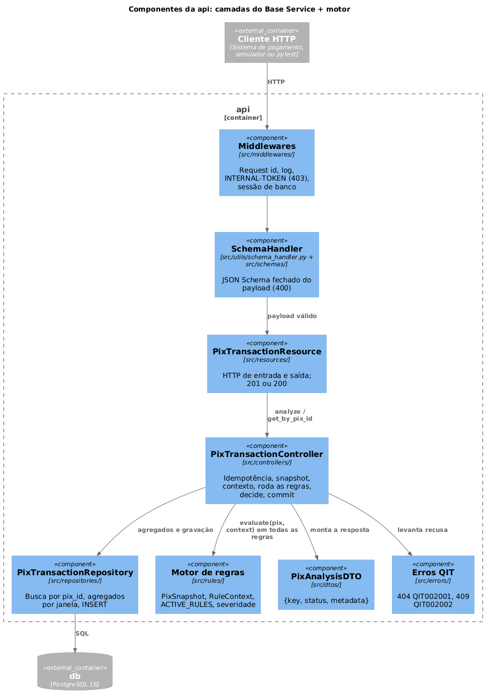
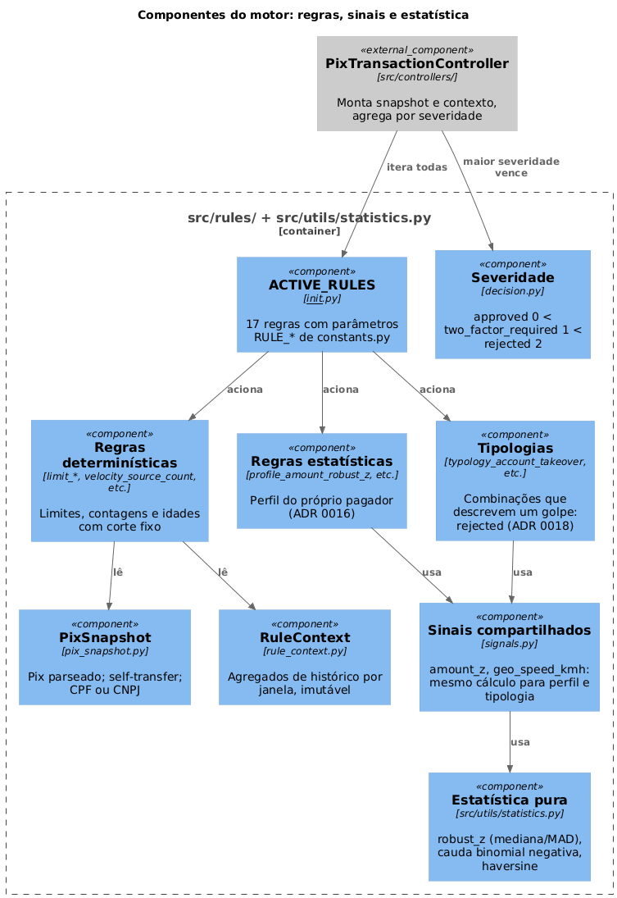
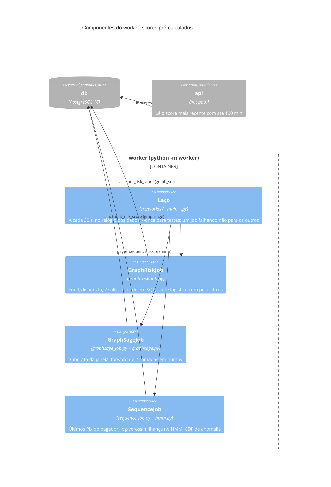
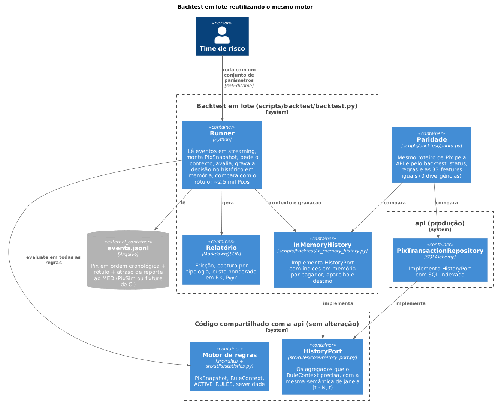
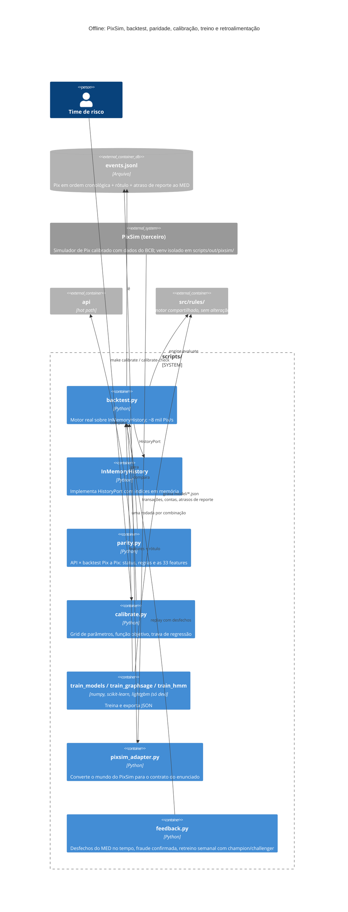

# Diagramas C4

> [Índice](../README.md) › Arquitetura › C4
>
> **Responde a:** quais sistemas e containers existem? como a API se divide por dentro? onde moram regras, estatística e modelos? o que roda no hot path e o que roda no cold path? como o backtest roda sem HTTP e sem banco? onde estão os diagramas, imagens e especificações?

O [modelo C4](https://c4model.com) desenha o sistema em níveis de zoom: **contexto** (quem usa), **containers** (o que roda separado) e **componentes** (os módulos dentro de um container).

Os diagramas da arquitetura estão disponíveis em múltiplos formatos na pasta [`diagramas/`](diagramas/):
- **Imagens renderizadas (`.png`):** visualização direta ao longo deste documento.
- **Fontes PlantUML (`.puml`):** especificação canônica com [C4-PlantUML](https://github.com/plantuml-stdlib/C4-PlantUML).

| Nível | Diagrama | Imagem (`.png`) | PlantUML (`.puml`) | Estado |
|---|---|---|---|---|
| 1. Contexto | [Quem fala com o motor](#1-contexto) | [`c4-contexto-motor.png`](diagramas/c4-contexto-motor.png) | [`c4-contexto-motor.puml`](diagramas/c4-contexto-motor.puml) | implementado |
| 2. Containers | [api, worker, db, simulador, backtest, testes](#2-containers) | [`c4-containers.png`](diagramas/c4-containers.png) | [`c4-containers.puml`](diagramas/c4-containers.puml) | implementado |
| 3. Componentes | [Camadas da API](#3-componentes-da-api) | [`c4-componentes-API.png`](diagramas/c4-componentes-API.png) | [`c4-componentes-API.puml`](diagramas/c4-componentes-API.puml) | implementado |
| 3. Componentes | [Motor: regras, estatística e modelos](#4-componentes-do-motor) | [`c4-componentes-motor.png`](diagramas/c4-componentes-motor.png) | [`c4-componentes-motor.puml`](diagramas/c4-componentes-motor.puml) | implementado |
| 3. Componentes | [Worker: cold path](#5-componentes-do-worker-cold-path) | — | — | implementado |
| 2/3. Offline | [Backtest em lote e treino](#6-backtest-em-lote-e-treino-offline) | [`c4-backtest.png`](diagramas/c4-backtest.png) | [`c4-backtest.puml`](diagramas/c4-backtest.puml) | implementado |

---

## 1. Contexto

> 📥 **Arquivos:** [Imagem PNG (`c4-contexto-motor.png`)](diagramas/c4-contexto-motor.png) · [Código PlantUML (`c4-contexto-motor.puml`)](diagramas/c4-contexto-motor.puml)



<details>
<summary>Ver código-fonte PlantUML (<code>diagramas/c4-contexto-motor.puml</code>)</summary>

```plantuml
@startuml
!include https://raw.githubusercontent.com/plantuml-stdlib/C4-PlantUML/master/C4_Context.puml

title Contexto: motor antifraude Pix

Person(risco, "Time de risco", "Calibra regras e lê as análises")
System_Ext(pagamento, "Sistema de pagamento Pix", "Banco cliente ou a banca do hackathon: manda o Pix antes de liquidar")

System(motor, "Motor antifraude Pix", "Recebe o Pix, decide approved / two_factor_required / rejected e grava a análise com o motivo")

System_Ext(med, "MED e contestações (futuro)", "Desfecho real da fraude: viraria rótulo")
System_Ext(twofa, "Fluxo de 2FA (futuro)", "Confirmação do cliente: rótulo fraco e imediato")

Rel(pagamento, motor, "POST /pix/transaction\nGET /pix/transaction/{id}", "HTTPS + INTERNAL-TOKEN")
Rel(risco, motor, "Simula tráfego e calibra parâmetros", "scripts/simulate.py")
Rel(med, motor, "Rótulos atrasados", "fora do escopo")
Rel(twofa, motor, "Resultado do 2FA", "fora do escopo")

@enduml
```

</details>

O motor não chama nada de fora no caminho da decisão ([ADR 0002](decisoes/0002-monolito-sincrono-sem-dependencia-externa.md)). MED e 2FA aparecem só como a origem futura dos rótulos (e hoje simulam a retroalimentação no backtest, [ADR 0032](decisoes/0032-retroalimentacao-pelo-med-no-backtest.md)).

---

## 2. Containers

> 📥 **Arquivos:** [Imagem PNG (`c4-containers.png`)](diagramas/c4-containers.png) · [Código PlantUML (`c4-containers.puml`)](diagramas/c4-containers.puml)



<details>
<summary>Ver código-fonte PlantUML (<code>diagramas/c4-containers.puml</code>)</summary>

```plantuml
@startuml
!include https://raw.githubusercontent.com/plantuml-stdlib/C4-PlantUML/master/C4_Container.puml

title Containers: o que roda separado

System_Ext(pagamento, "Sistema de pagamento Pix", "Cliente da API")
Person(risco, "Time de risco")

System_Boundary(motor_boundary, "Motor antifraude Pix") {
    Container(api, "api", "Python 3.11, FastAPI, SQLAlchemy 2", "Valida o contrato, carrega o histórico, roda as 15 regras, decide e grava")
    ContainerDb(db, "db", "PostgreSQL 16", "pix_transaction, pix_analysis, pix_analysis_reason, analysis_status (append-only)")
}

Container(sim, "Simulador", "Python, requests", "Gera Pix legítimos e fraudes rotuladas, manda pela API em ordem cronológica e mede fricção, captura e latência\n(scripts/simulate.py)")
Container(tests, "Suíte de testes", "pytest", "Black box por HTTP: cada regra, cada cenário, contrato e idempotência\n(tests/)")

Rel(pagamento, api, "POST/GET /pix/transaction", "HTTP/JSON")
Rel(api, db, "Consultas por janela e INSERT", "SQL")
Rel(risco, sim, "executa", "make simulate")
Rel(sim, api, "Milhares de POST com rótulo guardado no script", "HTTP/JSON")
Rel(tests, api, "POST/GET", "HTTP/JSON")
Rel(tests, db, "Só zera o banco entre execuções", "SQL")

@enduml
```

</details>

`api` e `worker` usam o mesmo código (`src/`), em targets diferentes do Dockerfile: só o worker tem numpy ([ADR 0026](decisoes/0026-graphsage-e-hmm-no-worker.md)). Simulador, backtest e testes rodam na máquina de quem desenvolve e no CI; o simulador é fixture do CI, sem valor estatístico ([ADR 0029](decisoes/0029-pixsim-como-referencia.md)).

---

## 3. Componentes da API

> 📥 **Arquivos:** [Imagem PNG (`c4-componentes-API.png`)](diagramas/c4-componentes-API.png) · [Código PlantUML (`c4-componentes-API.puml`)](diagramas/c4-componentes-API.puml)



<details>
<summary>Ver código-fonte PlantUML (<code>diagramas/c4-componentes-API.puml</code>)</summary>

```plantuml
@startuml
!include https://raw.githubusercontent.com/plantuml-stdlib/C4-PlantUML/master/C4_Component.puml

title Componentes da api: camadas do Base Service + motor

Container_Ext(cliente, "Cliente HTTP", "Sistema de pagamento, simulador ou pytest")
ContainerDb_Ext(db, "db", "PostgreSQL 16")

Container_Boundary(api_boundary, "api") {
    Component(mw, "Middlewares", "src/middlewares/", "Request id, log, INTERNAL-TOKEN (403), sessão de banco")
    Component(schema, "SchemaHandler", "src/utils/schema_handler.py + src/schemas/", "JSON Schema fechado do payload (400)")
    Component(resource, "PixTransactionResource", "src/resources/", "HTTP de entrada e saída; 201 ou 200")
    Component(controller, "PixTransactionController", "src/controllers/", "Idempotência, snapshot, contexto, roda as regras, decide, commit")
    Component(repo, "PixTransactionRepository", "src/repositories/", "Busca por pix_id, agregados por janela, INSERT")
    Component(engine, "Motor de regras", "src/rules/", "PixSnapshot, RuleContext, ACTIVE_RULES, severidade")
    Component(dto, "PixAnalysisDTO", "src/dtos/", "{key, status, metadata}")
    Component(errors, "Erros QIT", "src/errors/", "404 QIT002001, 409 QIT002002")
}

Rel(cliente, mw, "HTTP")
Rel(mw, schema, "")
Rel(schema, resource, "payload válido")
Rel(resource, controller, "analyze / get_by_pix_id")
Rel(controller, repo, "agregados e gravação")
Rel(repo, db, "SQL")
Rel(controller, engine, "evaluate(pix, context) em todas as regras")
Rel(controller, dto, "monta a resposta")
Rel(controller, errors, "levanta recusa")

@enduml
```

</details>

O controller não tem regra nem SQL de agregado. O motor só conhece o `HistoryPort`, e por isso o mesmo código roda no backtest ([ADR 0023](decisoes/0023-motor-extraido-e-history-port.md)).

---

## 4. Componentes do motor

> 📥 **Arquivos:** [Imagem PNG (`c4-componentes-motor.png`)](diagramas/c4-componentes-motor.png) · [Código PlantUML (`c4-componentes-motor.puml`)](diagramas/c4-componentes-motor.puml)



<details>
<summary>Ver código-fonte PlantUML (<code>diagramas/c4-componentes-motor.puml</code>)</summary>

```plantuml
@startuml
!include https://raw.githubusercontent.com/plantuml-stdlib/C4-PlantUML/master/C4_Component.puml

title Componentes do motor: regras, sinais e estatística

Component_Ext(controller, "PixTransactionController", "src/controllers/", "Monta snapshot e contexto, agrega por severidade")

Container_Boundary(rules_boundary, "src/rules/ + src/utils/statistics.py") {
    Component(snapshot, "PixSnapshot", "pix_snapshot.py", "Pix parseado; self-transfer; CPF ou CNPJ")
    Component(context, "RuleContext", "rule_context.py", "Agregados de histórico por janela, imutável")
    Component(registry, "ACTIVE_RULES", "__init__.py", "15 regras com parâmetros RULE_* de constants.py")
    Component(det, "Regras determinísticas", "limit_*, velocity_source_count, etc.", "Limites, contagens e idades com corte fixo")
    Component(stat, "Regras estatísticas", "profile_amount_robust_z, etc.", "Perfil do próprio pagador (ADR 0016)")
    Component(typo, "Tipologias", "typology_account_takeover, etc.", "Combinações que descrevem um golpe: rejected (ADR 0018)")
    Component(signals, "Sinais compartilhados", "signals.py", "amount_z, geo_speed_kmh: mesmo cálculo para perfil e tipologia")
    Component(statistics, "Estatística pura", "src/utils/statistics.py", "robust_z (mediana/MAD), cauda binomial negativa, haversine")
    Component(decision, "Severidade", "decision.py", "approved 0 < two_factor_required 1 < rejected 2")
}

Rel(controller, registry, "itera todas")
Rel(registry, det, "aciona")
Rel(registry, stat, "aciona")
Rel(registry, typo, "aciona")
Rel(det, snapshot, "lê")
Rel(det, context, "lê")
Rel(stat, signals, "usa")
Rel(typo, signals, "usa")
Rel(signals, statistics, "usa")
Rel(controller, decision, "maior severidade vence")

@enduml
```

</details>

Regras que decidem vão para `status` e `reasons`; regras shadow, só para `metadata.shadow` ([ADR 0022](decisoes/0022-shadow-mode.md)). Nada aqui importa banco, ambiente ou relógio.

---

## 5. Componentes do worker (cold path)



Ciclo completo no cenário padrão: 0,31 s ([ADR 0025](decisoes/0025-cold-path-worker.md), [ADR 0026](decisoes/0026-graphsage-e-hmm-no-worker.md)).

---

## 6. Backtest em lote e treino (offline)

> 📥 **Arquivos:** [Imagem PNG (`c4-backtest.png`)](diagramas/c4-backtest.png) · [Código PlantUML (`c4-backtest.puml`)](diagramas/c4-backtest.puml)



<details>
<summary>Ver código-fonte PlantUML (<code>diagramas/c4-backtest.puml</code>)</summary>

```plantuml
@startuml
!include https://raw.githubusercontent.com/plantuml-stdlib/C4-PlantUML/master/C4_Container.puml

title Proposta: backtest em lote reutilizando o mesmo motor

Person(risco, "Time de risco")
ContainerDb_Ext(arquivo, "events.jsonl", "Arquivo", "Pix em ordem cronológica + rótulo (sintético do simulador ou real: MED, contestação)")

System_Boundary(bt_boundary, "Backtest em lote (scripts/backtest.py)") {
    Container(runner, "Runner", "Python", "Lê eventos, monta PixSnapshot, pede o contexto, avalia, grava a decisão no histórico em memória, compara com o rótulo")
    Container(mem, "InMemoryHistory", "Python", "Implementa HistoryPort com índices em memória por pagador, aparelho e destino")
    Container(report, "Relatório", "Markdown/JSON", "Fricção, captura por tipologia, fronteira por parâmetro")
}

System_Boundary(shared_boundary, "Código compartilhado com a api (sem alteração)") {
    Container(core, "Motor de regras", "src/rules/ + src/utils/statistics.py", "PixSnapshot, RuleContext, ACTIVE_RULES, severidade")
    Container(port, "HistoryPort", "Interface Python", "Os agregados que o RuleContext precisa, com a mesma semântica de janela [t - N, t)")
}

System_Boundary(prod_boundary, "api (produção)") {
    Container(sqladapter, "PixTransactionRepository", "SQLAlchemy", "Implementa HistoryPort com SQL indexado")
}

Container(parity, "Teste de paridade", "pytest", "Mesmo roteiro de Pix nos dois adaptadores: todo agregado precisa sair igual")

Rel(risco, runner, "roda com um conjunto de parâmetros")
Rel(runner, arquivo, "lê")
Rel(runner, core, "evaluate em todas as regras")
Rel(runner, mem, "contexto e gravação")
Rel(mem, port, "implementa")
Rel(sqladapter, port, "implementa")
Rel(parity, mem, "compara")
Rel(parity, sqladapter, "compara")
Rel(runner, report, "gera")

@enduml
```

</details>



O backtest é a proposta do primeiro C4, agora implementada: as 5.062 Pix do cenário padrão levam 0,6 s, contra 206 s pela API, com zero divergências na paridade. As métricas de referência vêm do PixSim ([ADR 0029](decisoes/0029-pixsim-como-referencia.md)); a retroalimentação pelo MED existe só aqui, no backtest ([ADR 0032](decisoes/0032-retroalimentacao-pelo-med-no-backtest.md)).
