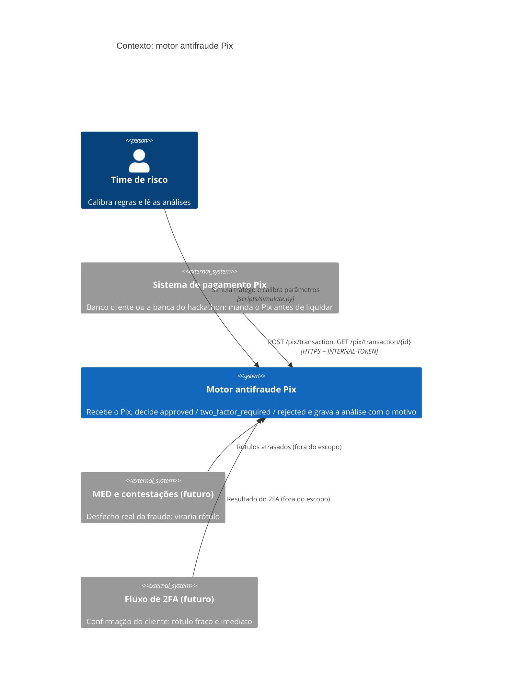
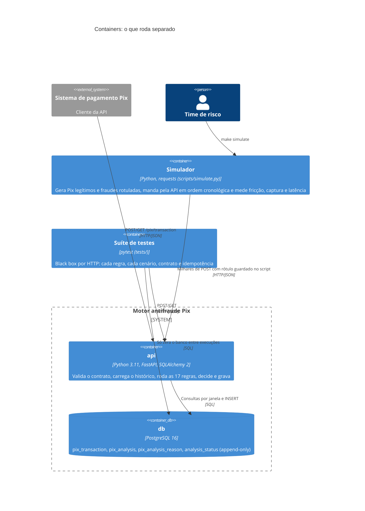
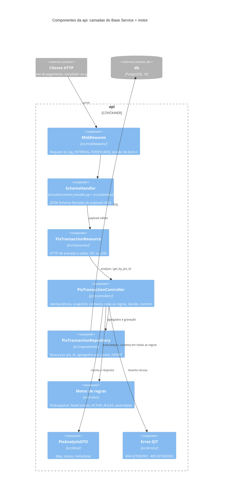
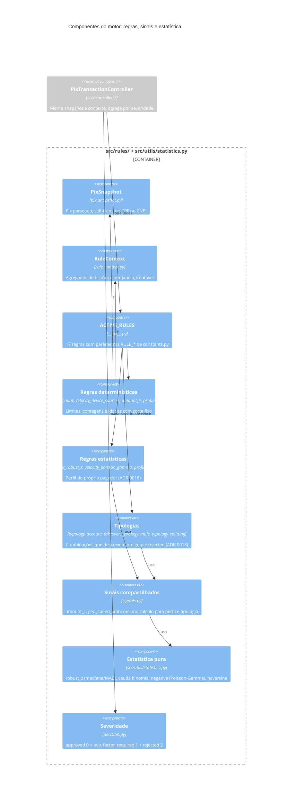
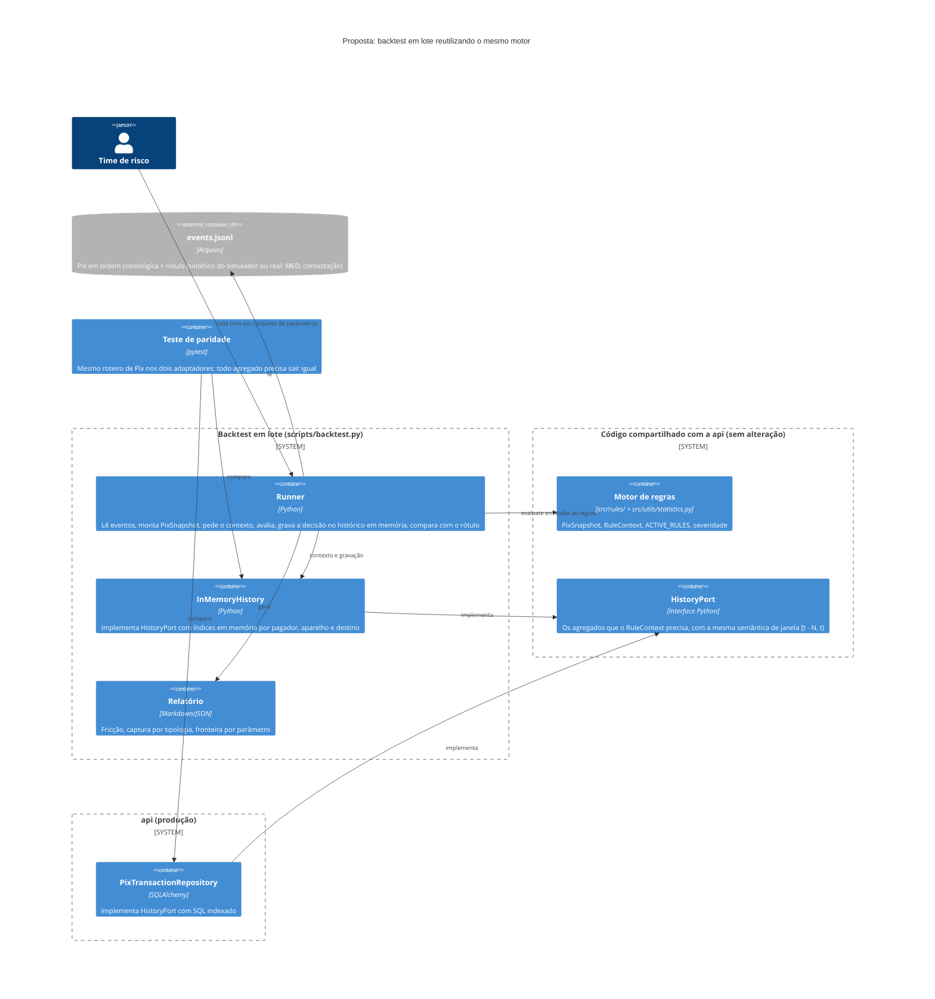

# Diagramas C4

> [Índice](../README.md) › Arquitetura › C4
>
> **Responde a:** quais sistemas e containers existem? como a API se divide por dentro? onde moram as regras e a estatística? onde entra o simulador? como seria um backtest sem HTTP e sem banco?

O [modelo C4](https://c4model.com) desenha o sistema em níveis de zoom: **contexto** (quem usa), **containers** (o que roda separado), **componentes** (os módulos de dentro de um container). Os diagramas são Mermaid C4 e renderizam no GitHub.

| Nível | Diagrama | Estado |
|---|---|---|
| 1. Contexto | [Quem fala com o motor](#1-contexto) | implementado |
| 2. Containers | [api, db, simulador, testes](#2-containers) | implementado |
| 3. Componentes | [Camadas da API](#3-componentes-da-api) | implementado |
| 3. Componentes | [Motor de regras e módulos estatísticos](#4-componentes-do-motor-de-regras) | implementado |
| 2/3. Proposta | [Backtest sem HTTP e sem banco](#5-proposta-backtest-sem-http-e-sem-banco) | fora do escopo ([ADR 0017](decisoes/0017-ml-fora-do-prazo-e-do-hot-path.md)) |

## 1. Contexto

O motor não chama nada de fora no caminho da decisão ([ADR 0002](decisoes/0002-monolito-sincrono-sem-dependencia-externa.md)). MED e 2FA aparecem só como a origem futura dos rótulos.

## 2. Containers

O simulador e os testes ficam fora do `docker-compose.yml`: rodam na máquina de quem desenvolve, contra a `api` de pé ([estratégia de testes](../07-testes/estrategia.md), [ADR 0020](decisoes/0020-simulador-para-calibracao.md)).

## 3. Componentes da API

A dependência anda num sentido só ([camadas](camadas.md)). O motor de regras não conhece repository nem banco: recebe tudo pronto no `RuleContext` ([ADR 0005](decisoes/0005-regras-puras-com-contexto-carregado.md)).

## 4. Componentes do motor de regras

Tudo dentro desta caixa é Python puro: sem banco, sem ambiente, sem relógio. É essa pureza que permite o backtest da seção seguinte reutilizar o motor sem mudar uma linha das regras.

## 5. Proposta: backtest sem HTTP e sem banco

**Estado:** fora do escopo desta entrega ([ADR 0017](decisoes/0017-ml-fora-do-prazo-e-do-hot-path.md)). Fica desenhado para mostrar que a arquitetura comporta.

O backtest atual é o simulador pela API: fiel, mas cada Pix paga o HTTP e as cerca de 15 consultas SQL (~45 ms). Para reprocessar milhões de Pix reais, o motor roda em lote, direto em Python. O risco é duplicar a lógica dos agregados (uma versão em SQL, outra em Python) e a calibração medir uma cópia do motor (*training-serving skew*). A proposta evita isso com uma **porta de histórico** e um **teste de paridade**:

O que precisaria mudar no código para isso existir:

| Mudança | Por quê |
|---|---|
| Extrair a montagem do `RuleContext` e o `_decide` do controller para `src/rules/engine.py` (`analyze(snapshot, history) -> decisão, motivos, sinais`) | Hoje essa orquestração mora no controller, que depende de sessão de banco. O runner e o controller passam a chamar a mesma função |
| Definir `HistoryPort` com os métodos de agregado que o repository já tem | Uma interface, dois adaptadores: SQL na api, memória no backtest |
| `InMemoryHistory` em `scripts/` | Agregados em memória, alimentados pelo próprio runner na ordem cronológica |
| Teste de paridade que roda o mesmo roteiro contra os dois adaptadores | Garante que "quantos Pix na janela" dá o mesmo número nos dois lados. Sem ele, a segunda implementação diverge em silêncio |

Ganho esperado: cada Pix deixa de pagar HTTP e consultas, e o lote passa de minutos para segundos, o que viabiliza grid de parâmetros e, um dia, gerar a base de treino de um modelo. Preço: uma segunda implementação dos agregados, contida pelo teste de paridade.
