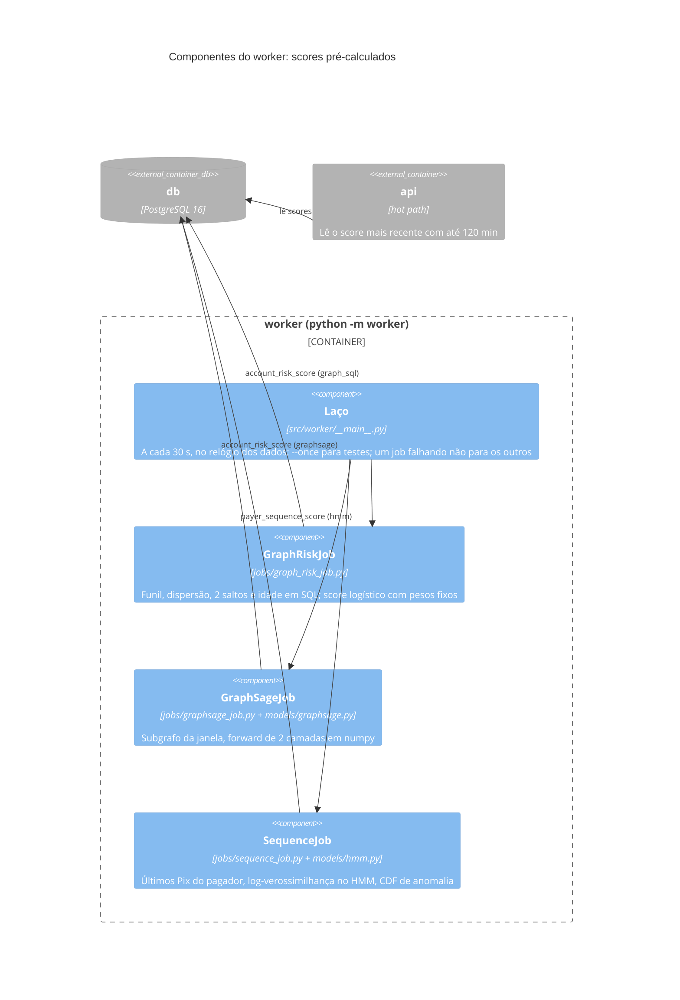
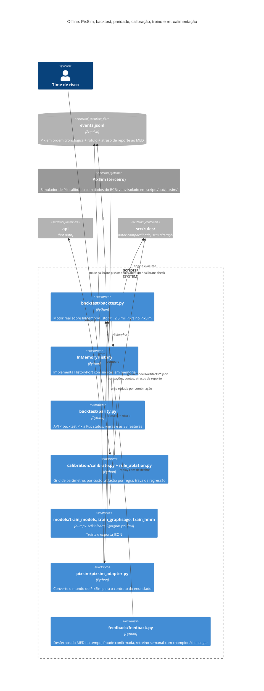
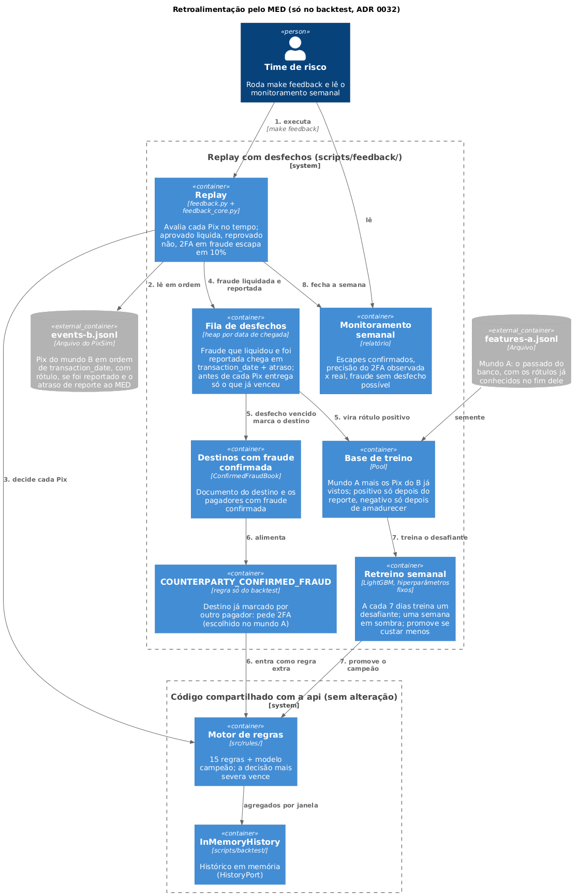
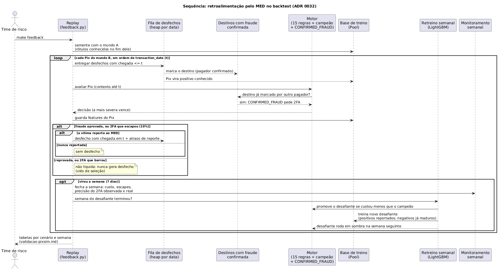
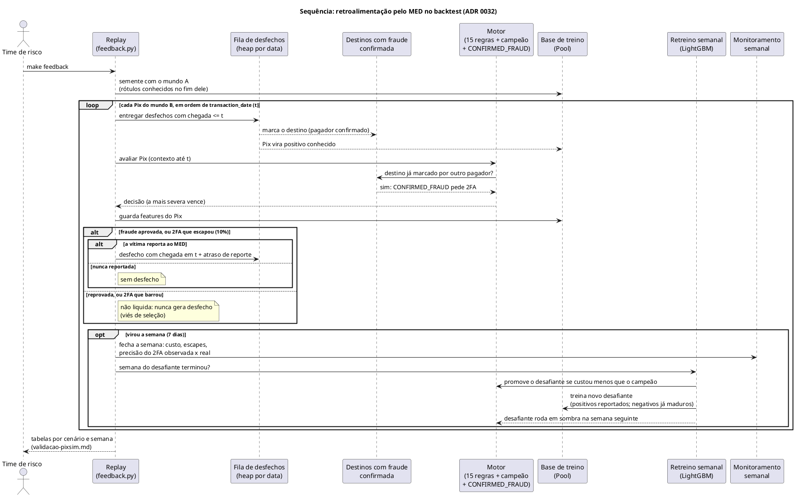

# Diagramas C4

> [Índice](../README.md) › Arquitetura › C4
>
> **Responde a:** quais sistemas e containers existem? como a API se divide por dentro? onde moram regras, estatística e modelos? o que roda no hot path e o que roda no cold path? como o backtest roda sem HTTP e sem banco? onde estão os diagramas, imagens e especificações?

O [modelo C4](https://c4model.com) desenha o sistema em níveis de zoom: **contexto** (quem usa), **containers** (o que roda separado) e **componentes** (os módulos dentro de um container).

Os diagramas da arquitetura estão disponíveis em múltiplos formatos na pasta [`diagramas/`](diagramas/):
- **Imagens renderizadas (`.png`):** visualização direta ao longo deste documento.
- **Fontes PlantUML (`.puml`):** especificação canônica com [C4-PlantUML](https://github.com/plantuml-stdlib/C4-PlantUML).

| Nível | Diagrama | Imagem (`.png`) | PlantUML (`.puml`) | Estado |
|---|---|---|---|---|
| 1. Contexto | [Quem fala com o motor](#1-contexto) | [`c4-contexto-motor.png`](diagramas/c4-contexto-motor.png) | [`c4-contexto-motor.puml`](diagramas/c4-contexto-motor.puml) | implementado |
| 2. Containers | [api, worker, db, ferramentas offline, simulador, testes](#2-containers) | [`c4-containers.png`](diagramas/c4-containers.png) | [`c4-containers.puml`](diagramas/c4-containers.puml) | implementado |
| 3. Componentes | [Camadas da API](#3-componentes-da-api) | [`c4-componentes-API.png`](diagramas/c4-componentes-API.png) | [`c4-componentes-API.puml`](diagramas/c4-componentes-API.puml) | implementado |
| 3. Componentes | [Motor: regras, estatística e modelos](#4-componentes-do-motor) | [`c4-componentes-motor.png`](diagramas/c4-componentes-motor.png) | [`c4-componentes-motor.puml`](diagramas/c4-componentes-motor.puml) | implementado |
| 3. Componentes | [Worker: cold path](#5-componentes-do-worker-cold-path) | — | — | implementado |
| 2/3. Offline | [Backtest em lote e treino](#6-backtest-em-lote-e-treino-offline) | [`c4-backtest.png`](diagramas/c4-backtest.png) | [`c4-backtest.puml`](diagramas/c4-backtest.puml) | implementado |
| 2/3. Offline | [Retroalimentação pelo MED](#7-retroalimentação-pelo-med-só-no-backtest) | [`c4-retroalimentacao.png`](diagramas/c4-retroalimentacao.png) | [`c4-retroalimentacao.puml`](diagramas/c4-retroalimentacao.puml) | implementado (só no backtest) |
| Sequência | [Retroalimentação passo a passo](#sequência-da-retroalimentação) | [`seq-retroalimentacao.png`](diagramas/seq-retroalimentacao.png) | [`seq-retroalimentacao.puml`](diagramas/seq-retroalimentacao.puml) | implementado (só no backtest) |

---

## 1. Contexto

> 📥 **Arquivos:** [Imagem PNG (`c4-contexto-motor.png`)](diagramas/c4-contexto-motor.png) · [Código PlantUML (`c4-contexto-motor.puml`)](diagramas/c4-contexto-motor.puml)


<details>
<summary>Ver código-fonte PlantUML (<code>diagramas/c4-contexto-motor.puml</code>)</summary>

```plantuml
@startuml
!include https://raw.githubusercontent.com/plantuml-stdlib/C4-PlantUML/master/C4_Context.puml

title Contexto: motor antifraude Pix

Person(risco, "Time de risco", "Calibra regras no PixSim, lê as análises e os relatórios")
System_Ext(pagamento, "Sistema de pagamento Pix", "Banco cliente ou a banca do hackathon: manda o Pix antes de liquidar")

System(motor, "Motor antifraude Pix", "15 regras decidem approved / two_factor_required / rejected; 5 modelos em shadow; grava a análise com o motivo")

System_Ext(pixsim, "PixSim (terceiro)", "Simulador de Pix calibrado com dados do BCB: referência das métricas, só offline")
System_Ext(med, "MED e contestações (futuro)", "Desfecho real da fraude: viraria rótulo; hoje simulado só no backtest")
System_Ext(twofa, "Fluxo de 2FA (futuro)", "Confirmação do cliente: rótulo fraco e imediato")

Rel(pagamento, motor, "POST /pix/transaction\nGET /pix/transaction/{id}", "HTTPS + INTERNAL-TOKEN")
Rel(risco, motor, "Calibra parâmetros e mede no backtest", "make calibrate-pixsim, make rule-ablation")
Rel(pixsim, motor, "Mundos A e B convertidos para o contrato", "offline, scripts/pixsim/")
Rel(med, motor, "Rótulos atrasados", "fora do escopo da API")
Rel(twofa, motor, "Resultado do 2FA", "fora do escopo")

@enduml
```

</details>

O motor não chama nada de fora no caminho da decisão ([ADR 0002](decisoes/0002-monolito-sincrono-sem-dependencia-externa.md)). MED e 2FA aparecem só como a origem futura dos rótulos (e hoje simulam a retroalimentação no backtest, [ADR 0032](decisoes/0032-retroalimentacao-pelo-med-no-backtest.md)).

---

## 2. Containers

> 📥 **Arquivos:** [Imagem PNG (`c4-containers.png`)](diagramas/c4-containers.png) · [Código PlantUML (`c4-containers.puml`)](diagramas/c4-containers.puml)


<details>
<summary>Ver código-fonte PlantUML (<code>diagramas/c4-containers.puml</code>)</summary>

```plantuml
@startuml
!include https://raw.githubusercontent.com/plantuml-stdlib/C4-PlantUML/master/C4_Container.puml

title Containers: o que roda separado

System_Ext(pagamento, "Sistema de pagamento Pix", "Cliente da API")
Person(risco, "Time de risco")

System_Boundary(motor_boundary, "Motor antifraude Pix (docker compose)") {
    Container(api, "api", "Python 3.11, FastAPI, SQLAlchemy 2", "Hot path: valida o contrato, carrega o histórico, roda as 15 regras e os 5 modelos em shadow, decide e grava")
    Container(worker, "worker", "Python 3.11, numpy", "Cold path: a cada 30 s calcula reputação de grafo (SQL), GraphSAGE e HMM de sequência\n(src/worker/)")
    ContainerDb(db, "db", "PostgreSQL 16", "pix_transaction, pix_analysis, pix_analysis_reason, analysis_status (append-only) + account_risk_score, payer_sequence_score")
}

Container(offline, "Ferramentas offline", "Python, scripts/", "Backtest em memória, paridade, calibração, ablação, treino, validação no PixSim, retroalimentação pelo MED")
Container(sim, "Simulador local (fixture do CI)", "Python", "Gera Pix rotulados para a paridade e a trava make calibrate-check; sem valor estatístico\n(scripts/fixture/simulate.py)")
Container(tests, "Suíte de testes", "pytest", "113 testes black box por HTTP: cada regra, cada cenário, contrato e idempotência\n(tests/)")

Rel(pagamento, api, "POST/GET /pix/transaction", "HTTP/JSON")
Rel(api, db, "Consultas por janela, leitura de scores e INSERT", "SQL")
Rel(worker, db, "Lê o grafo pagador → destino e grava scores", "SQL")
Rel(risco, offline, "executa", "make validate-pixsim, rule-ablation, calibrate-pixsim")
Rel(sim, api, "Pix rotulados pela API (paridade e simulate)", "HTTP/JSON")
Rel(offline, sim, "usa como fixture do CI")
Rel(tests, api, "POST/GET", "HTTP/JSON")
Rel(tests, db, "Só zera o banco entre execuções", "SQL")

@enduml
```

</details>

`api` e `worker` usam o mesmo código (`src/`), em targets diferentes do Dockerfile: só o worker tem numpy ([ADR 0026](decisoes/0026-graphsage-e-hmm-no-worker.md)). Simulador, backtest e testes rodam na máquina de quem desenvolve e no CI; o simulador é fixture do CI, sem valor estatístico ([ADR 0029](decisoes/0029-pixsim-como-referencia.md)).

---

## 3. Componentes da API

> 📥 **Arquivos:** [Imagem PNG (`c4-componentes-API.png`)](diagramas/c4-componentes-API.png) · [Código PlantUML (`c4-componentes-API.puml`)](diagramas/c4-componentes-API.puml)


<details>
<summary>Ver código-fonte PlantUML (<code>diagramas/c4-componentes-API.puml</code>)</summary>

```plantuml
@startuml
!include https://raw.githubusercontent.com/plantuml-stdlib/C4-PlantUML/master/C4_Component.puml

title Componentes da api: camadas do Base Service + motor

Container_Ext(cliente, "Cliente HTTP", "Sistema de pagamento, simulador ou pytest")
ContainerDb_Ext(db, "db", "PostgreSQL 16")

Container_Boundary(api_boundary, "api") {
    Component(mw, "Middlewares", "src/middlewares/", "Request id, log, INTERNAL-TOKEN (403), sessão de banco")
    Component(schema, "SchemaHandler", "src/utils/schema_handler.py + src/schemas/", "JSON Schema fechado do payload (400)")
    Component(resource, "PixTransactionResource", "src/resources/", "HTTP de entrada e saída; 201 ou 200")
    Component(controller, "PixTransactionController", "src/controllers/", "Idempotência, snapshot, contexto, roda as regras, decide, commit")
    Component(repo, "PixTransactionRepository", "src/repositories/", "Busca por pix_id, agregados por janela (HistoryPort), scores do worker, INSERT")
    Component(engine, "Motor de regras", "src/rules/ (core/engine.py)", "15 regras + 5 modelos em shadow; PixSnapshot, RuleContext, severidade")
    Component(dto, "PixAnalysisDTO", "src/dtos/", "{key, status, metadata}")
    Component(errors, "Erros QIT", "src/errors/", "404 QIT002001, 409 QIT002002")
}

Rel(cliente, mw, "HTTP")
Rel(mw, schema, "")
Rel(schema, resource, "payload válido")
Rel(resource, controller, "analyze / get_by_pix_id")
Rel(controller, repo, "agregados e gravação")
Rel(repo, db, "SQL")
Rel(controller, engine, "build_context + evaluate em todas as regras")
Rel(controller, dto, "monta a resposta")
Rel(controller, errors, "levanta recusa")

@enduml
```

</details>

O controller não tem regra nem SQL de agregado. O motor só conhece o `HistoryPort`, e por isso o mesmo código roda no backtest ([ADR 0023](decisoes/0023-motor-extraido-e-history-port.md)).

---

## 4. Componentes do motor

> 📥 **Arquivos:** [Imagem PNG (`c4-componentes-motor.png`)](diagramas/c4-componentes-motor.png) · [Código PlantUML (`c4-componentes-motor.puml`)](diagramas/c4-componentes-motor.puml)


<details>
<summary>Ver código-fonte PlantUML (<code>diagramas/c4-componentes-motor.puml</code>)</summary>

```plantuml
@startuml
!include https://raw.githubusercontent.com/plantuml-stdlib/C4-PlantUML/master/C4_Component.puml

title Componentes do motor: regras, sinais, estatística e modelos

Component_Ext(controller, "PixTransactionController", "src/controllers/", "Chama o motor e grava; único commit")
Component_Ext(history, "HistoryPort", "repository SQL (api) ou InMemoryHistory (backtest)", "Agregados por janela [t - N, t)")

Container_Boundary(rules_boundary, "src/rules/ + src/utils/statistics.py") {
    Component(engine, "Engine", "core/engine.py", "build_context, evaluate, metadata_from")
    Component(snapshot, "PixSnapshot", "core/pix_snapshot.py", "Pix parseado; self-transfer; CPF ou CNPJ")
    Component(context, "RuleContext", "core/rule_context.py", "Agregados de histórico por janela, imutável")
    Component(features, "Features", "core/features.py", "33 features gravadas em metadata e lidas pelos modelos")
    Component(registry, "ACTIVE_RULES", "src/rules/ (pacote)", "build_rules: 15 regras com parâmetros RULE_* de constants.py + modelos shadow")
    Component(det, "Regras determinísticas", "limit/, velocity/, counterparty/", "Limites, contagens, idades e reputação de grafo com corte fixo")
    Component(stat, "Regras estatísticas", "profile/, velocity/velocity_poisson_gamma_rule.py", "Perfil do próprio pagador: z robusto, Poisson-Gamma, aparelho novo, viagem impossível (ADR 0016)")
    Component(typo, "Tipologias", "typology/", "Conta tomada e mula: rejected (ADR 0018)")
    Component(models, "Modelos em shadow", "models/ + models/artifacts/*.json", "LogReg, LightGBM, Isolation Forest em Python puro; scores do worker; nunca decidem (ADR 0022)")
    Component(signals, "Sinais compartilhados", "core/signals.py", "amount_z, geo_speed_kmh, poisson_tail: mesmo cálculo para perfil, tipologia e features")
    Component(statistics, "Estatística pura", "src/utils/statistics.py", "robust_z (mediana/MAD), cauda binomial negativa, haversine")
    Component(decision, "Severidade", "core/decision.py", "approved 0 < two_factor_required 1 < rejected 2")
}

Rel(controller, engine, "evaluate(snapshot, context)")
Rel(engine, history, "agregados")
Rel(engine, context, "monta")
Rel(engine, registry, "itera todas")
Rel(registry, det, "aciona")
Rel(registry, stat, "aciona")
Rel(registry, typo, "aciona")
Rel(registry, models, "aciona (shadow)")
Rel(det, snapshot, "lê")
Rel(det, context, "lê")
Rel(stat, signals, "usa")
Rel(typo, signals, "usa")
Rel(models, features, "lê")
Rel(features, signals, "usa")
Rel(signals, statistics, "usa")
Rel(engine, decision, "maior severidade vence")

@enduml
```

</details>

Regras que decidem vão para `status` e `reasons`; regras shadow, só para `metadata.shadow` ([ADR 0022](decisoes/0022-shadow-mode.md)). Nada aqui importa banco, ambiente ou relógio.

---

## 5. Componentes do worker (cold path)



Ciclo completo no cenário padrão: 0,31 s ([ADR 0025](decisoes/0025-cold-path-worker.md), [ADR 0026](decisoes/0026-graphsage-e-hmm-no-worker.md)).

---

## 6. Backtest em lote e treino (offline)

> 📥 **Arquivos:** [Imagem PNG (`c4-backtest.png`)](diagramas/c4-backtest.png) · [Código PlantUML (`c4-backtest.puml`)](diagramas/c4-backtest.puml)


<details>
<summary>Ver código-fonte PlantUML (<code>diagramas/c4-backtest.puml</code>)</summary>

```plantuml
@startuml
!include https://raw.githubusercontent.com/plantuml-stdlib/C4-PlantUML/master/C4_Container.puml

title Backtest em lote reutilizando o mesmo motor

Person(risco, "Time de risco")
ContainerDb_Ext(arquivo, "events.jsonl", "Arquivo", "Pix em ordem cronológica + rótulo + atraso de reporte ao MED (PixSim ou fixture do CI)")

System_Boundary(bt_boundary, "Backtest em lote (scripts/backtest/backtest.py)") {
    Container(runner, "Runner", "Python", "Lê eventos em streaming, monta PixSnapshot, pede o contexto, avalia, grava a decisão no histórico em memória, compara com o rótulo; ~2,5 mil Pix/s")
    Container(mem, "InMemoryHistory", "scripts/backtest/in_memory_history.py", "Implementa HistoryPort com índices em memória por pagador, aparelho e destino")
    Container(report, "Relatório", "Markdown/JSON", "Fricção, captura por tipologia, custo ponderado em R$, P@k")
}

System_Boundary(shared_boundary, "Código compartilhado com a api (sem alteração)") {
    Container(core, "Motor de regras", "src/rules/ + src/utils/statistics.py", "PixSnapshot, RuleContext, ACTIVE_RULES, severidade")
    Container(port, "HistoryPort", "src/rules/core/history_port.py", "Os agregados que o RuleContext precisa, com a mesma semântica de janela [t - N, t)")
}

System_Boundary(prod_boundary, "api (produção)") {
    Container(sqladapter, "PixTransactionRepository", "SQLAlchemy", "Implementa HistoryPort com SQL indexado")
}

Container(parity, "Paridade", "scripts/backtest/parity.py", "Mesmo roteiro de Pix pela API e pelo backtest: status, regras e as 33 features iguais (0 divergências)")

Rel(risco, runner, "roda com um conjunto de parâmetros", "opções set e disable")
Rel(runner, arquivo, "lê")
Rel(runner, core, "evaluate em todas as regras")
Rel(runner, mem, "contexto e gravação")
Rel(mem, port, "implementa")
Rel(sqladapter, port, "implementa")
Rel(parity, mem, "compara")
Rel(parity, sqladapter, "compara")
Rel(runner, report, "gera")

@enduml
```

</details>



O backtest é a proposta do primeiro C4, agora implementada: no fixture do CI, 636 Pix levam 0,2 s contra 26 s pela API, com zero divergências na paridade; no PixSim, 254.795 Pix em cerca de 100 s. As métricas de referência vêm do PixSim ([ADR 0029](decisoes/0029-pixsim-como-referencia.md)); a retroalimentação pelo MED existe só aqui, no backtest ([ADR 0032](decisoes/0032-retroalimentacao-pelo-med-no-backtest.md)).

---

## 7. Retroalimentação pelo MED (só no backtest)

> 📥 **Arquivos:** [Imagem PNG (`c4-retroalimentacao.png`)](diagramas/c4-retroalimentacao.png) · [Código PlantUML (`c4-retroalimentacao.puml`)](diagramas/c4-retroalimentacao.puml)



<details>
<summary>Ver código-fonte PlantUML (<code>diagramas/c4-retroalimentacao.puml</code>)</summary>

```plantuml
@startuml
!include https://raw.githubusercontent.com/plantuml-stdlib/C4-PlantUML/master/C4_Container.puml

title Retroalimentação pelo MED (só no backtest, ADR 0032)

Person(risco, "Time de risco", "Roda make feedback e lê o monitoramento semanal")
ContainerDb_Ext(events, "events-b.jsonl", "Arquivo do PixSim", "Pix do mundo B em ordem de transaction_date, com rótulo, se foi reportado e o atraso de reporte ao MED")
ContainerDb_Ext(pool_a, "features-a.jsonl", "Arquivo", "Mundo A: o passado do banco, com os rótulos já conhecidos no fim dele")

System_Boundary(fb, "Replay com desfechos (scripts/feedback/)") {
    Container(replay, "Replay", "feedback.py + feedback_core.py", "Avalia cada Pix no tempo; aprovado liquida, reprovado não, 2FA em fraude escapa em 10%")
    Container(queue, "Fila de desfechos", "heap por data de chegada", "Fraude que liquidou e foi reportada chega em transaction_date + atraso; antes de cada Pix entrega só o que já venceu")
    Container(book, "Destinos com fraude confirmada", "ConfirmedFraudBook", "Documento do destino e os pagadores com fraude confirmada")
    Container(signal, "COUNTERPARTY_CONFIRMED_FRAUD", "regra só do backtest", "Destino já marcado por outro pagador: pede 2FA (escolhido no mundo A)")
    Container(pool, "Base de treino", "Pool", "Mundo A mais os Pix do B já vistos; positivo só depois do reporte, negativo só depois de amadurecer")
    Container(retrain, "Retreino semanal", "LightGBM, hiperparâmetros fixos", "A cada 7 dias treina um desafiante; uma semana em sombra; promove se custar menos")
    Container(monitor, "Monitoramento semanal", "relatório", "Escapes confirmados, precisão do 2FA observada x real, fraude sem desfecho possível")
}

System_Boundary(shared, "Código compartilhado com a api (sem alteração)") {
    Container(engine, "Motor de regras", "src/rules/", "15 regras + modelo campeão; a decisão mais severa vence")
    Container(mem, "InMemoryHistory", "scripts/backtest/", "Histórico em memória (HistoryPort)")
}

Rel(risco, replay, "1. executa", "make feedback")
Rel(replay, events, "2. lê em ordem")
Rel(replay, engine, "3. decide cada Pix")
Rel(engine, mem, "agregados por janela")
Rel(replay, queue, "4. fraude liquidada e reportada")
Rel(queue, book, "5. desfecho vencido marca o destino")
Rel(queue, pool, "5. vira rótulo positivo")
Rel(book, signal, "6. alimenta")
Rel(signal, engine, "6. entra como regra extra")
Rel(pool_a, pool, "semente")
Rel(pool, retrain, "7. treina o desafiante")
Rel(retrain, engine, "7. promove o campeão")
Rel(replay, monitor, "8. fecha a semana")
Rel(risco, monitor, "lê")

@enduml
```

</details>

As setas numeradas seguem um Pix pelo ciclo: o motor decide (3); se a fraude liquidou e a vítima reportou, o desfecho entra na fila com a data de chegada (4); quando o relógio dos dados alcança essa data, ele marca o destino e vira rótulo (5); o destino marcado vira 2FA para os próximos pagadores (6); toda semana um desafiante é treinado e promovido se custar menos (7); a semana fecha com o monitoramento (8). Pix reprovado nunca gera desfecho, o que reproduz o viés de seleção. A API não recebe desfechos: o contrato do enunciado só tem `POST` e `GET`, e a rota de desfechos fica como primeiro passo de produção ([ADR 0032](decisoes/0032-retroalimentacao-pelo-med-no-backtest.md); números em [validação no PixSim](../05-motor/validacao-pixsim.md#retroalimentação-pelo-med)).

### Sequência da retroalimentação

> 📥 **Arquivos:** [Imagem PNG (`seq-retroalimentacao.png`)](diagramas/seq-retroalimentacao.png) · [Código PlantUML (`seq-retroalimentacao.puml`)](diagramas/seq-retroalimentacao.puml)



<details>
<summary>Ver código-fonte PlantUML (<code>diagramas/seq-retroalimentacao.puml</code>)</summary>



</details>

A ordem dentro do laço importa: os desfechos vencidos são entregues **antes** de avaliar o Pix (`apply_due` em `scripts/feedback/feedback_core.py`), então o motor nunca vê um desfecho do futuro.
