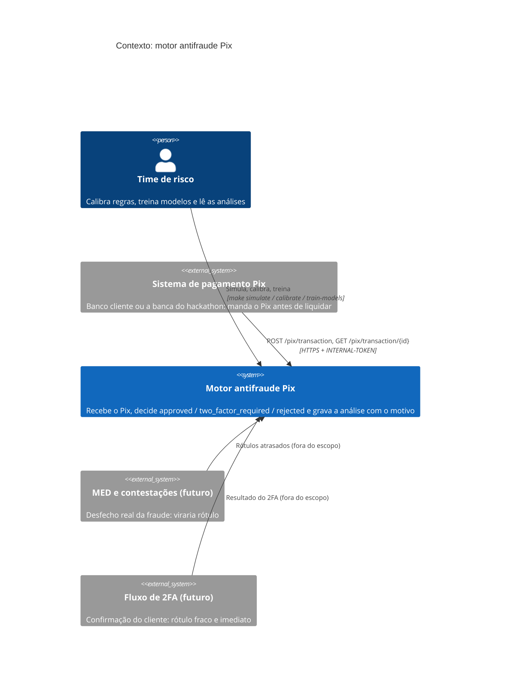
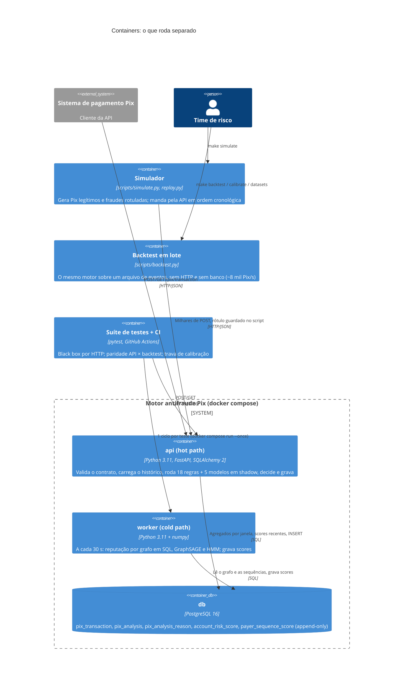
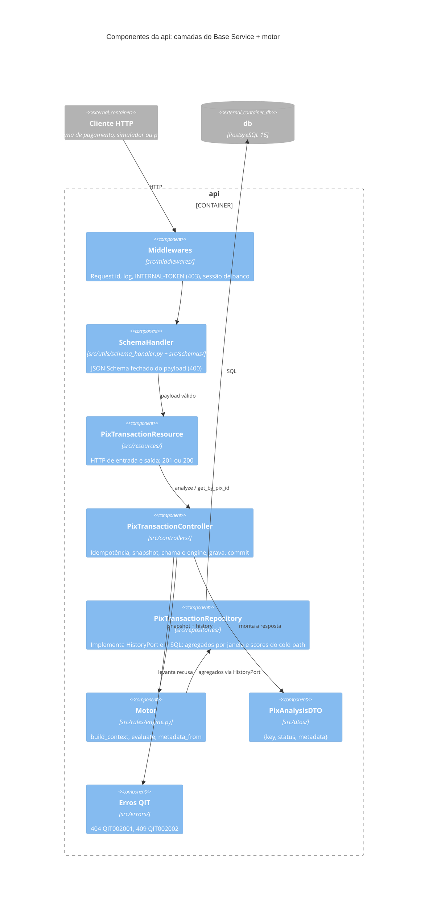
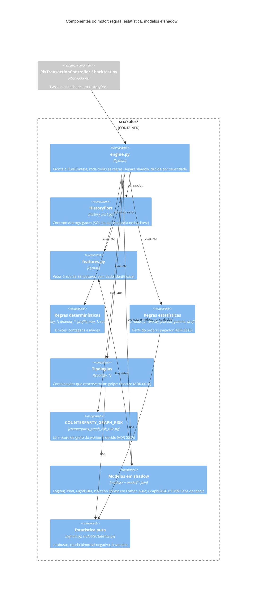
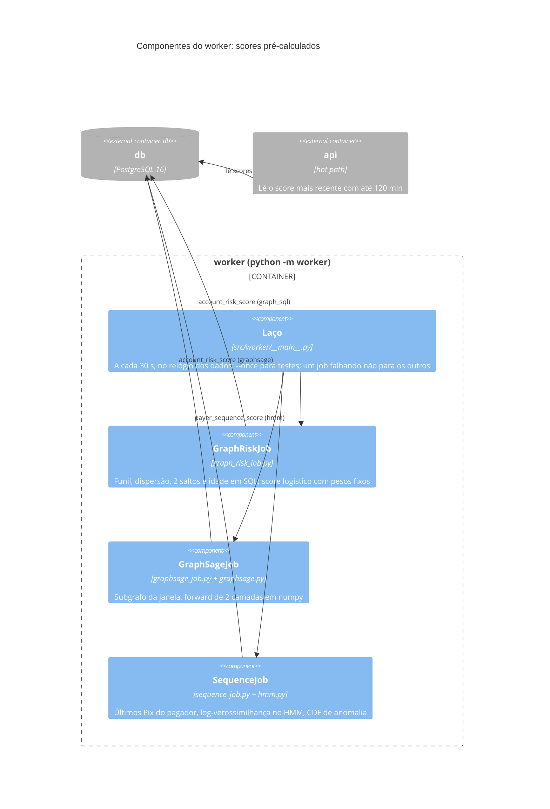
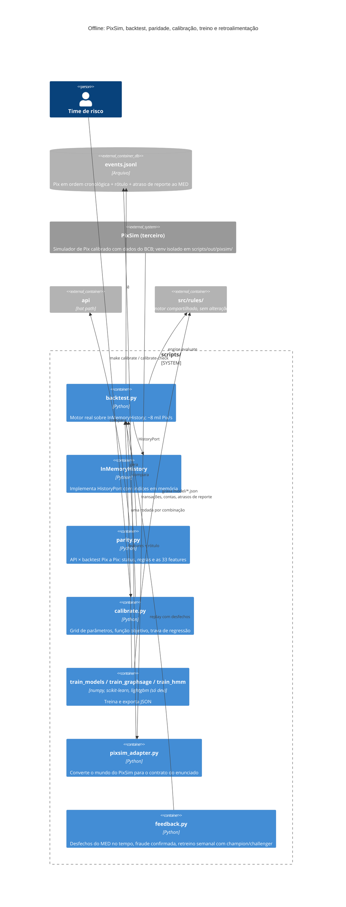

# Diagramas C4

> [Índice](../README.md) › Arquitetura › C4
>
> **Responde a:** quais sistemas e containers existem? como a API se divide por dentro? onde moram regras, estatística e modelos? o que roda no hot path e o que roda no cold path? como o backtest roda sem HTTP e sem banco?

O [modelo C4](https://c4model.com) desenha o sistema em níveis de zoom: **contexto** (quem usa), **containers** (o que roda separado) e **componentes** (os módulos dentro de um container). Os diagramas são Mermaid C4 e renderizam no GitHub.

| Nível | Diagrama |
|---|---|
| 1. Contexto | [Quem fala com o motor](#1-contexto) |
| 2. Containers | [api, worker, db, simulador, backtest, testes](#2-containers) |
| 3. Componentes | [Camadas da API](#3-componentes-da-api) |
| 3. Componentes | [Motor: regras, estatística e modelos](#4-componentes-do-motor) |
| 3. Componentes | [Worker: cold path](#5-componentes-do-worker-cold-path) |
| 2/3. Offline | [Backtest em lote e treino](#6-backtest-em-lote-e-treino-offline) |

## 1. Contexto

O motor não chama nada de fora no caminho da decisão ([ADR 0002](decisoes/0002-monolito-sincrono-sem-dependencia-externa.md)). MED e 2FA aparecem só como a origem futura dos rótulos ([ADR 0017](decisoes/0017-ml-fora-do-prazo-e-do-hot-path.md)).

## 2. Containers

`api` e `worker` usam o mesmo código (`src/`), em targets diferentes do Dockerfile: só o worker tem numpy ([ADR 0026](decisoes/0026-graphsage-e-hmm-no-worker.md)). Simulador, backtest e testes rodam na máquina de quem desenvolve e no CI.

## 3. Componentes da API

O controller não tem regra nem SQL de agregado. O motor só conhece o `HistoryPort`, e por isso o mesmo código roda no backtest ([ADR 0023](decisoes/0023-motor-extraido-e-history-port.md)).

## 4. Componentes do motor

Regras que decidem vão para `status` e `reasons`; regras shadow, só para `metadata.shadow` ([ADR 0022](decisoes/0022-shadow-mode.md)). Nada aqui importa banco, ambiente ou relógio.

## 5. Componentes do worker (cold path)

Ciclo completo no cenário padrão: 0,31 s ([ADR 0025](decisoes/0025-cold-path-worker.md), [ADR 0026](decisoes/0026-graphsage-e-hmm-no-worker.md)).

## 6. Backtest em lote e treino (offline)

O backtest é a proposta do primeiro C4, agora implementada: as 5.062 Pix do cenário padrão levam 0,6 s, contra 206 s pela API, com zero divergências na paridade. As métricas de referência vêm do PixSim ([ADR 0029](decisoes/0029-pixsim-como-referencia.md)); a retroalimentação pelo MED existe só aqui, no backtest ([ADR 0032](decisoes/0032-retroalimentacao-pelo-med-no-backtest.md)).
