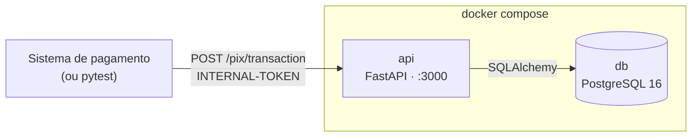
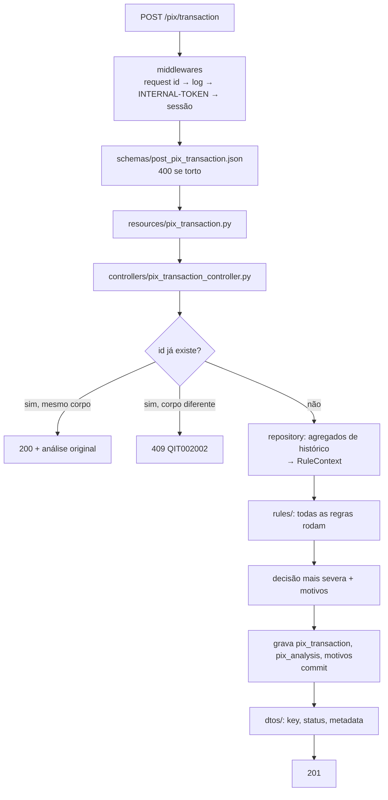

# Visão geral

> [Índice](../README.md) › Arquitetura › Visão geral
>
> **Responde a:** quais serviços sobem? por onde passa um Pix? o que veio da base e o que é novo?

## Ecossistema

Os mesmos sistemas em diagramas C4 (contexto, containers e componentes) estão em [c4.md](c4.md).

Dois containers, um `docker-compose.yml` ([ADR 0002](decisoes/0002-monolito-sincrono-sem-dependencia-externa.md)).

| Serviço | Imagem | Papel | Saúde |
|---|---|---|---|
| `api` | build local (`Dockerfile`) | Recebe o Pix, roda as regras, grava e responde | `GET /health_check` a cada 3s |
| `db` | build de `database/` (postgres:16 + `database.sql`) | Histórico de todo Pix recebido e das análises | `pg_isready` |

A API é stateless: a sessão de banco nasce e morre em cada requisição. Qualquer réplica atende qualquer Pix.

## O caminho de um Pix

O detalhe do motor está em [motor de regras](../05-motor/motor-de-regras.md); o de cada pasta, em [camadas](camadas.md).

## O que veio da base e o que é novo

| Herdado do `bootcamp-base-api` | Novo neste projeto |
|---|---|
| Camadas, `app.py`, `commit` como última linha do controller | `src/rules/`: uma classe por regra antifraude ([ADR 0004](decisoes/0004-motor-de-regras-em-codigo.md)) |
| Middlewares de request id, log, `INTERNAL-TOKEN` e sessão | `RuleContext` com agregados de histórico ([ADR 0005](decisoes/0005-regras-puras-com-contexto-carregado.md)) |
| `SchemaHandler` + JSON Schema; corpo de erro `QIT` | Decisão por severidade, motivos em `metadata` ([ADR 0006](decisoes/0006-pior-decisao-vence-e-todas-as-regras-rodam.md)) |
| `id` interno + `<entidade>_key` UUID; enumerador de status | Histórico append-only com índices de janela ([ADR 0009](decisoes/0009-historico-append-only.md)) |
| Compose `api` + `db` com healthchecks; testes black box | Idempotência pelo `id` do Pix ([ADR 0012](decisoes/0012-idempotencia-pelo-id-do-pix.md)), `Makefile`, `AGENTS.md`, `CHANGELOG.md` |

Estado atual do código: ver [CHANGELOG](../../CHANGELOG.md). Enquanto a rota do Pix não entra, o exemplo `sample_entity` da base continua no código.
