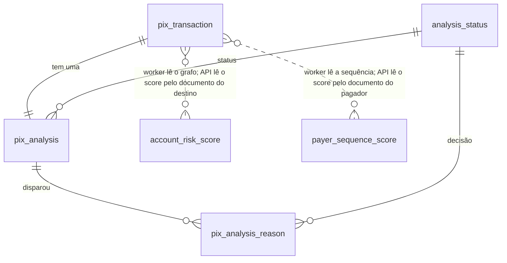

# Modelo de dados

> [Índice](../README.md) › Dados › Modelo
>
> **Responde a:** quais tabelas existem? por que cada coluna? quais índices servem às regras?

**Estado:** implementado em `database/database.sql`. As quatro primeiras tabelas são da API (`analysis_status` é o domínio fixo dos status; as outras três recebem um `INSERT` por Pix); `account_risk_score` e `payer_sequence_score` são escritas só pelo `worker` ([ADR 0025](../02-arquitetura/decisoes/0025-cold-path-worker.md)).

## Diagrama



`account_risk_score` e `payer_sequence_score` não têm chave estrangeira: ligam-se ao Pix pelo número do documento e pela janela de tempo.

## DDL de referência

```sql
CREATE TABLE analysis_status(
    id                              SERIAL PRIMARY KEY,
    enumerator                      VARCHAR(50) NOT NULL UNIQUE,
    severity                        SMALLINT NOT NULL UNIQUE,
    created_at                      TIMESTAMP NOT NULL DEFAULT(NOW())
);

INSERT INTO analysis_status (enumerator, severity) VALUES
('approved', 0),
('two_factor_required', 1),
('rejected', 2);

CREATE TABLE pix_transaction(
    id                              SERIAL PRIMARY KEY,
    pix_id                          VARCHAR(100) NOT NULL UNIQUE,
    amount                          BIGINT NOT NULL CHECK (amount > 0),
    transaction_date                TIMESTAMPTZ NOT NULL,
    source_branch                   VARCHAR(10) NOT NULL,
    source_account_number           VARCHAR(20) NOT NULL,
    source_opening_date             TIMESTAMPTZ NOT NULL,
    source_document_number          VARCHAR(18) NOT NULL,
    destination_participant         CHAR(8) NOT NULL,
    destination_branch              VARCHAR(10) NOT NULL,
    destination_account_number      VARCHAR(20) NOT NULL,
    destination_opening_date        TIMESTAMPTZ NOT NULL,
    destination_document_number     VARCHAR(18) NOT NULL,
    device_id                       VARCHAR(100) NOT NULL,
    channel                         VARCHAR(30) NOT NULL,
    ip                              INET NOT NULL,
    latitude                        NUMERIC(9,6),
    longitude                       NUMERIC(9,6),
    payload                         JSONB NOT NULL,
    created_at                      TIMESTAMP NOT NULL DEFAULT(NOW())
);

CREATE INDEX pix_transaction_source_date_idx      ON pix_transaction (source_document_number, transaction_date);
CREATE INDEX pix_transaction_device_date_idx      ON pix_transaction (device_id, transaction_date);
CREATE INDEX pix_transaction_destination_date_idx ON pix_transaction (destination_document_number, transaction_date);
CREATE INDEX pix_transaction_pair_idx             ON pix_transaction (source_document_number, destination_document_number);

CREATE TABLE pix_analysis(
    id                              SERIAL PRIMARY KEY,
    analysis_key                    CHAR(36) NOT NULL UNIQUE,
    pix_transaction_id              INTEGER NOT NULL UNIQUE REFERENCES pix_transaction(id),
    status_id                       INTEGER NOT NULL REFERENCES analysis_status(id),
    metadata                        JSONB NOT NULL,
    rule_set_version                VARCHAR(20) NOT NULL,
    created_at                      TIMESTAMP NOT NULL DEFAULT(NOW())
);

CREATE TABLE pix_analysis_reason(
    id                              SERIAL PRIMARY KEY,
    pix_analysis_id                 INTEGER NOT NULL REFERENCES pix_analysis(id),
    rule_code                       VARCHAR(60) NOT NULL,
    decision_status_id              INTEGER NOT NULL REFERENCES analysis_status(id),
    reason                          TEXT NOT NULL,
    created_at                      TIMESTAMP NOT NULL DEFAULT(NOW())
);

CREATE TABLE account_risk_score(
    id                              SERIAL PRIMARY KEY,
    document_number                 VARCHAR(18) NOT NULL,
    model                           VARCHAR(30) NOT NULL,
    score                           NUMERIC(6,5) NOT NULL CHECK (score >= 0 AND score <= 1),
    features                        JSONB NOT NULL,
    computed_at                     TIMESTAMPTZ NOT NULL,
    created_at                      TIMESTAMP NOT NULL DEFAULT(NOW())
);

CREATE INDEX account_risk_score_lookup_idx ON account_risk_score (document_number, model, computed_at DESC);

CREATE TABLE payer_sequence_score(
    id                              SERIAL PRIMARY KEY,
    document_number                 VARCHAR(18) NOT NULL,
    model                           VARCHAR(30) NOT NULL,
    score                           NUMERIC(6,5) NOT NULL CHECK (score >= 0 AND score <= 1),
    features                        JSONB NOT NULL,
    computed_at                     TIMESTAMPTZ NOT NULL,
    created_at                      TIMESTAMP NOT NULL DEFAULT(NOW())
);

CREATE INDEX payer_sequence_score_lookup_idx ON payer_sequence_score (document_number, model, computed_at DESC);
```

## Por que cada escolha

| Escolha | Porquê |
|---|---|
| Colunas tipadas + `payload JSONB` | Colunas para consultar e indexar; JSONB para reprocessar e para a idempotência comparar o corpo ([ADR 0009](../02-arquitetura/decisoes/0009-historico-append-only.md)) |
| `pix_id UNIQUE` | Idempotência e corrida resolvidas pelo banco ([ADR 0012](../02-arquitetura/decisoes/0012-idempotencia-pelo-id-do-pix.md)) |
| `TIMESTAMPTZ` em `transaction_date` | O fuso vem no payload e importa para a regra noturna ([ADR 0007](../02-arquitetura/decisoes/0007-relogio-da-transacao.md)) |
| `BIGINT` + `CHECK (amount > 0)` | Centavos, sem float ([ADR 0010](../02-arquitetura/decisoes/0010-dinheiro-em-centavos.md)) |
| `INET` em `ip` | Valida o formato e permite agrupar por faixa |
| `analysis_status.severity` | A regra "mais severa vence" vira `ORDER BY severity` sem lista no código ([ADR 0006](../02-arquitetura/decisoes/0006-pior-decisao-vence-e-todas-as-regras-rodam.md)) |
| `pix_analysis` separada de `pix_transaction` | O fato (o Pix) e a opinião (a análise) têm ciclos diferentes; reanálise futura não reescreve o fato |
| `pix_analysis_reason` em tabela | Calibrar uma regra é contar os disparos dela com SQL, sem abrir JSON |
| Índices `(documento/aparelho, transaction_date)` | Cada regra de janela é um range scan no índice |
| Índice `(pagador, destino)` | Recorrência do par ("já mandou para esse destino?") sem varrer o histórico do pagador |
| `account_risk_score` e `payer_sequence_score` | Cold path: o worker calcula a reputação de cada conta de destino (`graph_sql`, `graphsage`) e a sequência de cada pagador (`hmm`) e grava linhas novas; o hot path lê a mais recente com `computed_at` dentro da janela de 120 min, sem calcular nada ([ADR 0025](../02-arquitetura/decisoes/0025-cold-path-worker.md)). `features` guarda as contribuições do score, para explicar o motivo |
| `rule_set_version` na análise | Saber com qual versão das regras cada análise foi decidida ([ADR 0021](../02-arquitetura/decisoes/0021-o-que-cada-janela-conta-e-versao-das-regras.md)) |

## Invariantes

- Todas as tabelas só recebem `INSERT` (R4), inclusive as de score: um novo cálculo é uma linha nova, a leitura pega a mais recente.
- Todo `pix_transaction` tem exatamente um `pix_analysis`, gravados no mesmo commit.
- `analysis_key` e `pix_id` são os únicos identificadores que saem da API (R5).
