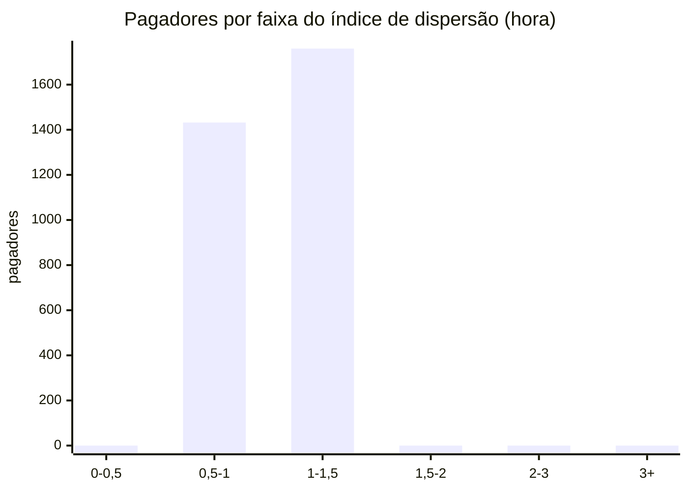
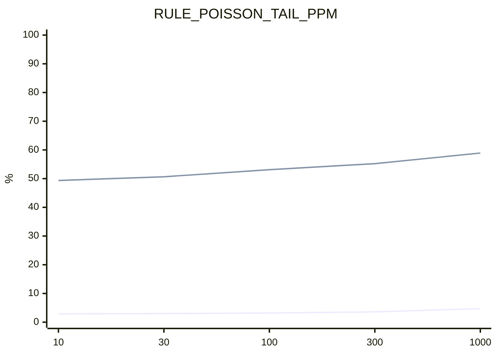
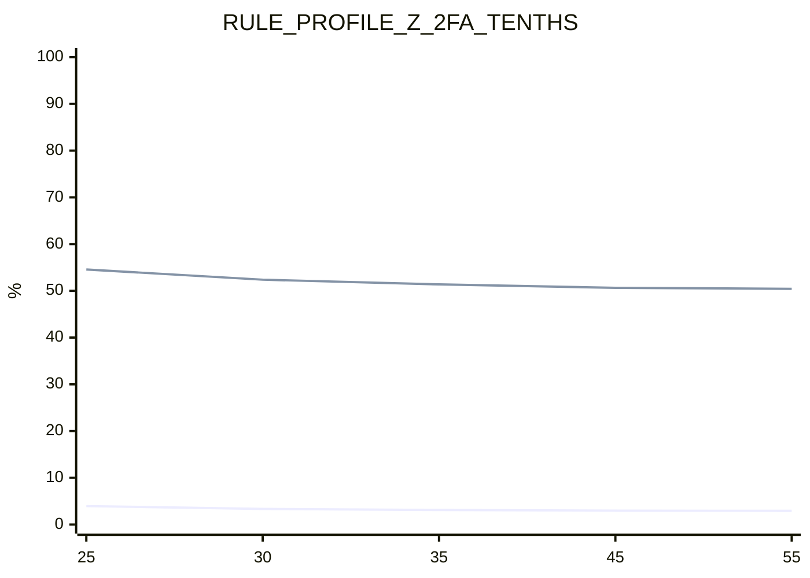

# Análises estatísticas

> [Índice](../README.md) › Motor › Análises
>
> **Responde a:** o valor do Pix por pagador é log-normal (vale o z robusto)? as contagens são Poisson ou super-dispersas (vale a Poisson–Gamma)? as features derivam entre janelas? o quanto cada limiar mexe em fricção e em fraude barrada?

**Métricas no PixSim, simulador de terceiros.** O PixSim ([validação](validacao-pixsim.md)) não é Pix real e foi gerado por quem não somos: as formas que ele sorteia (valores, chegadas) não foram escolhidas por nós para o motor passar. Os números provam o método e a sensibilidade dos parâmetros neste mundo; com dado real, a mesma rotina deve ser rerodada. O nosso simulador (`scripts/fixture/simulate.py`) é só fixture de CI e não entra nestas análises.

Gerado por `make analyze` ([scripts/analysis/analyze.py](../../scripts/analysis/analyze.py)), sem API e sem banco, em leitura por streaming: mundo A (131828 Pix de features, escolha) e mundo B (134353, confirmação), ambos de `scripts/out/pixsim/`. Pagadores com menos de 10 Pix ficam fora das análises 1 e 2.

## 1. `log(amount)` por pagador

**Medido.** No mundo A, só Pix legítimos (burn-in incluído) de 3192 pagadores com ao menos 10 Pix (246199 Pix; 3681 pagadores no total). Para cada um, assimetria e curtose em excesso de `log(amount)`; depois o QQ: os valores viram z-score dentro do pagador (média e desvio, e também mediana e MAD×1,4826, a escala da regra) e seus quantis são lidos contra os da normal.

| Medida | Valor |
|---|---|
| Assimetria mediana | 0,03 |
| Curtose em excesso mediana | -0,20 |
| Pagadores com \|assimetria\| < 0,5 | 2726 de 3192 (85,4%) |

QQ agregado (z dentro do pagador):

| Quantil | Normal teórico | Empírico (média/desvio) | Empírico (mediana/MAD) |
|---|---|---|---|
| 0,1 | -1,282 | -1,285 | -1,289 |
| 0,2 | -0,842 | -0,845 | -0,831 |
| 0,3 | -0,524 | -0,529 | -0,525 |
| 0,4 | -0,253 | -0,258 | -0,246 |
| 0,5 | 0,000 | -0,006 | 0,000 |
| 0,6 | 0,253 | 0,251 | 0,248 |
| 0,7 | 0,524 | 0,524 | 0,532 |
| 0,8 | 0,842 | 0,845 | 0,841 |
| 0,9 | 1,282 | 1,287 | 1,301 |

**Conclusão.** 85,4% dos pagadores têm `log(amount)` aproximadamente simétrico e o QQ fica a no máximo 0,01 da normal em z: o dado justifica o z robusto sobre `log(amount)` da regra `PROFILE_AMOUNT_ROBUST_Z`. Com poucos Pix por pagador a assimetria amostral é ruidosa; a mediana/MAD segue sem distorcer com um valor extremo no histórico, que é o caso que a regra precisa detectar.

## 2. Dispersão das contagens

**Medido.** No mundo A, contagem de Pix legítimos por pagador (3192 pagadores, burn-in incluído) em cada hora e em cada dia da janela, com zeros incluídos. Índice de dispersão = variância / média (1 para Poisson, > 1 para super-dispersão, que é o que a binomial negativa modela). A coluna de referência repete o cálculo com contagens Poisson sorteadas com a mesma média de cada pagador (seed 42), para mostrar quanto de ruído amostral cabe acima de 1,5 sem super-dispersão real.

| Janela | Intervalos | Média por intervalo | Índice mediano | Índice p90 | Pagadores com índice > 1,5 | Referência Poisson com índice > 1,5 |
|---|---|---|---|---|---|---|
| por hora | 1440 | 0,054 | 1,01 | 1,09 | 0 de 3192 (0,0%) | 0 de 3192 (0,0%) |
| por dia | 60 | 1,286 | 1,03 | 1,31 | 90 de 3192 (2,8%) | 38 de 3192 (1,2%) |

Distribuição do índice por hora (nº de pagadores):

**Conclusão.** Índice mediano 1,01 por hora e 1,03 por dia; 0,0% (hora) e 2,8% (dia) dos pagadores passam de 1,5, contra 0,0% e 1,2% na referência Poisson. Neste dado, a super-dispersão intra-pagador não passa do ruído de Poisson; a Poisson simples descreve cada pagador, e a Poisson–Gamma continua útil porque a taxa de cada pagador é incerta (prior + pouco histórico), o que dá cauda mais larga na preditiva.

## 3. PSI entre janelas

**Medido.** Population Stability Index de cada feature de `FEATURE_NAMES`, com 10 bins por quantil da amostra-base (bins repetidos por valores discretos são fundidos; o PSI usa piso de 0,0001 por bin). Leitura: < 0,1 estável, 0,1 a 0,25 atenção, > 0,25 drift. Três comparações: (a) primeira × segunda metade do mundo A, só legítimos (62759 × 62759 Pix), a deriva natural; (b) mundo A × mundo B, todos os Pix avaliados (131828 × 134353), mesma população gerada com outra semente; (c) o mesmo, só Pix de fraude (6310 × 6670).

| Feature | PSI metade × metade (legítimos) | Leitura | PSI A × B (todos) | PSI A × B (fraude) | Leitura (fraude) |
|---|---|---|---|---|---|
| hours_since_first_seen | 6,159 | drift | 0,000 | 0,017 | estável |
| source_history_size | 0,176 | atenção | 0,002 | 0,006 | estável |
| weekday | 0,039 | estável | 0,000 | 0,013 | estável |
| source_attempts_poisson_lookback | 0,003 | estável | 0,007 | 0,005 | estável |
| history_30d_median_cents | 0,003 | estável | 0,006 | 0,012 | estável |
| history_30d_size | 0,003 | estável | 0,007 | 0,006 | estável |
| local_hour | 0,003 | estável | 0,000 | 0,011 | estável |
| poisson_tail_log10 | 0,002 | estável | 0,003 | 0,004 | estável |
| source_age_days | 0,001 | estável | 0,010 | 0,017 | estável |
| destination_age_days | 0,001 | estável | 0,012 | 0,169 | atenção |
| source_new_destinations_last_24h | 0,001 | estável | 0,000 | 0,004 | estável |
| destination_rejected_by_others_last_window | 0,001 | estável | 0,001 | 0,009 | estável |
| source_small_attempts_last_24h | 0,001 | estável | 0,000 | 0,004 | estável |
| source_sum_last_24h_cents | 0,001 | estável | 0,002 | 0,008 | estável |
| amount_robust_z | 0,001 | estável | 0,000 | 0,004 | estável |
| source_attempts_last_velocity_window | 0,000 | estável | 0,000 | 0,000 | estável |
| source_attempts_poisson_window | 0,000 | estável | 0,000 | 0,002 | estável |
| amount | 0,000 | estável | 0,001 | 0,004 | estável |
| log_amount | 0,000 | estável | 0,001 | 0,004 | estável |
| destination_distinct_other_sources_last_1h | 0,000 | estável | 0,000 | 0,004 | estável |
| is_self_transfer | 0,000 | estável | 0,000 | 0,000 | estável |
| is_legal_entity_source | 0,000 | estável | 0,000 | 0,000 | estável |
| has_geolocation | 0,000 | estável | 0,000 | 0,000 | estável |
| device_seen_for_source | 0,000 | estável | 0,000 | 0,000 | estável |
| destination_seen_for_source | 0,000 | estável | 0,000 | 0,000 | estável |
| device_distinct_other_sources_last_24h | 0,000 | estável | 0,000 | 0,000 | estável |
| destination_used_before | 0,000 | estável | 0,000 | 0,000 | estável |
| km_since_last_geolocation | 0,000 | estável | 0,000 | 0,000 | estável |
| speed_kmh_since_last_geolocation | 0,000 | estável | 0,000 | 0,000 | estável |
| destination_graph_risk | 0,000 | estável | 0,000 | 0,000 | estável |
| destination_graph_risk_age_minutes | 0,000 | estável | 0,000 | 0,000 | estável |
| destination_graphsage_score | 0,000 | estável | 0,000 | 0,000 | estável |
| source_sequence_score | 0,000 | estável | 0,000 | 0,000 | estável |

**Conclusão.** Entre as metades do período, 2 de 33 features passam de 0,1 (source_history_size, hours_since_first_seen), todas efeito de aquecimento do histórico em memória (o histórico cresce com o tempo), não de mudança de comportamento. A × B: 0 features em drift considerando todos os Pix (a fraude é minoria) e 0 considerando só a fraude. Dois mundos da mesma população devem ficar estáveis; o PSI serve de alarme para recalibrar ou retreinar os modelos em shadow quando a população muda.

## 4. Sensibilidade de limiar

**Medido.** Passada em streaming pelo mundo A com um parâmetro por vez e os demais nos padrões atuais, a mesma avaliação da [calibração](calibracao.md). Em legítimos: % aprovado / 2FA / reprovado (fricção). Em fraude: % de Pix pagador→mula barrados (2FA ou reprovação). Custo: esperado por 1.000 Pix na visão do pagador, com a fraude ponderada pelo peso de importância do PixSim ([`scripts/backtest/cost-model.json`](../../scripts/backtest/cost-model.json)); a dispersão (lado da mula) não entra. Padrão de cada parâmetro marcado com `*`. Linha de base: legítimos 97,03% aprovados, fraude barrada 50,65% (1380 Pix pagador→mula), custo R$ 109,61 por 1.000 Pix.

### `RULE_POISSON_TAIL_PPM`

| Valor | Legítimos aprovados % | Legítimos 2FA % | Legítimos reprovados % | Fraude barrada % | Custo R$/1.000 Pix |
|---|---|---|---|---|---|
| 10 | 97,09 | 2,91 | 0,00 | 49,35 | 109,92 |
| 30* | 97,03 | 2,97 | 0,00 | 50,65 | 109,61 |
| 100 | 96,82 | 3,18 | 0,00 | 53,12 | 111,27 |
| 300 | 96,42 | 3,58 | 0,00 | 55,22 | 115,80 |
| 1000 | 95,28 | 4,72 | 0,00 | 58,91 | 134,12 |

Linhas: fricção em legítimos (100 − aprovados) e fraude barrada, em %.

Amplitude ao varrer o parâmetro: 1,81 p.p. de fricção, 9,57 p.p. de fraude barrada e R$ 24,51 de custo.

### `RULE_PROFILE_Z_2FA_TENTHS`

| Valor | Legítimos aprovados % | Legítimos 2FA % | Legítimos reprovados % | Fraude barrada % | Custo R$/1.000 Pix |
|---|---|---|---|---|---|
| 25 | 96,06 | 3,94 | 0,00 | 54,57 | 120,88 |
| 30 | 96,66 | 3,34 | 0,00 | 52,39 | 112,86 |
| 35 | 96,88 | 3,12 | 0,00 | 51,38 | 111,06 |
| 45* | 97,03 | 2,97 | 0,00 | 50,65 | 109,61 |
| 55 | 97,06 | 2,94 | 0,00 | 50,43 | 109,69 |

Linhas: fricção em legítimos (100 − aprovados) e fraude barrada, em %.

Amplitude ao varrer o parâmetro: 1,00 p.p. de fricção, 4,13 p.p. de fraude barrada e R$ 11,27 de custo.

**Conclusão.** `RULE_POISSON_TAIL_PPM` é o parâmetro de maior efeito no custo (R$ 24,51 na faixa varrida; 1,81 p.p. de fricção, 9,57 p.p. de fraude) e `RULE_PROFILE_Z_2FA_TENTHS` o de menor (R$ 11,27; 1,00 e 4,13 p.p.). Onde a fraude barrada não muda com a fricção, o limiar está num platô e a escolha é por custo de falso positivo; onde as duas curvas sobem juntas, há troca real. Os padrões em uso foram escolhidos na [calibração](calibracao.md); esta tabela só mede o entorno deles, no mesmo mundo.
