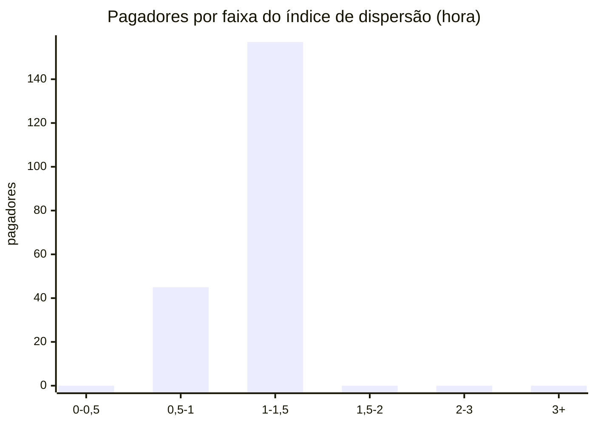
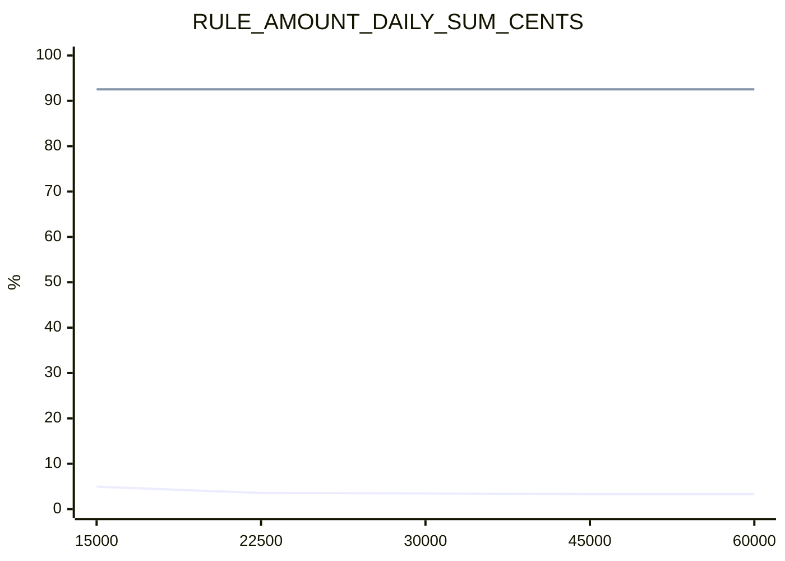
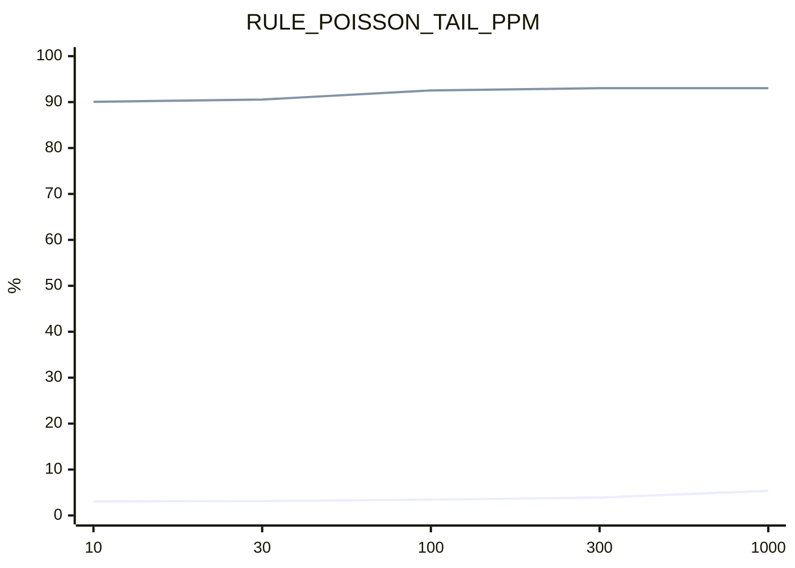
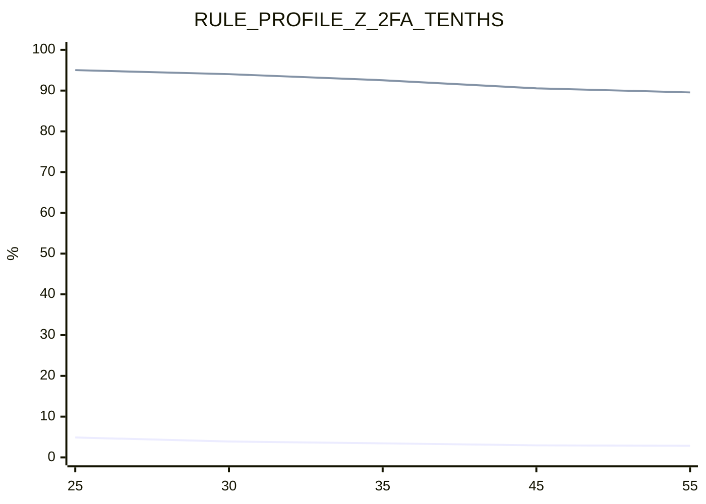

# Análises estatísticas

> [Índice](../README.md) › Motor › Análises
>
> **Responde a:** o valor do Pix por pagador é log-normal (vale o z robusto)? as contagens são Poisson ou super-dispersas (vale a Poisson–Gamma)? as features derivam entre janelas? o quanto cada limiar mexe em fricção e em fraude barrada?

**Aviso: os dados são sintéticos.** Vêm do simulador ([ADR 0020](../02-arquitetura/decisoes/0020-simulador-para-calibracao.md)), que sorteia valores log-normais e chegadas Poisson; confirmar essas formas nele é verificar a consistência do motor com o gerador, não a realidade do Pix. Os números provam o método e a sensibilidade dos parâmetros; com dado real, a mesma rotina deve ser rerodada.

Gerado por `make analyze` ([scripts/analyze.py](../../scripts/analyze.py)), sem API e sem banco: 7995 Pix de treino (seed 42, 300 pagadores, 14 dias) e 7102 Pix de teste perturbado (seed 7). Pagadores com menos de 10 Pix ficam fora das análises 1 e 2.

## 1. `log(amount)` por pagador

**Medido.** Só Pix legítimos de 202 pagadores com ao menos 10 Pix (7274 Pix; 299 pagadores no total). Para cada um, assimetria e curtose em excesso de `log(amount)`; depois o QQ: os valores viram z-score dentro do pagador (média e desvio, e também mediana e MAD×1,4826, a escala da regra) e seus quantis são lidos contra os da normal.

| Medida | Valor |
|---|---|
| Assimetria mediana | 0,13 |
| Curtose em excesso mediana | -0,27 |
| Pagadores com \|assimetria\| < 0,5 | 143 de 202 (70,8%) |

QQ agregado (z dentro do pagador):

| Quantil | Normal teórico | Empírico (média/desvio) | Empírico (mediana/MAD) |
|---|---|---|---|
| 0,1 | -1,282 | -1,284 | -1,318 |
| 0,2 | -0,842 | -0,854 | -0,846 |
| 0,3 | -0,524 | -0,540 | -0,549 |
| 0,4 | -0,253 | -0,261 | -0,239 |
| 0,5 | 0,000 | -0,020 | 0,000 |
| 0,6 | 0,253 | 0,239 | 0,221 |
| 0,7 | 0,524 | 0,506 | 0,528 |
| 0,8 | 0,842 | 0,823 | 0,812 |
| 0,9 | 1,282 | 1,291 | 1,313 |

**Conclusão.** 70,8% dos pagadores têm `log(amount)` aproximadamente simétrico e o QQ fica a no máximo 0,02 da normal em z: o dado justifica o z robusto sobre `log(amount)` da regra `PROFILE_AMOUNT_ROBUST_Z`. Com poucos Pix por pagador a assimetria amostral é ruidosa; a mediana/MAD segue sem distorcer com um valor extremo no histórico, que é o caso que a regra precisa detectar.

## 2. Dispersão das contagens

**Medido.** Contagem de Pix legítimos por pagador (202 pagadores) em cada hora e em cada dia da janela, com zeros incluídos. Índice de dispersão = variância / média (1 para Poisson, > 1 para super-dispersão, que é o que a binomial negativa modela). A coluna de referência repete o cálculo com contagens Poisson sorteadas com a mesma média de cada pagador (seed 42), para mostrar quanto de ruído amostral cabe acima de 1,5 sem super-dispersão real.

| Janela | Intervalos | Média por intervalo | Índice mediano | Índice p90 | Pagadores com índice > 1,5 | Referência Poisson com índice > 1,5 |
|---|---|---|---|---|---|---|
| por hora | 327 | 0,110 | 1,09 | 1,25 | 0 de 202 (0,0%) | 0 de 202 (0,0%) |
| por dia | 14 | 2,572 | 0,92 | 1,38 | 13 de 202 (6,4%) | 11 de 202 (5,4%) |

Distribuição do índice por hora (nº de pagadores):

**Conclusão.** Índice mediano 1,09 por hora e 0,92 por dia; 0,0% (hora) e 6,4% (dia) dos pagadores passam de 1,5, contra 0,0% e 5,4% na referência Poisson. Neste dado, a super-dispersão intra-pagador não passa do ruído de Poisson; a Poisson simples descreve cada pagador, e a Poisson–Gamma continua útil porque a taxa de cada pagador é incerta (prior + pouco histórico), o que dá cauda mais larga na preditiva.

## 3. PSI entre janelas

**Medido.** Population Stability Index de cada feature de `FEATURE_NAMES`, com 10 bins por quantil da amostra-base (bins repetidos por valores discretos são fundidos; o PSI usa piso de 0,0001 por bin). Leitura: < 0,1 estável, 0,1 a 0,25 atenção, > 0,25 drift. Três comparações: (a) primeira × segunda metade do período, só legítimos (3897 × 3897 Pix), a deriva natural; (b) treino × teste perturbado, todos os Pix (7995 × 7102); (c) o mesmo, só Pix de fraude (201 × 182), onde a perturbação (`--fraud-variant perturbed`) age.

| Feature | PSI metade × metade (legítimos) | Leitura | PSI treino × perturbado (todos) | PSI treino × perturbado (fraude) | Leitura (fraude) |
|---|---|---|---|---|---|
| hours_since_first_seen | 6,117 | drift | 0,004 | 1,189 | drift |
| source_attempts_poisson_lookback | 1,934 | drift | 0,007 | 0,173 | atenção |
| source_history_size | 1,897 | drift | 0,007 | 0,034 | estável |
| history_30d_size | 1,877 | drift | 0,006 | 0,032 | estável |
| amount_robust_z | 0,416 | drift | 0,003 | 0,357 | drift |
| source_new_destinations_last_24h | 0,287 | drift | 0,001 | 0,145 | atenção |
| poisson_tail_log10 | 0,272 | drift | 0,014 | 0,364 | drift |
| history_30d_median_cents | 0,167 | atenção | 0,041 | 0,376 | drift |
| km_since_last_geolocation | 0,109 | atenção | 0,002 | 0,157 | atenção |
| speed_kmh_since_last_geolocation | 0,062 | estável | 0,004 | 0,103 | atenção |
| source_sum_last_24h_cents | 0,027 | estável | 0,009 | 0,144 | atenção |
| source_small_attempts_last_24h | 0,026 | estável | 0,004 | 0,196 | atenção |
| local_hour | 0,014 | estável | 0,003 | 0,526 | drift |
| destination_age_days | 0,008 | estável | 0,043 | 0,174 | atenção |
| weekday | 0,006 | estável | 0,003 | 0,288 | drift |
| source_age_days | 0,005 | estável | 0,068 | 0,342 | drift |
| amount | 0,004 | estável | 0,008 | 0,496 | drift |
| log_amount | 0,004 | estável | 0,008 | 0,496 | drift |
| source_attempts_last_velocity_window | 0,000 | estável | 0,000 | 0,077 | estável |
| source_attempts_poisson_window | 0,000 | estável | 0,000 | 0,246 | atenção |
| is_legal_entity_source | 0,000 | estável | 0,001 | 0,000 | estável |
| is_self_transfer | 0,000 | estável | 0,000 | 0,000 | estável |
| has_geolocation | 0,000 | estável | 0,000 | 0,000 | estável |
| device_seen_for_source | 0,000 | estável | 0,000 | 0,000 | estável |
| destination_seen_for_source | 0,000 | estável | 0,000 | 0,000 | estável |
| device_distinct_other_sources_last_24h | 0,000 | estável | 0,000 | 0,078 | estável |
| destination_distinct_other_sources_last_1h | 0,000 | estável | 0,003 | 1,245 | drift |
| destination_used_before | 0,000 | estável | 0,000 | 0,000 | estável |
| destination_rejected_by_others_last_window | 0,000 | estável | 0,004 | 0,944 | drift |
| destination_graph_risk | 0,000 | estável | 0,000 | 0,000 | estável |
| destination_graph_risk_age_minutes | 0,000 | estável | 0,000 | 0,000 | estável |

**Conclusão.** Entre as metades do período, 9 de 31 features passam de 0,1 (source_history_size, source_attempts_poisson_lookback, source_new_destinations_last_24h, history_30d_size, history_30d_median_cents, amount_robust_z, hours_since_first_seen, km_since_last_geolocation, poisson_tail_log10), todas efeito de aquecimento do histórico em memória (o histórico cresce com o tempo), não de mudança de comportamento. Treino × perturbado: 0 features em drift considerando todos os Pix (a fraude é minoria) e 11 considerando só a fraude (amount, log_amount, local_hour, weekday, source_age_days, destination_distinct_other_sources_last_1h, destination_rejected_by_others_last_window, history_30d_median_cents, amount_robust_z, hours_since_first_seen, poisson_tail_log10). O PSI isola a perturbação nas features de fraude e serve de alarme para recalibrar ou retreinar os modelos em shadow.

## 4. Sensibilidade de limiar

**Medido.** Backtest em lote com `--set`, um parâmetro por vez, os demais nos padrões, sobre os Pix de treino. Em legítimos: % aprovado / 2FA / reprovado (fricção). Em fraude: % de Pix barrados (2FA ou reprovação). Padrão de cada parâmetro marcado com `*`. Linha de base: legítimos 96,55% aprovados, fraude barrada 92,54% (201 Pix de fraude).

### `RULE_AMOUNT_DAILY_SUM_CENTS`

| Valor | Legítimos aprovados % | Legítimos 2FA % | Legítimos reprovados % | Fraude barrada % |
|---|---|---|---|---|
| R$ 15.000 | 95,06 | 4,94 | 0,00 | 92,54 |
| R$ 22.500 | 96,45 | 3,55 | 0,00 | 92,54 |
| R$ 30.000* | 96,55 | 3,45 | 0,00 | 92,54 |
| R$ 45.000 | 96,69 | 3,31 | 0,00 | 92,54 |
| R$ 60.000 | 96,69 | 3,31 | 0,00 | 92,54 |

Linhas: fricção em legítimos (100 − aprovados) e fraude barrada, em %. Eixo x em reais.

Amplitude ao varrer o parâmetro: 1,63 p.p. de fricção e 0,00 p.p. de fraude barrada.

### `RULE_POISSON_TAIL_PPM`

| Valor | Legítimos aprovados % | Legítimos 2FA % | Legítimos reprovados % | Fraude barrada % |
|---|---|---|---|---|
| 10 | 96,93 | 3,07 | 0,00 | 90,05 |
| 30 | 96,86 | 3,14 | 0,00 | 90,55 |
| 100* | 96,55 | 3,45 | 0,00 | 92,54 |
| 300 | 96,10 | 3,90 | 0,00 | 93,03 |
| 1000 | 94,64 | 5,36 | 0,00 | 93,03 |

Linhas: fricção em legítimos (100 − aprovados) e fraude barrada, em %.

Amplitude ao varrer o parâmetro: 2,30 p.p. de fricção e 2,99 p.p. de fraude barrada.

### `RULE_PROFILE_Z_2FA_TENTHS`

| Valor | Legítimos aprovados % | Legítimos 2FA % | Legítimos reprovados % | Fraude barrada % |
|---|---|---|---|---|
| 25 | 95,12 | 4,88 | 0,00 | 95,02 |
| 30 | 96,10 | 3,90 | 0,00 | 94,03 |
| 35* | 96,55 | 3,45 | 0,00 | 92,54 |
| 45 | 97,05 | 2,95 | 0,00 | 90,55 |
| 55 | 97,15 | 2,85 | 0,00 | 89,55 |

Linhas: fricção em legítimos (100 − aprovados) e fraude barrada, em %.

Amplitude ao varrer o parâmetro: 2,03 p.p. de fricção e 5,47 p.p. de fraude barrada.

**Conclusão.** `RULE_PROFILE_Z_2FA_TENTHS` é o parâmetro mais sensível (2,03 p.p. de fricção, 5,47 p.p. de fraude) e `RULE_AMOUNT_DAILY_SUM_CENTS` o menos sensível (1,63 e 0,00 p.p.) na faixa varrida. Onde a fraude barrada não muda com a fricção, o limiar está num platô e a escolha é por custo de falso positivo; onde as duas curvas sobem juntas, há troca real. Os padrões em uso foram escolhidos na [calibração](calibracao.md); esta tabela só mede o entorno deles, com o mesmo conjunto sintético.
