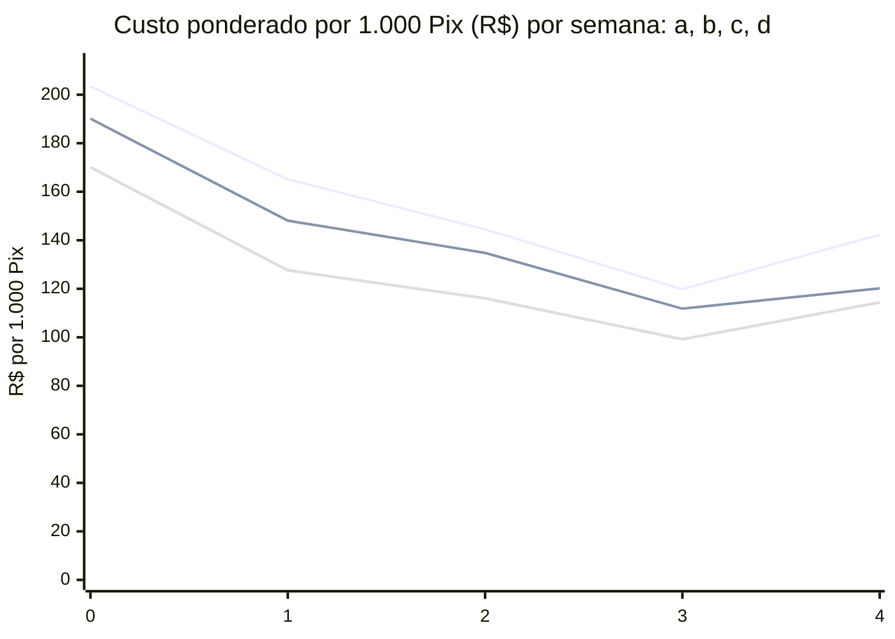
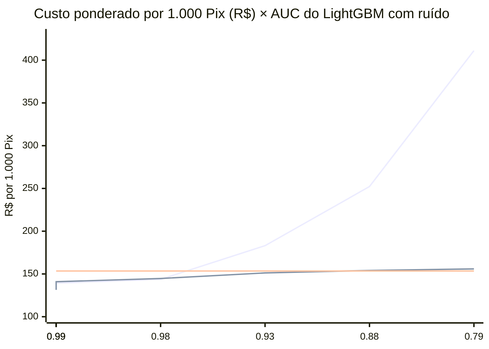

# Validação externa no PixSim

> [Índice](../README.md) › Motor › Validação no PixSim
>
> **Responde a:** o motor, calibrado só com o nosso simulador, continua útil em fraudes que nós não desenhamos? quais regras se mantêm e quais caem? os modelos treinados no nosso gerador generalizam? quão diferentes são as distribuições das features?

**Aviso: continua sendo dado sintético.** O PixSim não é Pix real; ele é de terceiros, com tipologias que não desenhamos. É a validação externa possível no prazo, não uma medida de desempenho em produção.

Regerar: `make pixsim` (clone, venv e mundo reduzido) e `make validate-pixsim` (adaptador, backtest e as tabelas abaixo). A paridade com a API roda em `make pixsim-parity`.

## O que é o PixSim

Zeimarani, B.; Khatib, A.; Mousavinasr, S.; Figueiredo, C. M. S. (2026). *PixSim: a calibrated open-source simulator of instant-payment fraud, recovery and interdiction under analyst capacity constraints*. Repositório [BashirZeimarani/pixsim_public](https://github.com/BashirZeimarani/pixsim_public), licença Apache-2.0, usado no commit `7fdfc90013960f46df60c3ea01838e768e7a420a`. Calibrado com dados abertos do Banco Central, gera contas (PF e PJ, região, faixa etária, idade da conta), tráfego legítimo (Poisson não homogêneo por conta), quatro tipologias de fraude do lado do pagador (engenharia social, conta tomada, Pix errado e QR adulterado) e cadeias de dispersão por mulas até contas de saída, com atraso de reporte ao MED. A parte de política de analistas, bloqueios e recuperação pelo MED do artigo **não** foi usada: só a geração de transações.

**Código de terceiro, tratado como não confiável.** Antes de executar li `README.md`, `environment.yml`, `requirements.txt`, `pixsim/__init__.py` e os módulos chamados (`config.py`, `experiment.py`, `runner.py`, `population.py`, `traffic.py`, `fraud.py`), mais `scripts/demo.py` e `configs/baseline.yaml`. Não rodei os testes, os notebooks nem scripts de instalação dele. As dependências pinadas do `requirements.txt` dele foram instaladas com `uv` num venv próprio (`scripts/out/pixsim/.venv`, Python 3.13.5; o artigo usou 3.13.13), nunca no `.venv` do projeto, sem privilégio. O código gerador roda com `python -I` e `ulimit -v`. Tudo fica em `scripts/out/pixsim/`, fora do Git.

## Escala usada e por que é reduzida

| Item | Valor |
|---|---|
| Contas | 5.025 (5.000 mais 25 contas de saída do PixSim) |
| Janela avaliada | 30 dias (seed 20260910) |
| Burn-in | 30 dias antes do dia 0, 122.967 Pix legítimos, enviados ao motor como histórico (`burn_in: true`) e excluídos das métricas |
| Pix totais | 254.795 (125.518 legítimos avaliados) |
| Eventos de fraude | 986: 618 engenharia social, 209 conta tomada, 91 Pix errado, 68 QR adulterado |
| Pix de fraude | 6.310: 1.380 pagador→mula, 91 sementes de Pix errado, 1.771 `mule_forward`, 3.068 `cash_out` |

O artigo roda 1,08 milhão de contas (19 GB por parte); a máquina de desenvolvimento tem cerca de 2 GB livres. O `scripts/backtest.py` agora lê o `events.jsonl` em streaming e agrega as métricas aos poucos: o pico neste mundo caiu de 2,07 GB para 0,52 GB (saída idêntica). Duas escolhas fora do `baseline.yaml` do PixSim: burn-in de 30 dias (o config traz 90; 30 dias cobre a maior janela do motor) e 1.000 eventos de fraude por mês no lugar dos 2.000, que foram calibrados para 100 mil contas. A fraude é superamostrada de propósito, e cada Pix de fraude carrega o peso de importância do PixSim (0,0071 aqui); os custos "ponderados" abaixo usam esse peso.

## O que foi mapeado, inventado e não existe

| Campo do contrato | Origem |
|---|---|
| `amount` | Valor em R$ do PixSim para centavos inteiros, arredondamento meio para cima (`Decimal`); mínimo 1 centavo |
| `transaction_date` | Início fixo 2026-09-01T00:00-03:00 mais `t` (segundos do PixSim); o burn-in tem `t` negativo |
| `source_account` e `destination_account` | **Inventados**: agência, conta e ISPB determinísticos a partir do `account_id`; `opening_date` é a do PixSim deslocada para a mesma origem de tempo, preservando a idade da conta |
| `owner.document_number` | **Inventado**: CPF (PF) ou CNPJ (PJ) sintético com dígitos verificadores válidos, derivado do `account_id` por um mapa bijetor (sem colisão, sem documento real) |
| `source.device_id` | O dispositivo do PixSim |
| `source.channel` | `mobile`→`app`, `internet`→`internet_banking`; nas saídas da dispersão, `crypto_exit`, `cash_withdrawal`, `merchant_purchase` |
| `source.ip` | **Inventado**: derivado do hash do dispositivo, faixa 198.18.0.0/15 |
| `source.geolocation` | **Não existe** no PixSim: o campo (opcional) fica ausente, então as regras e features de geolocalização ficam inertes |

Extras no `events.jsonl` (não vão ao motor): `typology` (tipo de fraude do PixSim ou `legit`), `role` (`none`, `victim_to_mule`, `fraudster_seed`, `mule_forward`, `cash_out`), `burn_in`, `weight`, `ring_id`, `report_delay_days` e `reported` (atraso de reporte ao MED do evento). Os 254.795 payloads passam no JSON Schema do enunciado: **0 inválidos**.

**Perspectiva.** O motor vê todos os Pix, mas a leitura é a da instituição pagadora. "Pagador→mula" (`victim_to_mule`) é a fraude contra o nosso cliente e é o que o motor deve barrar. A dispersão (`mule_forward`, `cash_out`) e a semente do Pix errado só chegariam ao motor se a mula fosse cliente do mesmo banco; por isso entram numa visão separada e não somam na captura principal.

<!-- pixsim:tables:start -->

### Tamanho avaliado

| Conjunto | Pix totais | Burn-in (histórico) | Legítimos avaliados | Fraude pagador→mula | Fraude dispersão |
|---|---|---|---|---|---|
| PixSim | 254795 | 122967 | 125518 | 1380 | 4930 |
| Fixture do CI, sem valor estatístico (seed 42) | 7995 | 0 | 7794 | 201 | n/a |

### Fricção em legítimos

| Conjunto | Legítimos | approved | 2FA | rejected |
|---|---|---|---|---|
| PixSim | 125518 | 96,18% | 3,81% | 0,01% |
| Fixture do CI, sem valor estatístico | 7794 | 94,01% | 5,99% | 0,00% |

### Captura por tipologia do PixSim

Pagador→mula é o Pix que a vítima faz (a fraude contra o nosso cliente). `fraudster_seed` é o Pix semente do golpe do Pix errado, enviado pelo fraudador à vítima. Dispersão (`mule_forward`, `cash_out`) é a mula movendo o dinheiro: o nosso motor só a veria se a mula fosse cliente do mesmo banco.

| Tipologia | Papel | Pix | approved (escapou) | 2FA | rejected |
|---|---|---|---|---|---|
| account_takeover | cash_out | 663 | 69,08% | 30,92% | 0,00% |
| account_takeover | mule_forward | 440 | 75,23% | 24,77% | 0,00% |
| account_takeover | victim_to_mule | 323 | 22,60% | 73,07% | 4,33% |
| pix_errado | cash_out | 215 | 79,53% | 20,47% | 0,00% |
| pix_errado | fraudster_seed | 91 | 91,21% | 8,79% | 0,00% |
| pix_errado | mule_forward | 118 | 86,44% | 13,56% | 0,00% |
| pix_errado | victim_to_mule | 91 | 87,91% | 12,09% | 0,00% |
| qr_substitution | cash_out | 152 | 78,95% | 21,05% | 0,00% |
| qr_substitution | mule_forward | 88 | 86,36% | 13,64% | 0,00% |
| qr_substitution | victim_to_mule | 68 | 70,59% | 29,41% | 0,00% |
| social_engineering | cash_out | 2038 | 64,13% | 35,23% | 0,64% |
| social_engineering | mule_forward | 1125 | 72,09% | 27,11% | 0,80% |
| social_engineering | victim_to_mule | 898 | 51,89% | 48,11% | 0,00% |

### Sequências e anéis

| Tipologia (eventos de fraude) | Eventos com ao menos um Pix de vítima barrado | Taxa |
|---|---|---|
| account_takeover | 206/209 | 98,6% |
| pix_errado | 11/91 | 12,1% |
| qr_substitution | 20/68 | 29,4% |
| social_engineering | 354/618 | 57,3% |

- Eventos com ao menos um Pix barrado em qualquer papel (vítima ou dispersão): 766/986 (77,7%).
- Anéis de mulas com ao menos um Pix barrado (qualquer papel): 75/75 (100,0%).

- Atraso de reporte ao MED nos eventos: mediana 2,06 dia(s), p90 19,8 dias; 98,2% reportados dentro da janela de contestação.

### Custo esperado (V1)

Modelo de [`scripts/cost-model.json`](../../scripts/cost-model.json). "Bruto" usa a fração de fraude da amostra; "ponderado" multiplica a fraude pelo peso de importância do PixSim (a amostra tem fraude superamostrada), aproximando a taxa real.

| Visão | Bruto por 1.000 Pix | Ponderado por 1.000 Pix | Parte fraude (pond.) | Parte fricção (pond.) |
|---|---|---|---|---|
| PixSim, visão pagador (legítimo + pagador→mula) | R$ 6.970,02 | R$ 132,13 | R$ 49,57 | R$ 82,56 |
| PixSim, visão dispersão (legítimo + dispersão) | R$ 19.969,36 | R$ 229,65 | R$ 147,11 | R$ 82,55 |
| Fixture do CI, sem valor estatístico | R$ 2.200,88 | R$ 2.200,88 | R$ 2.084,05 | R$ 116,82 |

Peso médio de importância da fraude no PixSim: 0,0071 (um evento de fraude vale 0,0071 de um real).

### P@k diário (V1)

Média diária da precisão nos k Pix mais bem ranqueados (fraude superamostrada: a precisão é inflada na mesma proporção do peso). As linhas "regras + LightGBM" usam o LightGBM treinado no próprio mundo A: são otimistas; o resultado fora da amostra (mundo B) está em "Modelos treinados no PixSim".

| Conjunto, ranking | P@5 | P@10 | P@25 | P@50 |
|---|---|---|---|---|
| PixSim, visão pagador, regras | 11,3% | 11,3% | 18,7% | 21,4% |
| PixSim, visão pagador, regras + LightGBM (dentro da amostra) | 90,0% | 94,3% | 87,6% | 71,2% |
| PixSim, visão dispersão, regras | 18,1% | 17,4% | 25,9% | 29,5% |
| PixSim, visão dispersão, regras + LightGBM (dentro da amostra) | 74,8% | 68,7% | 52,9% | 41,9% |
| Fixture do CI, sem valor estatístico, regras | 71,4% | 62,1% | 34,6% | 25,0% |
| Fixture do CI, sem valor estatístico, regras + LightGBM (treinado no PixSim A, aplicado ao fixture) | 72,9% | 64,3% | 33,4% | 19,7% |

### Regras que disparam

Parcela de cada grupo em que a regra disparou (qualquer decisão).

| Regra | PixSim legítimo | PixSim pagador→mula | PixSim dispersão | Fixture do CI legítimo | Fixture do CI fraude |
|---|---|---|---|---|---|
| COUNTERPARTY_FIRST_TIME_HIGH | 1,2% | 33,0% | 9,4% | 4,2% | 54,7% |
| PROFILE_NEW_DEVICE | 0,0% | 14,9% | 0,0% | 1,0% | 21,9% |
| VELOCITY_POISSON_GAMMA | 0,1% | 6,4% | 12,9% | 0,1% | 14,9% |
| LIMIT_NIGHT_AMOUNT | 0,6% | 5,0% | 3,4% | 0,7% | 26,9% |
| COUNTERPARTY_FLAGGED | 0,6% | 1,7% | 7,1% | 0,0% | 34,8% |
| PROFILE_AMOUNT_ROBUST_Z | 0,1% | 1,3% | 0,7% | 0,3% | 21,4% |
| COUNTERPARTY_NEW_ACCOUNT | 1,2% | 0,0% | 1,0% | 0,0% | 52,2% |
| TYPOLOGY_ACCOUNT_TAKEOVER | 0,0% | 1,0% | 0,0% | 0,0% | 8,5% |
| AMOUNT_SOURCE_DAILY_SUM | 0,4% | 0,1% | 0,0% | 0,0% | 0,0% |
| LIMIT_SINGLE_AMOUNT | 0,0% | 0,1% | 0,0% | 0,0% | 0,0% |
| PROFILE_NEW_SOURCE_ACCOUNT | 0,0% | 0,1% | 0,0% | 0,0% | 0,0% |
| TYPOLOGY_SPLITTING | 0,0% | 0,0% | 0,4% | 0,0% | 0,0% |
| VELOCITY_SOURCE_COUNT | 0,0% | 0,0% | 1,2% | 0,0% | 0,0% |
| TYPOLOGY_MULE | 0,0% | 0,0% | 0,0% | 0,0% | 24,4% |
| VELOCITY_DEVICE_SOURCES | 0,0% | 0,0% | 0,0% | 0,0% | 8,0% |
| COUNTERPARTY_FAN_IN | 0,0% | 0,0% | 0,0% | 0,0% | 2,5% |
| PROFILE_GEO_VELOCITY | 0,0% | 0,0% | 0,0% | 0,0% | 1,0% |

### Modelos em shadow instalados (logística e LightGBM treinados no mundo A do PixSim; Isolation Forest do nosso simulador)

AUC é pontuação do modelo na fraude contra o legítimo; recall e fricção usam o limiar do próprio modelo. A logística e o LightGBM foram treinados neste mesmo mundo A, então as colunas do PixSim aqui são **dentro da amostra** (otimistas) para eles; o Isolation Forest instalado vem do nosso simulador, então é fora da distribuição; o teste fora da amostra, no mundo B, está em "Modelos treinados no PixSim". As colunas "Nosso" aplicam os modelos instalados ao fixture do CI, sem valor estatístico.

| Modelo | PixSim AUC pagador | PixSim recall pagador | PixSim AUC dispersão | PixSim fricção legítimo | Nosso AUC | Nosso recall | Nossa fricção |
|---|---|---|---|---|---|---|---|
| MODEL_IFOREST | 0,797 | 37,0% | 0,500 | 8,0% | 0,892 | 22,9% | 1,0% |
| MODEL_LIGHTGBM | 0,996 | 81,4% | 0,818 | 0,3% | 0,596 | 10,0% | 2,6% |
| MODEL_LOGREG | 0,990 | 63,6% | 0,902 | 0,8% | 0,871 | 52,7% | 3,6% |
| regras (decisão como score) | 0,739 |  | 0,630 |  | 0,977 |  |  |

### PSI das features (nosso gerador × PixSim)

Base: nosso simulador (seed 42); comparado: PixSim. PSI acima de 0,25 é deriva forte, entre 0,1 e 0,25 atenção. Features constantes nos dois lados ficam de fora.

| Feature | PSI (todos os Pix) | PSI (Pix de fraude pagador→mula) |
|---|---|---|
| speed_kmh_since_last_geolocation | 8,282 | 8,198 |
| km_since_last_geolocation | 8,282 | 8,198 |
| hours_since_first_seen | 5,329 | 8,293 |
| history_30d_median_cents | 2,117 | 4,066 |
| source_history_size | 1,996 | 4,204 |
| history_30d_size | 1,350 | 3,079 |
| source_attempts_poisson_lookback | 1,348 | 3,265 |
| source_age_days | 0,871 | 0,808 |
| amount | 0,738 | 0,589 |
| log_amount | 0,738 | 0,589 |
| destination_distinct_other_sources_last_1h | 0,425 | 2,040 |
| destination_age_days | 0,377 | 4,393 |
| source_sum_last_24h_cents | 0,350 | 0,237 |
| poisson_tail_log10 | 0,279 | 0,203 |
| amount_robust_z | 0,239 | 2,920 |

### Latência do backtest

- `scripts/backtest.py`: 254795 Pix em 102,3 s (2490 Pix/s).
- Avaliação em streaming deste relatório (motor + histórico em memória, sem HTTP): 254795 Pix, 2689 Pix/s; por Pix P50 0,33 ms, P95 0,61 ms, P99 0,85 ms.

<!-- pixsim:tables:end -->

## O que se mantém e o que cai

- **Se mantém.** Fricção em legítimos: 3,81% de 2FA e 0,01% de reprovação no PixSim (a coluna do fixture do CI, sem valor estatístico, mostra 5,99% e 0,00%; ver a tabela de fricção). As regras de perfil e de contraparte continuam raras em legítimos (cada uma abaixo de 1,3%). Conta tomada continua sendo a tipologia mais barrada: 77,4% dos Pix de vítima viram 2FA (73,1%) ou reprovação (4,3%) e 206 dos 209 eventos (98,6%) têm ao menos um Pix barrado. No conjunto das vítimas, as regras que mais disparam são `COUNTERPARTY_FIRST_TIME_HIGH` (33,0%), `PROFILE_NEW_DEVICE` (14,9%) e a Poisson–Gamma (6,4%).
- **Cai.** A captura global de Pix de vítima fica em 51,7% (fixture do CI: 98,5%, circular por construção), e só 1,7% do valor das vítimas é reprovado (fixture: 50,1%); 27,7% do valor da vítima passa aprovado e 70,6% cai em 2FA, que a vítima coagida pode confirmar. `COUNTERPARTY_NEW_ACCOUNT`, a regra que mais pega no fixture (52% da fraude), não dispara em Pix de vítima no PixSim (0,0%): as mulas do PixSim são contas com idade comum, não contas recém-abertas. `TYPOLOGY_MULE` e `COUNTERPARTY_FAN_IN` também ficam em zero, provavelmente porque as vítimas do PixSim chegam à mesma mula espalhadas no tempo, e não em rajada como no fixture (hipótese: não medi a distribuição temporal). Pix errado (11 de 91 eventos barrados, 12,1%) e QR adulterado (20 de 68, 29,4%) escapam quase todos: o Pix da vítima parece um pagamento comum (hipótese; não separei por valor).
- **Engenharia social** (618 dos 986 eventos) é barrada em 48,1% dos Pix de vítima e em 57,3% dos eventos: o golpe é a própria vítima pagando, com valores dentro do perfil dela.
- **Anéis.** Todos os 75 anéis de mulas têm ao menos um Pix barrado em algum papel (vítima ou dispersão); a parte da dispersão só ajuda se a mula for cliente do banco.

## Peer group

`PROFILE_PEER_AMOUNT` (decide 2FA) compara o valor de um pagador **sem perfil próprio** (menos de 5 Pix em 30 dias) com os Pix não reprovados de outros pagadores do mesmo grupo (PF/PJ × idade da conta: < 30 dias, 30–365, > 365; até 500 valores, mínimo 50), z robusto de log(valor) acima de 3,5. Medida com `RULE_PEER_MIN_SAMPLE` inviável (antes) contra o padrão (depois), no mundo B do PixSim (seed 20261017, visão vítima) e no nosso simulador (seed 42).

| Conjunto | Fricção legítimo (2FA / reprovado) | Vítima aprovada / 2FA / reprovada | Custo ponderado por 1.000 Pix | Disparos da regra |
|---|---|---|---|---|
| PixSim B, antes | 3,74% / 0,03% | 886 / 536 / 16 | R$ 157,60 | 0 |
| PixSim B, depois | 3,74% / 0,03% | 886 / 536 / 16 | R$ 157,60 | 1 (dispersão) |
| Nosso simulador, antes | 3,45% / 0,00% | 15 / 86 / 100 | R$ 3.299,23 | 0 |
| Nosso simulador, depois | 3,45% / 0,00% | 15 / 86 / 100 | R$ 3.299,23 | 0 |

A captura por tipologia não muda em nenhum dos dois. **Decisão: medida e descartada** ([ADR 0028](../02-arquitetura/decisoes/0028-peer-group-medido-e-descartado.md)). A regra não piora o custo, mas o efeito medido é nulo: só 12 dos 1.438 Pix de vítima do mundo B (0,8%) vêm de pagador sem perfil, e o z mediano deles é 1,7, abaixo do corte de 3,5. Seria uma rede de segurança para pagador novo, não um ganho de captura demonstrado, e o custo de latência não se paga. Latência: o backtest em memória não muda (1.960 contra 1.957 Pix/s no mundo B; 2.642 contra 2.559 no nosso simulador). Pela API, com 300 mil Pix em 30 dias, a consulta de pares leva 8,7 ms num grupo cheio (índice `pix_transaction_date_idx`, varredura reversa que para no LIMIT; sem o índice, 371 ms) e cerca de 94 ms num grupo vazio, que obriga a percorrer a janela inteira; o Pix de pagador novo custou em média 59 ms contra 50 ms do pagador com histórico, e 144 ms para conta jovem (grupo vazio).

## Modelos em shadow: teste fora da distribuição

Primeira rodada, antes de treinar no PixSim: os três modelos (regressão logística, LightGBM, Isolation Forest) foram **treinados no nosso simulador** e testados no mundo B do PixSim. É a coluna "nosso → PixSim B" das tabelas de [Modelos treinados no PixSim](#modelos-treinados-no-pixsim). O AUC contra legítimos cai de 0,990 para 0,580 (LightGBM), de 0,978 para 0,770 (logística) e de 0,866 para 0,788 (Isolation Forest); o recall no limiar do próprio modelo é 27,5% no LightGBM, com 7,3% de fricção em legítimos. É o esperado de um modelo que aprendeu os sinais do nosso gerador (conta de destino nova, geolocalização) e não os do PixSim. Hoje `logreg.json` e `lightgbm.json` (e `graphsage.json` no worker) são os treinados no mundo A do PixSim (AUC 0,990 e 0,990 no mundo B, mesmo gerador); `iforest.json` continua o treinado no nosso simulador, porque a versão do PixSim (AUC 0,846) não atendeu ao critério de troca. O resumo do artigo cita um *synthetic scorer* de 0,82 AUC, que não é comparável a estes números: vem de um desenho diferente (escala cheia, scorer ajustado no aquecimento e avaliado na janela seguinte do mesmo mundo, com as features do PixSim), e não do nosso A→B. A diferença não se explica por ruído: o ruído de score do PixSim só existe no experimento de sensibilidade S7 e não está no scorer padrão (ver [Sensibilidade à qualidade do scorer](#sensibilidade-à-qualidade-do-scorer)). O AUC das regras, usando a decisão como score, é 0,673 no mundo B, abaixo da logística e do Isolation Forest treinados no PixSim, o que indica ganho de ordenação com um modelo treinado nele.

## Modelos treinados no PixSim

Regerar: `make pixsim` com `PIXSIM_SEED=20261017 PIXSIM_OUT=scripts/out/pixsim/data-b` (mundo B, 5.025 contas, 30 dias, mesma escala do A), `scripts/pixsim_adapter.py --data ... --out scripts/out/pixsim/events-b.jsonl`, `scripts/export_features.py` sobre os dois mundos, `scripts/train_models.py --source pixsim` e `scripts/train_graphsage.py --source pixsim --epochs 100 --batch 256`. Mundo A = seed 20260910 (o das seções acima); mundo B = seed 20261017, 259.646 Pix (125.293 de burn-in), 986 eventos de fraude, 6.670 Pix de fraude, 1.438 de vítima.

**Linha de base destas tabelas.** As tabelas de modelos, de rótulos atrasados e de retroalimentação pelo MED foram geradas com as regras de antes da calibração e o custo antigo (R$ 50 fixos por legítimo reprovado): as regras sozinhas custam R$ 157,60 por 1.000 Pix e barram 38,4% dos Pix de vítima no mundo B. Com o conjunto `2026.10.18-pixsim` e o modelo de custo final, as regras sozinhas custam R$ 153,51 e barram 51,8% (ver [Contribuição de cada regra](#contribuição-de-cada-regra)). Compare decisores dentro de uma mesma tabela, não entre tabelas.

### Modelos do caminho quente (regressão logística, LightGBM, Isolation Forest)

<!-- pixsim:models:start -->

Treino no mundo A do PixSim (seed 20260910), teste no mundo B (seed 20261017) e no nosso simulador (seed 7). Mesmos hiperparâmetros fixos de `scripts/train_models.py`; fatia de ajuste = primeiros 75% do mundo A no tempo, validação = 25% finais (limiar por F1 máximo; Platt na validação). Linhas: 95173 de ajuste, 31725 de validação. Limiares: {"logreg": 0.1899, "lightgbm": 0.9404, "iforest": 0.5942}.

Positivo = Pix de vítima (`victim_to_mule`); legítimo = tráfego legítimo. A dispersão (`mule_forward`, `cash_out`) e a semente do Pix errado ficam fora do treino e da avaliação: o banco só a veria se a mula fosse cliente, e misturá-la como positivo ensinaria o modelo a pontuar o comportamento da mula, não o da vítima. Burn-in só alimenta o histórico. Custos e precisão usam o peso de importância do PixSim; AUC, recall e P@k são brutos.

| Conjunto | Pix avaliados | Legítimos | Fraude pagador→mula | Peso médio da fraude |
|---|---|---|---|---|
| PixSim A (treino) | 126898 | 125518 | 1380 | 0,0071 |
| PixSim B (teste) | 129121 | 127683 | 1438 | 0,0072 |
| Nosso simulador (seed 7, teste) | 7100 | 6920 | 180 | 1,0000 |

**AUC**

| decisor | nosso → PixSim B | PixSim A → PixSim B | PixSim A → nosso | nosso → nosso (referência) |
|---|---|---|---|---|
| logreg | 0,770 | 0,990 | 0,901 | 0,978 |
| lightgbm | 0,580 | 0,990 | 0,674 | 0,990 |
| iforest | 0,788 | 0,846 | 0,926 | 0,866 |
| rules | 0,673 | 0,673 | 0,896 | 0,896 |
| rules+lightgbm | 0,654 | 0,987 | 0,910 | 0,993 |

**Recall no limiar**

| decisor | nosso → PixSim B | PixSim A → PixSim B | PixSim A → nosso | nosso → nosso (referência) |
|---|---|---|---|---|
| logreg | 8,0% | 65,0% | 62,8% | 68,3% |
| lightgbm | 27,5% | 63,6% | 14,4% | 83,9% |
| iforest | 38,9% | 8,5% | 67,8% | 25,6% |
| rules | 38,4% | 38,4% | 81,1% | 81,1% |
| rules+lightgbm | 51,5% | 70,8% | 85,6% | 89,4% |

**Precisão ponderada**

| decisor | nosso → PixSim B | PixSim A → PixSim B | PixSim A → nosso | nosso → nosso (referência) |
|---|---|---|---|---|
| logreg | 0,1% | 0,6% | 28,3% | 93,2% |
| lightgbm | 0,0% | 1,1% | 14,2% | 95,0% |
| iforest | 0,0% | 0,1% | 34,0% | 39,7% |
| rules | 0,1% | 0,1% | 38,7% | 38,7% |
| rules+lightgbm | 0,0% | 0,1% | 30,6% | 40,7% |

**Fricção em legítimos**

| decisor | nosso → PixSim B | PixSim A → PixSim B | PixSim A → nosso | nosso → nosso (referência) |
|---|---|---|---|---|
| logreg | 0,8% | 0,8% | 4,1% | 0,1% |
| lightgbm | 7,3% | 0,5% | 2,3% | 0,1% |
| iforest | 8,9% | 1,4% | 3,4% | 1,0% |
| rules | 3,8% | 3,8% | 3,3% | 3,3% |
| rules+lightgbm | 10,3% | 4,1% | 5,0% | 3,4% |

**Custo ponderado por 1.000 Pix**

| decisor | nosso → PixSim B | PixSim A → PixSim B | PixSim A → nosso | nosso → nosso (referência) |
|---|---|---|---|---|
| logreg | R$ 156,12 | R$ 53,44 | R$ 24.872,61 | R$ 29.799,46 |
| lightgbm | R$ 254,61 | R$ 58,68 | R$ 50.786,57 | R$ 10.228,05 |
| iforest | R$ 253,11 | R$ 158,33 | R$ 15.725,87 | R$ 33.790,64 |
| rules | R$ 157,60 | R$ 157,60 | R$ 8.000,14 | R$ 8.000,14 |
| rules+lightgbm | R$ 274,15 | R$ 128,79 | R$ 6.720,78 | R$ 6.124,20 |

**P@k diário** (fraude superamostrada: a precisão do PixSim é inflada na proporção do peso)

| cenário | decisor | P@5 | P@10 | P@25 | P@50 |
|---|---|---|---|---|---|
| nosso → PixSim B | logreg | 11,3% | 12,3% | 11,6% | 9,3% |
| nosso → PixSim B | lightgbm | 27,3% | 16,0% | 7,2% | 3,7% |
| nosso → PixSim B | iforest | 6,0% | 6,7% | 9,9% | 8,0% |
| nosso → PixSim B | rules | 12,0% | 9,7% | 14,4% | 18,3% |
| nosso → PixSim B | rules+lightgbm | 30,0% | 18,7% | 9,1% | 4,7% |
| PixSim A → PixSim B | logreg | 88,7% | 83,3% | 67,2% | 52,6% |
| PixSim A → PixSim B | lightgbm | 100,0% | 97,7% | 80,1% | 59,7% |
| PixSim A → PixSim B | iforest | 2,7% | 3,0% | 5,6% | 6,3% |
| PixSim A → PixSim B | rules | 12,0% | 9,7% | 14,4% | 18,3% |
| PixSim A → PixSim B | rules+lightgbm | 80,7% | 85,7% | 76,8% | 58,9% |
| PixSim A → nosso | logreg | 52,9% | 46,4% | 30,6% | 19,3% |
| PixSim A → nosso | lightgbm | 21,4% | 15,7% | 11,4% | 7,7% |
| PixSim A → nosso | iforest | 57,1% | 48,6% | 33,4% | 20,3% |
| PixSim A → nosso | rules | 61,4% | 49,3% | 35,1% | 21,1% |
| PixSim A → nosso | rules+lightgbm | 55,7% | 47,9% | 31,4% | 18,3% |

**Captura por tipologia do PixSim em PixSim B** (Pix de vítima acima do limiar do modelo, ou fora de `approved` nas regras)

| tipologia | logreg (nosso) | lightgbm (nosso) | iforest (nosso) | logreg (PixSim A) | lightgbm (PixSim A) | iforest (PixSim A) | regras |
|---|---|---|---|---|---|---|---|
| account_takeover | 11,5% | 45,5% | 63,1% | 91,9% | 84,9% | 11,2% | 63,7% |
| pix_errado | 3,7% | 1,9% | 14,8% | 16,7% | 11,1% | 3,7% | 7,4% |
| qr_substitution | 2,5% | 10,0% | 15,0% | 28,7% | 25,0% | 2,5% | 11,2% |
| social_engineering | 7,4% | 23,6% | 33,1% | 60,7% | 61,7% | 8,2% | 32,9% |

**Captura por tipologia do nosso simulador (modelos do PixSim A)**

| tipologia | logreg | lightgbm | iforest | rules | rules+lightgbm |
|---|---|---|---|---|---|
| account_takeover | 43,8% | 6,2% | 43,8% | 100,0% | 100,0% |
| device_farm | 40,7% | 0,0% | 0,0% | 70,4% | 70,4% |
| mule | 62,7% | 0,0% | 84,0% | 100,0% | 100,0% |
| night_kidnapping | 66,7% | 0,0% | 33,3% | 100,0% | 100,0% |
| splitting | 78,6% | 44,6% | 89,3% | 53,6% | 67,9% |

<!-- pixsim:models:end -->

### GraphSAGE (nível de nó, offline)

<!-- pixsim:graphsage:start -->

Grafo pagador→destino em janelas de 72 h (passo de 24 h) só do período avaliado; o burn-in alimenta apenas o primeiro pagamento das arestas. Rótulo de nó = `is_mule` da conta no PixSim (rótulo do simulador de terceiros, não o nosso); mulas: 1366 no mundo A, 1321 no B. Arquitetura e taxa de aprendizado do GraphSAGE do nosso simulador; épocas e lote mudados (200 e 64 no nosso) para caber no prazo, o grafo do PixSim tem muito mais nós alvo (100 épocas, lr 0.01, lote 256, oculta 16); limiar 0.73864 (F1 máximo nos nós de treino, dentro da amostra). Treino em 404 s. Só entram como nó alvo as contas que recebem ao menos um Pix na janela.

| modelo | avaliado em | nós alvo | nós mula | AUC | precisão | recall | fricção em destinos legítimos |
|---|---|---|---|---|---|---|---|
| treinado no PixSim A | treino (dentro da amostra) | 80709 | 9143 | 0,912 | 0,777 | 0,754 | 2,8% |
| treinado no PixSim A | PixSim B | 82682 | 8688 | 0,919 | 0,786 | 0,787 | 2,5% |
| treinado no nosso simulador | PixSim B | 82682 | 8688 | 0,518 | 0,241 | 0,005 | 0,2% |

<!-- pixsim:graphsage:end -->

### Conclusão

- Treinados no PixSim A e testados no PixSim B, regressão logística e LightGBM sobem de AUC 0,77 e 0,58 (treino no nosso gerador) para 0,99; o LightGBM leva a captura de conta tomada a 85% e a de engenharia social a 62%, com 0,5% de fricção em legítimos. O custo ponderado por 1.000 Pix cai de R$ 157,60 (regras) para R$ 58,68 (LightGBM) e R$ 53,44 (logística).
- Isso é otimista: os mundos A e B vêm do mesmo gerador e da mesma configuração, só muda a seed. O teste mede generalização entre amostras do PixSim, não entre geradores; para o PixSim real ou para dados de banco o número não se transfere.
- Pix errado (11% a 17% de captura) e QR adulterado (25% a 29%) continuam difíceis: o Pix da vítima parece um pagamento comum. A precisão ponderada pelo peso de importância fica em torno de 1%: com a taxa de fraude real, a fila dos analistas seria quase toda de falso positivo.
- No sentido inverso (PixSim A → nosso simulador) o LightGBM cai a AUC 0,67 e 14% de recall, e as regras (0,90) ganham dos modelos. Os dois geradores ensinam sinais diferentes; nenhum dos modelos é "o" modelo, e o PixSim não substitui o nosso simulador como teste.
- O Isolation Forest treinado no PixSim melhora o AUC (0,85 contra 0,79), mas o limiar p99 só captura 8,5% da fraude e o P@k despenca; o critério de troca não foi atendido e o arquivo `iforest.json` continua o do simulador.
- GraphSAGE: AUC de nó 0,92 no mundo B (0,52 para o modelo treinado no nosso simulador), com precisão 0,79 e recall 0,79 no limiar. O rótulo `is_mule` é estático por conta e a janela contém os Pix sendo pontuados, então é um teto, não o desempenho do ciclo anterior que o caminho quente usaria.
- Trocados em `src/`: `logreg.json`, `lightgbm.json` e `graphsage.json` (`trained_on` com o SHA do PixSim e a seed; continuam em shadow). O `graphsage.json` do PixSim pontua abaixo de uma conta comum a mula do nosso simulador (conta nova, 10 pagadores); a mula do PixSim é uma conta antiga que recebe de vários pagadores e dispersa, e o teste de integração do worker (`test_post_mule_destination_after_worker_returns_graphsage_score_above_ordinary`) passou a montar esse cenário (a asserção não mudou). O `make train-models` (fonte mock) sobrescreve `logreg.json` e `lightgbm.json` com os modelos do simulador; o PixSim A é reproduzível pelos comandos acima.

<!-- pixsim:delayed:start -->

### Rótulos atrasados

Em produção o rótulo de fraude chega depois do Pix, quando a vítima contesta no MED. O corte de treino T é o fim do mundo A; uma fraude só vira positiva se `transaction_date + atraso de reporte <= T` (e se foi reportada), e as demais entram como legítimas. Atrasos do PixSim (`draw_report_delay`, exportados por `frauds.csv` e levados ao `events.jsonl`) nas 1380 fraudes de vítima do mundo A: mediana 2,1 dias e p90 17,5 dias entre as reportadas; 1,8% nunca são reportadas. LightGBM com os mesmos hiperparâmetros de `--source pixsim`, avaliado no mundo B com rótulos verdadeiros. Descartar os últimos 14 dias é a correção simples: tira do treino os Pix cujo rótulo ainda não amadureceu. Gerado em 31 s por `make delayed-labels`.

| cenário de rótulo | positivos conhecidos | AUC | recall | fricção | custo por 1.000 Pix |
|---|---|---|---|---|---|
| oráculo (todos os rótulos) | 1380 de 1380 | 0,990 | 63,6% | 0,5% | R$ 58,68 |
| atraso do PixSim (MED) | 1083 de 1380 | 0,970 | 59,2% | 0,6% | R$ 69,11 |
| atraso fixo de 3 dias | 1254 de 1380 | 0,990 | 63,8% | 0,5% | R$ 58,58 |
| atraso fixo de 7 dias | 1061 de 1380 | 0,990 | 47,4% | 0,2% | R$ 81,01 |
| atraso fixo de 14 dias | 723 de 1380 | 0,641 | 6,5% | 0,7% | R$ 159,06 |
| atraso do PixSim, descartando os últimos 14 dias | 644 de 1380 | 0,969 | 50,3% | 0,5% | R$ 82,64 |

Captura por tipologia no mundo B (Pix de vítima acima do limiar):

| cenário de rótulo | account_takeover | pix_errado | qr_substitution | social_engineering |
|---|---|---|---|---|
| oráculo (todos os rótulos) | 84,9% | 11,1% | 25,0% | 61,7% |
| atraso do PixSim (MED) | 74,6% | 18,5% | 28,7% | 58,4% |
| atraso fixo de 3 dias | 85,2% | 11,1% | 25,0% | 62,1% |
| atraso fixo de 7 dias | 75,4% | 1,9% | 5,0% | 43,0% |
| atraso fixo de 14 dias | 19,0% | 7,4% | 5,0% | 1,8% |
| atraso do PixSim, descartando os últimos 14 dias | 69,6% | 7,4% | 25,0% | 47,7% |

<!-- pixsim:delayed:end -->

Conclusão: com o atraso real do MED (mediana de 2 dias, cauda de 17 dias) o modelo perde pouco no AUC (0,990 para 0,970) e algum recall (63,6% para 59,2%), mas o custo sobe cerca de 18% (R$ 58,68 para R$ 69,11 por 1.000 Pix). O dano cresce rápido com o atraso fixo: 7 dias já derruba o recall para 47% e 14 dias deixa o modelo quase cego (recall 6,5%), porque os positivos recentes, que são os mais parecidos com o tráfego de amanhã, viram "legítimos". Descartar os últimos 14 dias não recuperou nada (custo R$ 82,64): com um mundo de 30 dias, joga fora metade dos positivos. Na prática, retreinar com frequência e esperar a cauda do MED antes de usar o rótulo importa mais do que corrigir o prior.

<!-- pixsim:feedback:start -->

### Retroalimentação pelo MED

Regerar: `make feedback` (só no backtest: API, banco e `ACTIVE_RULES` não mudam). O mundo B é reproduzido em ordem de `transaction_date`; cada fraude de vítima reportada gera um desfecho em `transaction_date + report_delay_days`, aplicado ao histórico quando o relógio dos dados o alcança. Pix que o motor reprova não liquida e não gera desfecho (viés de seleção); com 2FA, a fração `two_factor_escape_rate` (10%) passa e gera desfecho, sorteada por hash do id do Pix, igual em todos os cenários. Só o Pix de vítima (`victim_to_mule`) vira desfecho: o MED é o reporte da vítima, e a dispersão da mula e o cash-out ficam sem rótulo, como nas seções anteriores. Fraude nunca reportada não gera desfecho.

Peças (todas em `scripts/feedback_core.py`): heap de desfechos pendentes; regra `COUNTERPARTY_CONFIRMED_FRAUD` (destino que recebeu, de outro pagador, Pix com fraude confirmada antes do instante t), registrada só no backtest com `build_rules() + [regra]`; LightGBM instalado (treinado no mundo A) como regra extra (score ≥ limiar → `two_factor_required`); retreino a cada 7 dias com os hiperparâmetros fixos de `--source pixsim`, em pool formado pelas linhas do mundo A (com os rótulos conhecidos no fim do A, a história anterior) mais as linhas do mundo B já passadas: positivo = desfecho já chegado, negativo = Pix com mais de 7 dias sem desfecho (mais novos ficam fora). O desafiante treinado na virada da semana k roda em sombra na semana k+1 e é promovido se o custo ponderado dessa semana, com a decisão final (regras + modelo), for menor que o do campeão.

Decisão do sinal escolhida no mundo A (para não usar o B na escolha): 2FA custa R$ 130,14 por 1,000 Pix e reprovar custa R$ 268,06; usado: `two_factor_required`,

| cenário | custo ponderado por 1.000 Pix | captura ponderada | captura bruta | fricção em legítimos | AUC médio do campeão | fraudes sem desfecho possível | escapes confirmados |
|---|---|---|---|---|---|---|---|
| a) regras, sem retroalimentação | R$ 157,60 | 38,4% | 38,4% | 3,8% | 0,990 | 36,2% | 763 (R$ 925.935,28) |
| b) + sinal de fraude confirmada | R$ 144,87 | 59,7% | 59,7% | 4,0% | 0,990 | 54,8% | 512 (R$ 634.533,40) |
| c) + modelo campeão fixo | R$ 127,74 | 78,2% | 78,2% | 4,3% | 0,990 | 71,6% | 271 (R$ 221.213,65) |
| d) + retreino semanal, campeão/desafiante | R$ 127,74 | 78,2% | 78,2% | 4,3% | 0,990 | 71,6% | 271 (R$ 221.213,65) |
| d') como d, pool só do mundo B | R$ 127,74 | 78,2% | 78,2% | 4,3% | 0,990 | 71,6% | 271 (R$ 221.213,65) |

O AUC é o do LightGBM instalado ou promovido, calculado por semana sobre os Pix de vítima e legítimos (rótulo verdadeiro) e tirado a média; nos cenários a e b o modelo não decide, só é medido. "Fraudes sem desfecho possível" é o peso das fraudes de vítima reprovadas, com 2FA que barrou ou nunca reportadas, sobre o peso total das fraudes.

**Custo ponderado por 1.000 Pix, semana a semana**

| semana | a | b | c | d | d' |
|---|---|---|---|---|---|
| 0 | R$ 203,44 | R$ 190,11 | R$ 170,09 | R$ 170,09 | R$ 170,09 |
| 1 | R$ 165,11 | R$ 148,12 | R$ 127,62 | R$ 127,62 | R$ 127,62 |
| 2 | R$ 144,49 | R$ 134,78 | R$ 116,09 | R$ 116,09 | R$ 116,09 |
| 3 | R$ 119,79 | R$ 111,80 | R$ 99,19 | R$ 99,19 | R$ 99,19 |
| 4 | R$ 142,26 | R$ 120,24 | R$ 114,40 | R$ 114,40 | R$ 114,40 |

**Captura ponderada de vítimas, semana a semana**

| semana | a | b | c | d | d' |
|---|---|---|---|---|---|
| 0 | 42,9% | 54,9% | 80,1% | 80,1% | 80,1% |
| 1 | 37,6% | 63,0% | 82,4% | 82,4% | 82,4% |
| 2 | 42,1% | 61,3% | 79,6% | 79,6% | 79,6% |
| 3 | 31,8% | 56,6% | 70,1% | 70,1% | 70,1% |
| 4 | 33,6% | 70,1% | 78,5% | 78,5% | 78,5% |

**AUC do campeão, semana a semana**

| semana | a | b | c | d | d' |
|---|---|---|---|---|---|
| 0 | 0,991 | 0,991 | 0,991 | 0,991 | 0,991 |
| 1 | 0,993 | 0,993 | 0,993 | 0,993 | 0,993 |
| 2 | 0,990 | 0,990 | 0,990 | 0,990 | 0,990 |
| 3 | 0,989 | 0,989 | 0,989 | 0,989 | 0,989 |
| 4 | 0,989 | 0,989 | 0,989 | 0,989 | 0,989 |

A semana 4 tem só 2 dias de dados (o mundo B tem 30 dias de avaliação).

Linhas, na ordem: a, b, c, d.

**Promoções, cenário d) + retreino semanal, campeão/desafiante**

| semana avaliada | linhas do treino | positivos no treino | custo do campeão | custo do desafiante | promovido |
|---|---|---|---|---|---|
| 1 | 126958 | 1142 | R$ 127,62 | R$ 142,52 | não |
| 2 | 157995 | 1212 | R$ 116,09 | R$ 117,30 | não |
| 3 | 187817 | 1287 | R$ 99,19 | R$ 124,35 | não |
| 4 | 217366 | 1369 | R$ 114,40 | R$ 148,42 | não |

**Promoções, cenário d') como d, pool só do mundo B**

| semana avaliada | linhas do treino | positivos no treino | custo do campeão | custo do desafiante | promovido |
|---|---|---|---|---|---|
| 1 | 60 | 59 | R$ 127,62 | R$ 1.995,17 | não |
| 2 | 31097 | 129 | R$ 116,09 | R$ 265,86 | não |
| 3 | 60919 | 204 | R$ 99,19 | R$ 356,73 | não |
| 4 | 90468 | 286 | R$ 114,40 | R$ 139,26 | não |

**Monitoramento semanal, cenário d) + retreino semanal, campeão/desafiante**

| semana | escapes confirmados na semana | valor dos escapes | 2FA: precisão real | 2FA: precisão observada | reprovação: precisão real | reprovação: precisão observada | reprovações (% dos Pix) | fraudes sem desfecho possível |
|---|---|---|---|---|---|---|---|---|
| 0 | 38 | R$ 28.022,03 | 0,13% | 0,01% | 0,19% | 0,00% | 0,1% | 71,0% |
| 1 | 54 | R$ 51.267,34 | 0,13% | 0,01% | 0,48% | 0,00% | 0,0% | 76,8% |
| 2 | 56 | R$ 42.273,06 | 0,15% | 0,01% | 1,19% | 0,00% | 0,0% | 72,9% |
| 3 | 64 | R$ 51.200,97 | 0,18% | 0,01% | 0,18% | 0,00% | 0,0% | 65,7% |
| 4 | 59 | R$ 48.450,25 | 0,20% | 0,03% | 0,48% | 0,00% | 0,1% | 72,0% |

Precisão real usa o rótulo do simulador; a observada é o que o banco enxergaria: desfechos chegados na semana (só dos Pix com 2FA que escaparam, 10%) sobre os Pix com 2FA; ambas com o peso de importância. Escapes e valores são contagens brutas (a fraude está superamostrada). Reprovação nunca gera desfecho, então a precisão observada é 0 por construção.

Tempo e pico de memória por cenário (um processo por cenário, `ulimit -v 2500000`): a: 64 s, pico 373 MB; b: 63 s, pico 372 MB; c: 64 s, pico 373 MB; d: 80 s, pico 544 MB; d-b: 66 s, pico 441 MB.

<!-- pixsim:feedback:end -->

Conclusão: (1) o sinal de destino com fraude confirmada, só depois do reporte do MED (mediana de 2 dias), tira o custo ponderado de R$ 157,60 para R$ 144,87 por 1.000 Pix e leva a captura de 38,4% para 59,7%, com 2FA como decisão (escolhida no mundo A: R$ 130,14 contra R$ 268,06 de reprovar). (2) O campeão fixo soma mais (R$ 127,74; captura 78,2%) ao custo de fricção maior (4,3% contra 3,8%). (3) O retreino semanal nunca superou o campeão: dos 4 desafiantes, nenhum custou menos na semana de sombra, e o cenário d fica idêntico ao c; sem a semente do mundo A (d') os desafiantes são bem piores. O mundo é estacionário (mesmo gerador, sem deriva), então o retreino não tem o que acompanhar, e os rótulos maduros vêm censurados pelo próprio motor: fraude barrada vira "legítima" no pool. (4) Viés de seleção: 36% das fraudes (ponderadas) já não geram desfecho só pelo desenho do MED, e 72% quando o motor também barra; a precisão do 2FA vista pelos desfechos (0,01%) é cerca de dez vezes menor que a real (0,13%) e a de reprovação é zero por construção, então monitorar só por rótulo subestima o que o motor acerta. (5) Limites: 4 retreinos em 30 dias, fraude superamostrada (peso médio ~0,007) e custo semanal ruidoso; a escolha do sinal e a regra de promoção são decisões de backtest, não calibração de produção.

## Contribuição de cada regra

Regerar: `make rule-ablation` (retoma do cache em `scripts/out/pixsim/ablation.json`; uma passada de cerca de 1 min por regra e por valor de parâmetro).

<!-- pixsim:ablation:start -->

Mundo B do PixSim (seed 20261017), visão pagador (legítimo + pagador→mula), custo ponderado pelo peso de importância (0,0072) e por [`scripts/cost-model.json`](../../scripts/cost-model.json). Parâmetros atuais (`RULE_SET_VERSION` 2026.10.18-pixsim). Linha de base com as 18 regras: **R$ 153,51 por 1.000 Pix**; 51,8% dos Pix de vítima barrados; 4,13% de 2FA e 0,03% de reprovação em legítimos (127683 legítimos, 1438 Pix de vítima). Taxa base de fraude ponderada: 0,008%.

**Como ler.** *Disparo* é a fração de Pix do grupo em que a regra aparece nos motivos (qualquer decisão). *Precisão ponderada* é a fração dos disparos que é fraude de vítima, com a fraude multiplicada pelo peso; *lift* é essa precisão dividida pela taxa base. *Sem a regra* é o mesmo mundo com a regra desligada (`scripts/backtest.py --disable`; as outras 17 seguem ativas e o histórico reflete as decisões sem ela). *Contribuição* é o custo sem a regra menos o custo com todas: positiva quer dizer que a regra economiza dinheiro; negativa, que atrapalha. A ablação é marginal: duas regras que cobrem o mesmo Pix aparecem as duas com contribuição baixa.

| Regra | Disparo em legítimos | Disparo em Pix de vítima | Precisão ponderada | Lift | Custo sem a regra (por 1.000 Pix) | Contribuição (R$ por 1.000 Pix) | Vítima barrada sem a regra | Veredito |
|---|---|---|---|---|---|---|---|---|
| `LIMIT_NIGHT_AMOUNT` | 0,568% | 4,6% | 0,1% | 8,1x | R$ 147,05 | R$ -6,46 | 50,9% | sem efeito no PixSim (custa mais com ela) |
| `LIMIT_SINGLE_AMOUNT` | 0,022% | 0,0% | 0,0% | n/a | R$ 153,51 | R$ 0,00 | 51,8% | sem efeito no PixSim |
| `VELOCITY_SOURCE_COUNT` | 0,000% | 0,0% | n/a | n/a | R$ 153,51 | R$ 0,00 | 51,8% | sem efeito no PixSim (nunca dispara) |
| `VELOCITY_DEVICE_SOURCES` | 0,000% | 0,0% | n/a | n/a | R$ 153,51 | R$ 0,00 | 51,8% | sem efeito no PixSim (nunca dispara) |
| `AMOUNT_SOURCE_DAILY_SUM` | 0,515% | 0,1% | 0,0% | 0,1x | R$ 144,82 | R$ -8,69 | 51,7% | sem efeito no PixSim (custa mais com ela) |
| `PROFILE_NEW_DEVICE` | 0,002% | 15,0% | 43,8% | 5367,5x | R$ 158,95 | R$ 5,44 | 41,7% | contribui |
| `PROFILE_NEW_SOURCE_ACCOUNT` | 0,000% | 0,1% | 100,0% | 12262,4x | R$ 153,69 | R$ 0,18 | 51,7% | contribui |
| `PROFILE_AMOUNT_ROBUST_Z` | 0,121% | 1,0% | 0,1% | 8,0x | R$ 152,06 | R$ -1,45 | 51,6% | sem efeito no PixSim (custa mais com ela) |
| `PROFILE_GEO_VELOCITY` | 0,000% | 0,0% | n/a | n/a | R$ 153,51 | R$ 0,00 | 51,8% | sem efeito no PixSim (nunca dispara) |
| `VELOCITY_POISSON_GAMMA` | 0,146% | 6,8% | 0,4% | 46,4x | R$ 157,34 | R$ 3,83 | 46,1% | contribui |
| `COUNTERPARTY_NEW_ACCOUNT` | 1,127% | 1,1% | 0,0% | 1,0x | R$ 129,23 | R$ -24,28 | 51,3% | sem efeito no PixSim (custa mais com ela) |
| `COUNTERPARTY_FAN_IN` | 0,000% | 0,0% | n/a | n/a | R$ 153,51 | R$ 0,00 | 51,8% | sem efeito no PixSim (nunca dispara) |
| `COUNTERPARTY_FIRST_TIME_HIGH` | 1,286% | 32,7% | 0,2% | 25,4x | R$ 188,30 | R$ 34,79 | 28,7% | contribui |
| `COUNTERPARTY_FLAGGED` | 0,717% | 1,3% | 0,0% | 1,8x | R$ 141,75 | R$ -11,76 | 51,3% | sem efeito no PixSim (custa mais com ela) |
| `COUNTERPARTY_GRAPH_RISK` | 0,000% | 0,0% | n/a | n/a | R$ 153,51 | R$ 0,00 | 51,8% | sem efeito no PixSim (nunca dispara) |
| `TYPOLOGY_ACCOUNT_TAKEOVER` | 0,000% | 1,0% | 100,0% | 12262,4x | R$ 154,01 | R$ 0,50 | 51,3% | contribui |
| `TYPOLOGY_MULE` | 0,001% | 0,0% | 0,0% | n/a | R$ 153,13 | R$ -0,38 | 51,8% | sem efeito no PixSim (custa mais com ela) |
| `TYPOLOGY_SPLITTING` | 0,027% | 0,1% | 0,0% | 2,6x | R$ 127,52 | R$ -25,99 | 51,7% | sem efeito no PixSim (custa mais com ela) |

**Antes da calibração** (os seis parâmetros ajustados nos valores anteriores, mesmo modelo de custo): R$ 161,87 por 1.000 Pix e 38,4% dos Pix de vítima barrados, contra R$ 153,51 e 51,8% agora.

### Sensibilidade dos parâmetros principais

Um parâmetro por vez, os outros nos valores atuais (**negrito**). Custo ponderado por 1.000 Pix, fricção em legítimos (2FA + reprovação) e Pix de vítima barrados.

| Regra | Parâmetro | Valor | Custo por 1.000 Pix | Fricção em legítimos | Vítima barrada |
|---|---|---|---|---|---|
| `LIMIT_NIGHT_AMOUNT` | `RULE_LIMIT_NIGHT_AMOUNT_CENTS` | R$ 500 | R$ 163,04 | 4,75% | 55,9% |
| `LIMIT_NIGHT_AMOUNT` | `RULE_LIMIT_NIGHT_AMOUNT_CENTS` | **R$ 1.000** | R$ 153,51 | 4,15% | 51,8% |
| `LIMIT_NIGHT_AMOUNT` | `RULE_LIMIT_NIGHT_AMOUNT_CENTS` | R$ 2.000 | R$ 148,71 | 3,89% | 51,3% |
| `LIMIT_SINGLE_AMOUNT` | `RULE_LIMIT_SINGLE_AMOUNT_CENTS` | R$ 25.000 | R$ 153,60 | 4,16% | 51,8% |
| `LIMIT_SINGLE_AMOUNT` | `RULE_LIMIT_SINGLE_AMOUNT_CENTS` | **R$ 50.000** | R$ 153,51 | 4,15% | 51,8% |
| `LIMIT_SINGLE_AMOUNT` | `RULE_LIMIT_SINGLE_AMOUNT_CENTS` | R$ 100.000 | R$ 153,51 | 4,15% | 51,8% |
| `AMOUNT_SOURCE_DAILY_SUM` | `RULE_AMOUNT_DAILY_SUM_CENTS` | R$ 30.000 | R$ 153,67 | 4,17% | 51,9% |
| `AMOUNT_SOURCE_DAILY_SUM` | `RULE_AMOUNT_DAILY_SUM_CENTS` | **R$ 45.000** | R$ 153,51 | 4,15% | 51,8% |
| `AMOUNT_SOURCE_DAILY_SUM` | `RULE_AMOUNT_DAILY_SUM_CENTS` | R$ 60.000 | R$ 153,51 | 4,15% | 51,8% |
| `PROFILE_NEW_DEVICE` | `RULE_NEW_DEVICE_MIN_AMOUNT_CENTS` | R$ 100 | R$ 153,50 | 4,16% | 52,2% |
| `PROFILE_NEW_DEVICE` | `RULE_NEW_DEVICE_MIN_AMOUNT_CENTS` | **R$ 200** | R$ 153,51 | 4,15% | 51,8% |
| `PROFILE_NEW_DEVICE` | `RULE_NEW_DEVICE_MIN_AMOUNT_CENTS` | R$ 500 | R$ 154,18 | 4,15% | 49,3% |
| `PROFILE_NEW_SOURCE_ACCOUNT` | `RULE_SOURCE_MIN_AGE_DAYS` | 3 | R$ 153,69 | 4,15% | 51,7% |
| `PROFILE_NEW_SOURCE_ACCOUNT` | `RULE_SOURCE_MIN_AGE_DAYS` | **7** | R$ 153,51 | 4,15% | 51,8% |
| `PROFILE_NEW_SOURCE_ACCOUNT` | `RULE_SOURCE_MIN_AGE_DAYS` | 14 | R$ 153,57 | 4,16% | 51,8% |
| `PROFILE_AMOUNT_ROBUST_Z` | `RULE_PROFILE_Z_2FA_TENTHS` | 35 | R$ 155,19 | 4,28% | 52,2% |
| `PROFILE_AMOUNT_ROBUST_Z` | `RULE_PROFILE_Z_2FA_TENTHS` | **45** | R$ 153,51 | 4,15% | 51,8% |
| `PROFILE_AMOUNT_ROBUST_Z` | `RULE_PROFILE_Z_2FA_TENTHS` | 55 | R$ 152,83 | 4,11% | 51,6% |
| `VELOCITY_POISSON_GAMMA` | `RULE_POISSON_TAIL_PPM` | 10 | R$ 154,64 | 4,08% | 49,8% |
| `VELOCITY_POISSON_GAMMA` | `RULE_POISSON_TAIL_PPM` | **30** | R$ 153,51 | 4,15% | 51,8% |
| `VELOCITY_POISSON_GAMMA` | `RULE_POISSON_TAIL_PPM` | 100 | R$ 154,04 | 4,34% | 55,0% |
| `COUNTERPARTY_NEW_ACCOUNT` | `RULE_DESTINATION_MIN_AGE_DAYS` | 15 | R$ 137,92 | 3,37% | 51,5% |
| `COUNTERPARTY_NEW_ACCOUNT` | `RULE_DESTINATION_MIN_AGE_DAYS` | **30** | R$ 153,51 | 4,15% | 51,8% |
| `COUNTERPARTY_NEW_ACCOUNT` | `RULE_DESTINATION_MIN_AGE_DAYS` | 60 | R$ 198,48 | 6,45% | 52,9% |
| `COUNTERPARTY_FIRST_TIME_HIGH` | `RULE_FIRST_TIME_MIN_AMOUNT_CENTS` | R$ 500 | R$ 160,52 | 5,14% | 72,2% |
| `COUNTERPARTY_FIRST_TIME_HIGH` | `RULE_FIRST_TIME_MIN_AMOUNT_CENTS` | **R$ 1.000** | R$ 153,51 | 4,15% | 51,8% |
| `COUNTERPARTY_FIRST_TIME_HIGH` | `RULE_FIRST_TIME_MIN_AMOUNT_CENTS` | R$ 3.000 | R$ 158,86 | 3,42% | 37,0% |
| `COUNTERPARTY_FLAGGED` | `RULE_FLAGGED_WINDOW_DAYS` | 3 | R$ 153,51 | 4,15% | 51,8% |
| `COUNTERPARTY_FLAGGED` | `RULE_FLAGGED_WINDOW_DAYS` | **7** | R$ 153,51 | 4,15% | 51,8% |
| `COUNTERPARTY_FLAGGED` | `RULE_FLAGGED_WINDOW_DAYS` | 14 | R$ 153,51 | 4,15% | 51,8% |
| `TYPOLOGY_ACCOUNT_TAKEOVER` | `RULE_ATO_Z_TENTHS` | 20 | R$ 150,49 | 4,17% | 54,4% |
| `TYPOLOGY_ACCOUNT_TAKEOVER` | `RULE_ATO_Z_TENTHS` | **30** | R$ 153,51 | 4,15% | 51,8% |
| `TYPOLOGY_ACCOUNT_TAKEOVER` | `RULE_ATO_Z_TENTHS` | 40 | R$ 154,05 | 4,15% | 51,3% |
| `TYPOLOGY_MULE` | `RULE_MULE_MIN_SOURCES_1H` | 3 | R$ 167,44 | 4,22% | 51,8% |
| `TYPOLOGY_MULE` | `RULE_MULE_MIN_SOURCES_1H` | **5** | R$ 153,51 | 4,15% | 51,8% |
| `TYPOLOGY_MULE` | `RULE_MULE_MIN_SOURCES_1H` | 8 | R$ 153,13 | 4,15% | 51,8% |
| `TYPOLOGY_SPLITTING` | `RULE_SPLITTING_MIN_SUM_CENTS` | R$ 5.000 | R$ 288,06 | 7,01% | 52,4% |
| `TYPOLOGY_SPLITTING` | `RULE_SPLITTING_MIN_SUM_CENTS` | **R$ 15.000** | R$ 153,51 | 4,15% | 51,8% |
| `TYPOLOGY_SPLITTING` | `RULE_SPLITTING_MIN_SUM_CENTS` | R$ 50.000 | R$ 129,83 | 3,58% | 51,7% |

Regras que não aparecem na sensibilidade nunca dispararam neste mundo (veja o veredito acima).

<!-- pixsim:ablation:end -->

**Leitura.** Poucas regras carregam o resultado no PixSim: `COUNTERPARTY_FIRST_TIME_HIGH` (R$ 34,79 por 1.000 Pix; sem ela só 28,7% dos Pix de vítima são barrados), `PROFILE_NEW_DEVICE` (R$ 5,44), `VELOCITY_POISSON_GAMMA` (R$ 3,83) e, em escala menor, `TYPOLOGY_ACCOUNT_TAKEOVER` e `PROFILE_NEW_SOURCE_ACCOUNT` (precisão ponderada de 100%, mas com 14 e 1 disparos). Cinco regras nunca disparam (`VELOCITY_SOURCE_COUNT`, `VELOCITY_DEVICE_SOURCES`, `PROFILE_GEO_VELOCITY`, `COUNTERPARTY_FAN_IN`, `COUNTERPARTY_GRAPH_RISK`), `TYPOLOGY_MULE` dispara uma única vez (em legítimo) e `LIMIT_SINGLE_AMOUNT` dispara em 28 legítimos sem mudar a decisão final: o PixSim não gera rajada na conta da vítima, aparelho compartilhado, geolocalização nem funil de vítimas em 1 h, e o worker não roda no backtest. Seis regras têm contribuição **negativa**, isto é, custam mais do que evitam neste gerador: `TYPOLOGY_SPLITTING` (−R$ 25,99), `COUNTERPARTY_NEW_ACCOUNT` (−R$ 24,28), `COUNTERPARTY_FLAGGED` (−R$ 11,76), `AMOUNT_SOURCE_DAILY_SUM` (−R$ 8,69), `LIMIT_NIGHT_AMOUNT` (−R$ 6,46) e `PROFILE_AMOUNT_ROBUST_Z` (−R$ 1,45). A hipótese comum: elas reprovam ou pedem 2FA a legítimos (que pagam contas novas, somam valores altos, pagam à noite) sem pegar a fraude, porque as quatro tipologias do PixSim (engenharia social, conta tomada, Pix errado, QR adulterado) não incluem fracionamento nem mula recém-aberta. **Nenhuma foi removida**: a decisão é do time, e duas delas têm âncora regulatória (`LIMIT_NIGHT_AMOUNT` no limite noturno do BCB, `COUNTERPARTY_NEW_ACCOUNT` no art. 39-B, §1º, II do Regulamento do Pix). O PixSim mede o que o seu gerador desenhou; ausência de efeito aqui não prova ausência de efeito em Pix real.

## Deriva das features

O PSI usa o nosso gerador (seed 42, 14 dias) como base. Boa parte do desvio é artefato de construção, não de realismo: as features de geolocalização (`km_since_last_geolocation`, `speed_kmh_since_last_geolocation`, PSI 8,3) mudam porque o PixSim não tem geolocalização, e as de histórico (`source_history_size`, `history_30d_*`, `hours_since_first_seen`) mudam porque o PixSim tem 30 dias de burn-in e 30 de janela contra 14 dias no nosso. O que sobra de informação real: `amount` e `log_amount` (PSI 0,74), `source_age_days` (0,87) e, na fraude, `destination_age_days` (4,39, coerente com o `COUNTERPARTY_NEW_ACCOUNT` zerado: no nosso gerador o destino da fraude é conta nova, no PixSim não).

## Sensibilidade à qualidade do scorer

Réplica do experimento S7 do PixSim (varredura de qualidade do scorer), sobre os modelos que já temos, sem retreinar. A degradação é a de `pixsim/scoring.py` (`_degrade`): `logit(p) + N(0, σ)` de volta para probabilidade, com o mesmo recorte de ±36 no logit e um gerador próprio de seed fixa (20261017 + 17). Rodamos σ ∈ {0, 1, 2, 3, 6, 8, 12} nos scores do LightGBM e da regressão logística no mundo B (visão vítima: 129121 Pix, 1438 de vítima). O ruído **só existe neste experimento**: não está no scorer padrão do PixSim nem nos nossos modelos. Código: [`scripts/scorer_noise.py`](../../scripts/scorer_noise.py), a partir dos scores de [`scripts/pixsim_scores.py`](../../scripts/pixsim_scores.py).

Decisão como na avaliação P2: as regras decidem e um score do modelo acima do limiar do próprio modelo sobre um Pix aprovado vira 2FA. A última coluna refaz o limiar do score ruidoso para marcar a mesma fração de legítimos aprovados que o σ = 0, isolando a perda de ordenação da inflação de fricção. As regras sozinhas, no mesmo recorte: AUC 0,738, custo R$ 153,51, captura 51,8%, fricção 4,2%.

**LightGBM**

| σ | AUC ponderada | Custo ponderado por 1.000 Pix | Captura de vítimas | Fricção em legítimos | Custo com limiar de mesma fricção |
|---|---|---|---|---|---|
| 0 | 0,990 | R$ 131,41 | 75,1% | 4,3% | R$ 131,41 |
| 1 | 0,989 | R$ 133,54 | 76,1% | 4,4% | R$ 133,80 |
| 2 | 0,985 | R$ 139,19 | 76,4% | 4,6% | R$ 140,94 |
| 3 | 0,979 | R$ 143,73 | 75,8% | 4,8% | R$ 144,67 |
| 6 | 0,927 | R$ 183,06 | 75,9% | 6,7% | R$ 151,23 |
| 8 | 0,876 | R$ 252,19 | 75,9% | 10,2% | R$ 154,09 |
| 12 | 0,791 | R$ 411,07 | 76,2% | 18,0% | R$ 155,93 |

**Regressão logística**

| σ | AUC ponderada | Custo ponderado por 1.000 Pix | Captura de vítimas | Fricção em legítimos | Custo com limiar de mesma fricção |
|---|---|---|---|---|---|
| 0 | 0,990 | R$ 139,26 | 69,4% | 4,4% | R$ 139,26 |
| 1 | 0,986 | R$ 143,23 | 72,9% | 4,7% | R$ 143,69 |
| 2 | 0,971 | R$ 161,43 | 75,7% | 5,6% | R$ 150,19 |
| 3 | 0,946 | R$ 194,87 | 76,1% | 7,2% | R$ 153,39 |
| 6 | 0,851 | R$ 349,37 | 76,7% | 15,0% | R$ 157,36 |
| 8 | 0,799 | R$ 444,87 | 76,6% | 19,7% | R$ 158,09 |
| 12 | 0,726 | R$ 589,51 | 76,4% | 26,9% | R$ 158,44 |

Linhas, na ordem: regras + LightGBM com o limiar do modelo; o mesmo com o limiar reajustado para a fricção do σ = 0; regras sozinhas.

O AUC de 0,82 cai em σ ≈ 10,5 para o LightGBM e σ ≈ 7,1 para a logística. Nesse ponto, com o limiar do modelo, o custo vai a R$ 353,54 (LightGBM) e R$ 405,37 (logística), contra R$ 153,51 das regras: o modelo ruidoso dispara fricção em 15,2% e 17,7% dos legítimos. Com o limiar reajustado o custo é R$ 155,56 e R$ 157,74, ou seja, **sem ganho sobre as regras** (a captura volta a 53,3% e 53,0%). O ganho de custo do modelo (−14% com o LightGBM sem ruído) existe só enquanto o AUC fica acima de cerca de 0,9; um scorer de 0,82 de AUC não paga a fricção que causa. Ressalva: o ruído é gaussiano e independente do Pix, o que degrada o score de forma mais uniforme do que um modelo treinado com features piores.

## Alinhamento com a metodologia do PixSim

Definições do PixSim em `docs/metrics_definitions.md` (SHA 7fdfc90).

| Aspecto | PixSim | Aqui | Situação |
|---|---|---|---|
| Perspectiva | Banco pagador | Banco pagador | Alinhado |
| Positivos | Pix `victim_to_mule` (vítima), dispersão à parte | Mesmos | Alinhado |
| Peso da cadeia | Peso de importância por evento de fraude | Mesmo peso nos custos e na cascata | Alinhado |
| Janela de avaliação | Fraudes cujo primeiro Pix de vítima cai na janela | Todos os 30 dias do mundo (o burn-in só alimenta o histórico) | Alinhado no recorte; a janela deles começa depois do aquecimento do scorer |
| Falso bloqueio | R$ 50 + 2% do valor (A3.5, ASSUMED) | R$ 50 + 2% do valor, desde esta mudança | Alinhado (antes: R$ 50 fixos) |
| Escala | 1,08 milhão de contas, 90 dias de aquecimento | 5 mil contas, burn-in de 30 dias | Difere: escala reduzida |
| Fraude | Taxa real, com pesos de importância | Superamostrada; os pesos corrigem custo, não P@k | Difere |
| Ações | `pass`, `alert` (fila de analistas), `block` | `approved`, `two_factor_required`, `rejected` | Difere: não há fila de analistas nem retenção |
| Marcação no DICT e Res. 587 | Opcional (flag) | Não existe | Difere |
| Regimes do MED de 2026 | Três regimes comparados | Só o relógio padrão do `baseline.yaml` | Difere |
| Scorer | GBM ajustado no aquecimento, avaliado na janela do mesmo mundo | Modelos treinados no mundo A, avaliados no B | Difere (AUC não comparável) |

### Cascata de valor

Roda o relógio do MED do próprio PixSim (`pixsim.med`, métricas de `pixsim.metrics`) sobre as decisões do nosso motor no mundo B, regerado com os mesmos parâmetros de `pixsim_export.py` ([`scripts/pixsim_waterfall.py`](../../scripts/pixsim_waterfall.py), no venv do PixSim). Mapeamento: `approved` liquida; `rejected` bloqueia; `two_factor_required` em fraude bloqueia com probabilidade 1 − `two_factor_escape_rate` (0,9) e liquida no restante, com sorteio determinístico por id do Pix (o mesmo da avaliação de retroalimentação); em legítimo o 2FA é confirmado e liquida. A decisão vale para todos os Pix, inclusive os de dispersão. As linhas somam 1. A linha "Perdido" é a perda de valor de vítima depois da recuperação pelo MED e pelo bloqueio cautelar.

| Política | Barrado antes da liquidação | Retido num salto | Recuperado pelo MED | Recuperado por bloqueio cautelar | Perdido | Falsos bloqueios | Dano dos falsos bloqueios |
|---|---|---|---|---|---|---|---|
| `pass_all` (nosso mundo B) | 0,0% | 0,0% | 6,1% | 14,6% | 79,3% | 0 | R$ 0 |
| Regras (nosso motor) | 66,4% | 7,0% | 1,9% | 4,5% | 20,3% | 36 | R$ 2.345 |
| Regras + LightGBM decidindo | 83,6% | 2,6% | 0,6% | 2,4% | 10,8% | 36 | R$ 2.345 |
| `pass_all` do PixSim (mundo regerado, escala reduzida) | 0,0% | 0,0% | 5,2% | 15,2% | 79,6% | 0 | R$ 0 |
| `threshold_block` do PixSim (scorer deles) | 63,5% | 26,1% | 0,4% | 7,0% | 3,0% | 485 | R$ 33.487 |

As políticas de referência do PixSim vêm de `run_chunked` no mesmo recorte de escala (5 mil contas, seed do mundo B), mas é outro mundo gerado (o aquecimento de 10 dias do scorer deles tira esses dias da avaliação) e com o scorer deles em AUC de vítima 0.998, então servem de ordem de grandeza e não de comparação Pix a Pix. Leituras: sem barrar nada, 79% do valor se perde (o MED e o bloqueio cautelar devolvem 21%); as regras sozinhas deixam perder 20%, e com o LightGBM decidindo 11%. O `threshold_block` do PixSim perde só 3%, mas à custa de 485 falsos bloqueios contra 36 das regras. O custo em R$ do [ADR 0030](../02-arquitetura/decisoes/0030-custo-assimetrico-e-p-at-k.md) trata fraude aprovada como perda total do valor; a cascata mostra que parte desse valor volta, então o custo é um limite superior da perda.

### Custo do falso bloqueio

O custo de reprovar um legítimo passou de R$ 50 fixos para R$ 50 + 2% do valor (`friction_cost_reject_share_of_amount` em [`scripts/cost-model.json`](../../scripts/cost-model.json)). Nas regras atuais, por 1.000 Pix ponderados: mundo B, visão vítima, R$ 149,24 → R$ 153,51; mundo A (pagador→mula), R$ 131,66 → R$ 132,13. A diferença é pequena porque só 0,01% a 0,03% dos legítimos são reprovados; a parte proporcional é maior onde a reprovação cai em valores altos (valor médio reprovado em B: R$ 757).

## Conclusão

O motor sobrevive à troca de gerador no que mede pouco e é barato: fricção em legítimos baixa (3,81% de 2FA, 0,01% de reprovação) e boa captura de conta tomada (98,6% dos eventos). Fora disso a captura de golpes em que a própria vítima paga (engenharia social, Pix errado, QR adulterado) é baixa, e 27,7% do valor das vítimas passa aprovado (70,6% cai em 2FA). As regras mais fortes no nosso gerador (conta destino nova, rajada de vítimas para a mesma mula) dependem de como nós desenhamos a mula; o PixSim a desenha diferente e essas regras caem a zero. Os modelos em shadow perdem a maior parte do poder fora da distribuição. Isso reforça que a calibração anterior era circular e que os números do nosso simulador não devem ser lidos como desempenho esperado. Calibrar no PixSim é outro tipo de circularidade (ajustar ao gerador de outra pessoa): por isso a [calibração](calibracao.md) escolhe no mundo A, confirma no B e mantém o limite noturno por âncora regulatória, e a [contribuição de cada regra](#contribuição-de-cada-regra) mostra, regra a regra, o que se sustenta fora do nosso gerador.

## Limitações

- Escala reduzida (5.025 contas, 30 dias) e uma seed por mundo (A: 20260910; B: 20261017); não há intervalo de confiança. Diferenças de custo abaixo de cerca de R$ 1 por 1.000 Pix entre configurações (ver a sensibilidade) devem ser lidas como ruído, não como efeito.
- Fraude superamostrada. Pesos de importância corrigem o custo, mas não o P@k, que é inflado.
- Documento, IP, agência e conta são sintéticos; sem geolocalização, regras e features geográficas não são exercitadas.
- O motor só recebe o lado do banco pagador; a dispersão foi tratada à parte porque exige a mula ser cliente.
- O PixSim também é um simulador: as tipologias refletem as hipóteses dos autores, calibradas com dados agregados do Banco Central, e não casos reais.
- O worker não roda no backtest: os scores de grafo (graph risk, GraphSAGE, HMM) ficam em -1, então `COUNTERPARTY_GRAPH_RISK` e os modelos GraphSAGE e HMM em shadow não são exercitados nas métricas de custo. A única medida do GraphSAGE é offline (AUC de nó no mundo B), citada com esse limite no README e no [catálogo de regras](regras.md).
- Paridade API × backtest verificada em 500 Pix (cerca de 40 de fraude, janela na virada do burn-in): **0 divergências**. Fora dessa amostra, o backtest em memória não foi comparado com a API.
