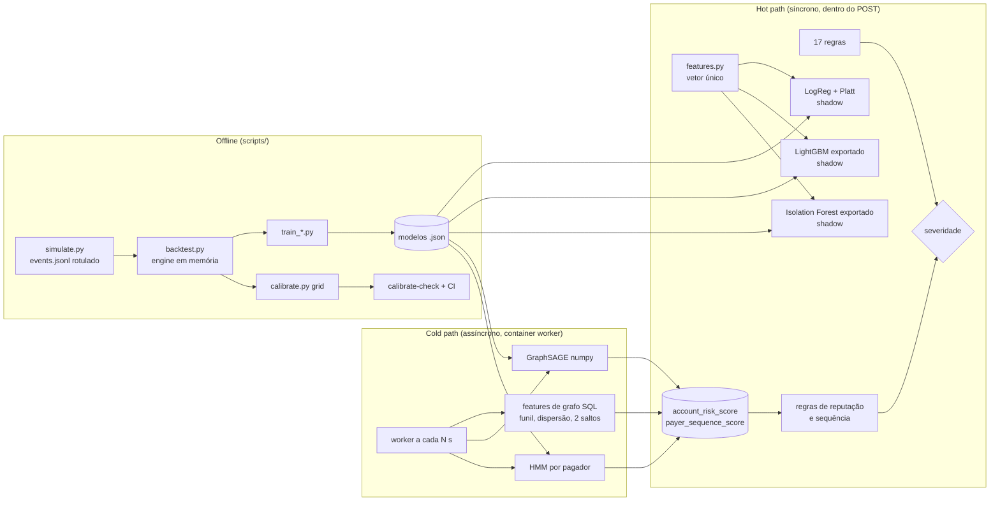
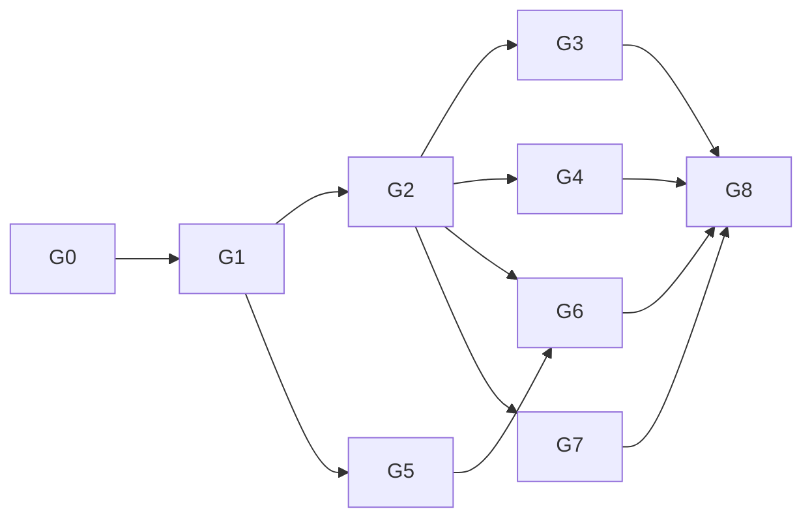

# Plano de implementação 2

> **Registro histórico.** Plano escrito antes da implementação; caminhos, contagens e números podem não bater com o código entregue. O estado atual está no [README](../README.md), no [catálogo de regras](05-motor/regras.md) e nas [decisões](02-arquitetura/decisoes/README.md).

> [Índice](README.md) › Plano de implementação 2
>
> **Responde a:** o que entra depois do motor de regras? quais modelos, síncronos e assíncronos? em que ordem? o que muda na arquitetura?

**Estado:** executado (G0–G8). Resultados no [README](../README.md), nas ADRs 0022–0027 e no [CHANGELOG](../CHANGELOG.md). Ficaram fora, como planejado: RNN, LLM, Benford, streaming e modelo decidindo.

## O que muda em relação ao plano 1

| Item da pesquisa | Plano 1 | Plano 2 | Como fica viável |
|---|---|---|---|
| Backtest sem HTTP e sem banco | proposta no [C4](02-arquitetura/c4.md#5-proposta-backtest-sem-http-e-sem-banco) | **FAZER** | `HistoryPort` + adaptador em memória + teste de paridade |
| Regressão logística, LightGBM (M3) | NÃO | **FAZER, em shadow** | Treino em `scripts/` com dependências só de dev; árvores exportadas em JSON e avaliadas em Python puro na `api` |
| Calibração de probabilidade (Platt) | NÃO | **FAZER** | Dal Pozzolo (2015): a base é desbalanceada |
| Isolation Forest (M2) | NÃO | **FAZER, em shadow** | Mesmo truque das árvores exportadas; treina sem rótulo |
| Reputação de conta por grafo (funil, dispersão) | NÃO | **FAZER, assíncrono** | Container `worker` (cold path) grava scores numa tabela; regra síncrona só lê |
| GNN (GraphSAGE) | NÃO | **FAZER, assíncrono e enxuto** | GraphSAGE de 2 camadas em numpy, só na imagem do `worker`, vizinhança limitada (grau 1–2, até 10 vizinhos, como na pesquisa) |
| Sequência: HMM (Lucas et al., 2019) | NÃO | **FAZER, assíncrono** | HMM discreto em numpy sobre a sequência de Pix do pagador; vira a feature `seq_anomaly_likelihood` |
| RNN/LSTM | NÃO | **NÃO** | O payload não tem eventos de sessão do app; o HMM cobre a sequência de Pix com uma fração do custo |
| JEV/LLM semântico | NÃO | **NÃO** | O payload não tem texto nem sinais de aparelho (bateria, app aberto); seria teatro |
| Análises 1–2 (log-normal, dispersão) e 6 (PSI/drift) | TALVEZ | **FAZER** | Script de análise sobre o export do simulador, saída em Markdown |
| Benford por conta | NÃO | **NÃO** | Evidência fraca segundo a própria pesquisa; precisa de semanas por conta |
| Pipeline de calibração automático | descartado | **FAZER** | Grid sobre o backtest em lote (segundos por rodada) |
| Trava de regressão + CI | descartado | **FAZER** | `make calibrate-check` + GitHub Actions |

Premissa mantida: **a decisão continua sendo das regras.** Todo modelo entra em shadow mode: calcula, grava em `metadata.shadow` e é comparado com as regras, mas nunca muda `status`. Os rótulos são do simulador, então é demonstração de viabilidade, não prova de eficácia ([ADR 0017](02-arquitetura/decisoes/0017-ml-fora-do-prazo-e-do-hot-path.md)). Hiperparâmetros fixos e simples, sem busca exaustiva.

## Arquitetura alvo

## Fases

Cada fase termina com `make reset check` verde, linha no CHANGELOG, ADR quando houver decisão nova, commit atômico e push.

| Fase | Entrega | Arquivos principais | Depende de |
|---|---|---|---|
| **G0** Fechar a calibração | Configuração final do fracionamento; `docs/05-motor/calibracao.md`; catálogo de regras e README com o porquê numérico; ADRs 0016, 0018 e 0019 em `aceita` | `src/constants.py`, `docs/05-motor/`, `README.md` | — |
| **G1** Motor extraído + features | `src/rules/core/engine.py` (`analyze(snapshot, history)` com contexto, decisão, motivos, sinais); `HistoryPort`; `src/rules/core/features.py` (vetor único de features, sem dado identificável) em `metadata.features`; suporte a regras `shadow` (`metadata.shadow`, nunca na decisão) | `src/rules/`, `src/controllers/`, `src/repositories/` | G0 |
| **G2** Backtest em lote | `scripts/backtest/backtest.py` + `InMemoryHistory`; simulador separado em gerar (`events.jsonl` com rótulo) e replay; **teste de paridade** SQL × memória sobre o mesmo roteiro; relatório igual ao do simulador | `scripts/`, `tests/` | G1 |
| **G3** Pipeline de calibração + CI | `scripts/calibration/calibrate.py` (grid em JSON sobre o backtest, função objetivo, tabela); `make calibrate`, `make calibrate-check` (trava: nenhum legítimo reprovado, nenhuma sequência de fraude que escape, 2FA em legítimos ≤ teto); `.github/workflows/ci.yml` com `make all` + trava | `scripts/`, `Makefile`, `.github/` | G2 |
| **G4** Modelos síncronos em shadow | `train_logreg.py` (com Platt), `train_lightgbm.py`, `train_iforest.py` (lightgbm, scikit-learn e numpy em `requirements-dev.txt`); exportação para JSON em `src/rules/models/artifacts/`; avaliador de árvores em Python puro; regras `MODEL_LOGREG`, `MODEL_LIGHTGBM`, `MODEL_IFOREST` com `shadow = True`; avaliação em outra seed e com gerador perturbado; `scripts/models/model-results.md` (AUC, precisão, recall, Brier, captura por tipologia, modelo × regras × união) | `scripts/`, `src/rules/` | G1, G2 |
| **G5** Cold path: worker + grafo | Container `worker` no `docker-compose.yml` (mesma imagem da `api`, outro comando); tabelas `account_risk_score` e `payer_sequence_score` (append-only, com `computed_at`); job a cada `WORKER_INTERVAL_SECONDS` com features de grafo em SQL (funil, dispersão, 2 saltos a partir de destinos reprovados); regra síncrona `COUNTERPARTY_GRAPH_RISK` lê o score mais recente (decide, porque é regra explícita sobre features de grafo) | `docker-compose.yml`, `database/database.sql`, `src/worker/`, `src/rules/` | G1 |
| **G6** GraphSAGE e HMM | GraphSAGE de 2 camadas (agregação por média, até 10 vizinhos) em numpy, treinado no grafo do simulador e servido pelo worker; HMM discreto (valor em faixas, hora, destino novo) por pagador, com `seq_anomaly_likelihood`; ambos gravam score e regras `MODEL_GRAPHSAGE` e `MODEL_SEQUENCE_HMM` leem em shadow; numpy entra só na imagem do worker (target Docker próprio) | `src/worker/`, `scripts/models/train_graphsage.py`, `scripts/models/train_hmm.py`, `Dockerfile` | G5, G2 |
| **G7** Análises estatísticas | `scripts/analysis/analyze.py` sobre o export: log-normalidade de `log(amount)` por pagador (assimetria, curtose, quantis), dispersão das contagens (Poisson × binomial negativa), PSI entre duas janelas, sensibilidade de limiar; saída em `docs/05-motor/analises.md` | `scripts/`, `docs/05-motor/` | G2 |
| **G8** Entrega | README final (motor, regras, modelos em shadow, cold path), C4 atualizado (o backtest deixa de ser proposta e entra o worker), ADRs novas, slide de arquitetura e de resultados, `make reset all` de clone limpo | `README.md`, `docs/` | todas |

## Paralelismo

- **Faixa A (motor e offline):** G1 → G2 → G3.
- **Faixa B (modelos síncronos):** G4, assim que G2 entregar o `events.jsonl` e o backtest.
- **Faixa C (cold path):** G5 logo após G1 (não depende do backtest), depois G6.
- **G7** corre sozinha a partir de G2.
- Conflitos de arquivo: G4 e G6 tocam `src/rules/__init__.py` (só uma linha cada para registrar as regras shadow); serializar o merge. G5 é a única fase que toca `docker-compose.yml` e `database/database.sql`.
- Banco compartilhado: fases que rodam a suíte de testes ou o simulador pela API não rodam ao mesmo tempo (os testes zeram o banco). O backtest em lote (G2+) não usa o banco, o que libera o paralelismo.

## Decisões novas que este plano gera (ADRs)

| ADR | Decisão |
|---|---|
| 0022 | Shadow mode: regras e modelos que calculam e registram sem decidir |
| 0023 | Motor extraído (`engine.py`) + `HistoryPort` com dois adaptadores e teste de paridade |
| 0024 | Modelos treinados fora da API e servidos em Python puro a partir de JSON (árvores e pesos exportados) |
| 0025 | Cold path em container `worker`, com scores pré-calculados em tabela lida pelo hot path |
| 0026 | GraphSAGE e HMM enxutos em numpy, restritos ao worker |
| 0027 | Pipeline de calibração e CI com trava de regressão |
| 0017 | Passa a **substituída parcialmente por 0022–0026**: ML deixa de estar fora; continua valendo que a decisão é das regras e que os rótulos são sintéticos |

## O que continua fora, e por quê

- **RNN/LSTM:** o payload não traz eventos de sessão; a sequência de Pix já está coberta pelo HMM.
- **JEV/LLM:** sem texto nem sinais ricos de aparelho no contrato.
- **Benford:** evidência fraca; precisa de semanas de somas diárias por conta.
- **Kafka/Flink/Redis:** o worker com Postgres mostra o padrão hot/cold path sem infraestrutura de streaming; em escala, é para onde iria.
- **Modelo decidindo:** sem rótulo real, nenhum modelo muda `status`.

## Riscos

| Risco | Mitigação |
|---|---|
| Teste de paridade revela divergência entre SQL e memória | É exatamente o que ele existe para pegar; corrigir antes de usar o backtest para treinar |
| Worker e testes concorrendo pelo banco | Worker desligável por variável (`WORKER_ENABLED`); a suíte roda com ele desligado e tem testes próprios que chamam o job uma vez |
| numpy/lightgbm deixarem o `make all` lento numa máquina limpa | lightgbm e scikit-learn só no `.venv` de dev; a imagem da `api` não muda; numpy só no target do worker |
| Modelo bom no sintético e ruim no perturbado | Reportar o número como está: é o argumento de que dado real é necessário |
| `make all` deixar de subir em máquina limpa (R2) | G8 termina com `make clean all` a partir de um clone novo |
