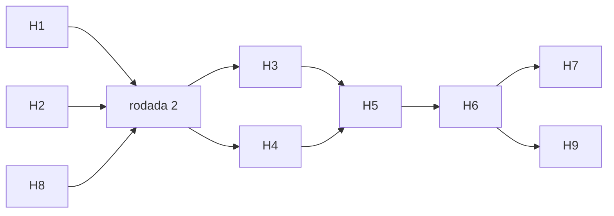

# Plano de implementação 3

> [Índice](README.md) › Plano de implementação 3
>
> **Responde a:** o que ainda dá para trazer da pesquisa depois do plano 2? em que ordem? o que fica fora?

**Estado:** aprovado pelo time para execução.

## Itens

| # | Item da pesquisa | Entrega | Usa o banco? |
|---|---|---|---|
| H1 | Custo assimétrico + P@k | Função de custo em R$ (fraude que passa custa o valor; 2FA e reprovação de legítimo custam fricção) na calibração e no relatório; P@k diário simulando uma mesa de k analistas | não |
| H2 | Peer group (Bolton & Hand, nível 2) | Regra `PROFILE_PEER_AMOUNT`: valor comparado com pares (CPF/CNPJ × faixa de idade da conta de origem) quando o pagador ainda não tem perfil próprio | sim |
| H3 | Ponto de ruptura (nível 3) | CUSUM na série do pagador, calculado no worker; regra que lê o score | sim |
| H4 | Monitoramento de drift | Job no worker com o PSI por feature e janela, gravado em tabela; alerta acima de 0,25 | sim |
| H5 | Embeddings assíncronos → LightGBM | Backtest simula os ciclos do worker em lote; scores de grafo, HMM e CUSUM viram features do LightGBM; reavaliação honesta do GraphSAGE (score do ciclo anterior) | não |
| H6 | Rótulos atrasados (Dal Pozzolo, 2018) | Treino que só enxerga rótulos com mais de D dias; curva de perda conforme D | não |
| H7 | Feature store em streaming (SCARFF) | Redis com contadores de janela atualizados fora do POST; comparação de latência com o SQL | sim |
| H8 | Elliptic | GraphSAGE retreinado e avaliado num grafo com rótulos reais | não |
| H9 | PixSim | Verificar se o código existe; se existir, adaptador para o nosso `events.jsonl` | não |

## Ordem

- **Rodada 1:** H1 (sem banco), H2 (dono do banco) e H8 (sem banco, depende de download).
- **Rodada 2:** H3 e H4 no worker.
- **Rodada 3:** H5 e H6, que precisam de todos os scores.
- **Rodada 4:** H7 (compose) e H9.

Premissas mantidas: a decisão continua com as regras explícitas; modelos em shadow; `make all` sobe tudo do zero (R2); CI verde a cada fase.

## Fica fora

RNN/LSTM e JEV/LLM (o contrato não traz sessão nem texto) e Benford (evidência fraca).
